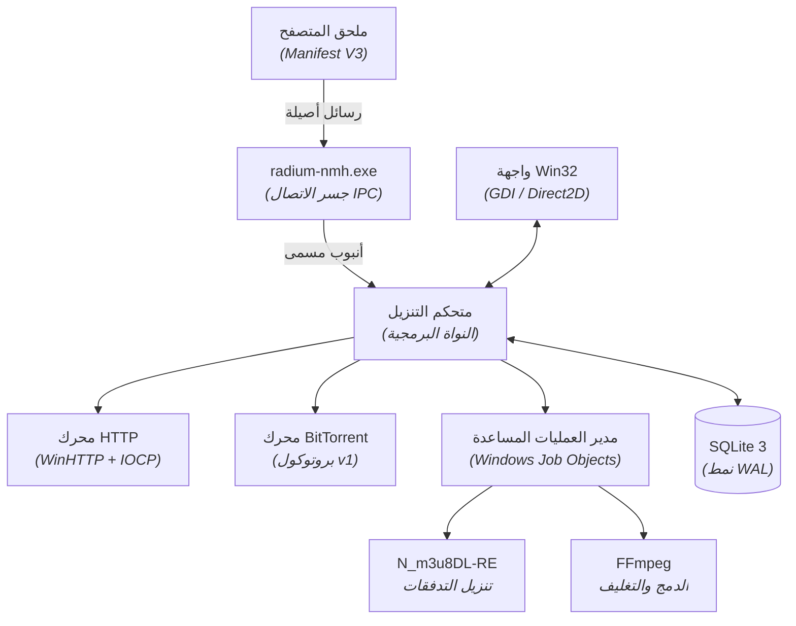

<p align="center">
  
</p>

<p align="center">
  <picture>
    
  </picture>
</p>

<h1 align="center">Radium Download Manager</h1>

<p align="center">
  <a href="README.md">English</a> · <a href="README.ja.md">日本語</a> · <a href="README.zh-CN.md">简体中文</a> · <a href="README.zh-TW.md">繁體中文</a> · <a href="README.ko.md">한국어</a> · <a href="README.es.md">Español</a> · <a href="README.fr.md">Français</a> · <a href="README.pt-BR.md">Português</a> · <a href="README.de-DE.md">Deutsch</a> · <a href="README.ru-RU.md">Русский</a> · <a href="README.it-IT.md">Italiano</a> · <b>العربية</b>
</p>

<div dir="rtl">

<p align="center">
  <b>مدير تنزيل سريع وخفيف لنظام Windows 11 مع ميزة التقاط الوسائط والفيديو المدمجة.</b><br>
  تسريع تنزيل الملفات عبر الاتصالات المتعددة المجزأة وتنزيل مقاطع الفيديو من YouTube وBilibili والعديد من المواقع الأخرى (HLS وDASH وبث الويب).<br>
  تطبيق أصيل مبني باستخدام C++20 وWin32 دون عبء Electron الزائد — استهلاك ضئيل للذاكرة العشوائية وتشغيل هادئ خالٍ من العمليات الخلفية غير الضرورية.
</p>

<p align="center">
  <a href="https://github.com/alve33/Radium-Download-Manager/releases/latest"></a>
  <a href="https://github.com/alve33/Radium-Download-Manager/releases/latest"></a>
  
  
  
  
  <a href="https://github.com/alve33/Radium-Download-Manager/actions/workflows/windows-release.yml"></a>
</p>

<p align="center">
  <a href="#التنزيل-والتثبيت"><b>التنزيل</b></a> ·
  <a href="#الميزات-الرئيسية"><b>الميزات</b></a> ·
  <a href="#المظهر-الفاتح-والداكن"><b>المظهر</b></a> ·
  <a href="#الواجهة-متعددة-اللغات"><b>اللغات</b></a> ·
  <a href="#اختبارات-الأداء-والمقارنة"><b>الأداء</b></a> ·
  <a href="#محرك-التنزيل-عالي-الأداء"><b>محرك التنزيل</b></a> ·
  <a href="#تنزيلات-bittorrent"><b>BitTorrent</b></a> ·
  <a href="#التكامل-مع-المتصفح"><b>المتصفح</b></a> ·
  <a href="#البنية-الهندسية-للنظام"><b>البنية الهندسية</b></a> ·
  <a href="#البناء-من-المصدر"><b>البناء</b></a>
</p>

<br>

<p align="center">
  
</p>

## نظرة عامة

برنامج Radium هو مدير تنزيلات أصيل ومفتوح المصدر فائق الأداء مصمم خصيصاً لنظام Windows 11. صُمم ليكون بديلاً خفيفاً وحديثاً وخالياً تماماً من الإعلانات للبرامج التقليدية القديمة، حيث يجمع بين تنزيل الملفات المجزأ فائق السرعة والالتقاط المباشر لوسائط الفيديو والصوت من المتصفحات.

<table>
  <tr>
    <td width="33%" valign="top">
      <h3>⚡ استغلال كامل للسرعة</h3>
      محرك تنزيل مجزأ لبروتوكولات HTTP/HTTPS يعتمد على الإدخال/الإخراج غير المتزامن (WinHTTP + IOCP) مع تقسيم ديناميكي للاتصالات وإعادة استغلال ذكية للمسارات غير المكتملة.
    </td>
    <td width="33%" valign="top">
      <h3>🌐 التقاط فوري من المتصفح</h3>
      ملحق خفيف مبني وفق معيار Manifest V3 لمتصفحات Chromium وFirefox. يكتشف قوائم HLS (.m3u8) وملفات DASH (.mpd) والروابط المباشرة، مع توفير زر تنزيل مدمج فوق مشغلات الفيديو.
    </td>
    <td width="33%" valign="top">
      <h3>🧲 BitTorrent ومعالجة البث</h3>
      محرك مدمج لبروتوكول BitTorrent v1 يدعم الروابط المغناطيسية (BEP 9) وتحديد ملفات التنزيل بدقة. وتتم معالجة تدفقات الفيديو في بيئات Windows Job Objects معزولة باستخدام N_m3u8DL-RE وFFmpeg.
    </td>
  </tr>
</table>

## التنزيل والتثبيت

أحدث إصدار منشور هو **[v1.0.0](https://github.com/alve33/Radium-Download-Manager/releases/tag/v1.0.0)**. الحزم المتوفرة لنظام Windows:

| الحزمة | المعمارية | الصيغة | الوصف |
| :--- | :---: | :---: | :--- |
| **مثبت Radium (القياسي)** | x64 | [Setup (.exe)](https://github.com/alve33/Radium-Download-Manager/releases/download/v1.0.0/Radium-Setup-x64-1.0.0.exe) | المثبت الموصى به لمعظم المستخدمين (Windows 11 / 10 x64) |
| **Radium المحمول (الكامل)** | x64 | [أرشيف ZIP](https://github.com/alve33/Radium-Download-Manager/releases/download/v1.0.0/Radium-v1.0.0-Windows-x64-Full.zip) | حزمة محمولة تتضمن أدوات البث N_m3u8DL-RE وFFmpeg |
| **Radium المحمول (النواة الأساسية)** | x64 | [أرشيف ZIP](https://github.com/alve33/Radium-Download-Manager/releases/download/v1.0.0/Radium-v1.0.0-Windows-x64-Core.zip) | الحزمة الأساسية (تتطلب أدوات البث بشكل منفصل) |
| **مثبت Radium (النواة الأساسية)** | x64 | [Setup (.exe)](https://github.com/alve33/Radium-Download-Manager/releases/download/v1.0.0/Radium-Setup-x64-Core-1.0.0.exe) | مثبت خفيف الوزن بدون أدوات البث المدمجة |
| **مثبت Radium (ARM64)** | ARM64 | [Setup (.exe)](https://github.com/alve33/Radium-Download-Manager/releases/download/v1.0.0/Radium-Setup-ARM64-1.0.0.exe) | مثبت أصلي لأجهزة Windows 11 بمعالج ARM |
| **Radium المحمول الكامل (ARM64)** | ARM64 | [أرشيف ZIP](https://github.com/alve33/Radium-Download-Manager/releases/download/v1.0.0/Radium-v1.0.0-Windows-ARM64-Full.zip) | حزمة محمولة كاملة مع أدوات البث لـ ARM64 |

تتوفر بصمات التحقق SHA256 لملفات الإصدار المنشورة في [SHA256SUMS.txt](https://github.com/alve33/Radium-Download-Manager/releases/download/v1.0.0/SHA256SUMS.txt).

### التثبيت السريع لملحق المتصفح

> [!TIP]
> **ملحق المتصفح مفصول بشكل تركيبي مستقل لضمان أعلى درجات الأمان.** يمكنك تثبيت مجلد [`extension/`](extension/) مباشرة عبر تفعيل وضع المطور في متصفحك:
> 1. **متصفحات Chromium (Chrome وEdge وBrave):** افتح الرابط `chrome://extensions`، وفعّل **وضع المطور (Developer Mode)**، ثم اضغط على **تحميل ملحق غير مضغوط (Load unpacked)** واختر المجلد `extension/`.
> 2. **متصفح Firefox:** افتح الرابط `about:debugging#/runtime/this-firefox`، واضغط على **تحميل ملحق مؤقت (Load Temporary Add-on...)** وحدد الملف `manifest.firefox.json` من داخل المجلد `extension/`.
> 3. **تسجيل مضيف الرسائل الأصيلة:** قم بتشغيل سكريبت PowerShell الموجود في `scripts/register-native-messaging.ps1` لتسجيل قناة الاتصال المحلي في سجل نظام Windows.

## الميزات الرئيسية

<p align="center">
  
</p>

### تنزيل HTTP وHTTPS المجزأ
- **تقسيم ديناميكي للمسارات:** تقوم خيوط الاتصال النشطة بتجزئة الأجزاء المتبقية من الملف فور توفر سعة تشغيل جديدة لدى المعالج.
- **إدخال/إخراج غير متزامن بدون حظر:** يعتمد على منافذ إكمال الإدخال/الإخراج الرسمية في Windows (IOCP) واستخدام الملفات المتفرقة (Sparse Files) لتجنب تجمد القرص الصلب.
- **حفظ ذري موثوق للملفات:** يتم كتابة البيانات مؤقتاً بصيغة `*.radium.part` ولا يُعاد تسميتها إلى الاسم النهائي إلا بعد التحقق التام من البصمة الرقمية للبيانات.
- **استئناف دقيق للملفات:** تعامل صارم واحترافي مع ترويسات `Range` ووسوم `ETag` لضمان متابعة التنزيل دون أي تلف في الملفات.

### ميزات تنزيل BitTorrent
- **استخراج سريع للروابط المغناطيسية:** معالجة فورية لبيانات التورنت الوصفية في ثوانٍ معدودة عبر ملحق بروتوكول BEP 9.
- **شجرة تفاعلية لتحديد الملفات:** معاينة هيكل المجلدات الكامل لاختيار وتنزيل الملفات المرغوبة فقط قبل البدء.
- **حفظ واستعادة ضد الأعطال:** حفظ مستمر وتلقائي لتقدم التنزيل في قاعدة بيانات SQLite 3 (بنمط WAL) لضمان الاستئناف بعد انقطاع الكهرباء.

### الأمان والصلابة البرمجية
- **عزل العمليات عبر Windows Job Objects:** الأدوات المساعدة الخارجية (FFmpeg وN_m3u8DL-RE) تعمل تحت مظلة Job Object محكومة بخاصية `JOB_OBJECT_LIMIT_KILL_ON_JOB_CLOSE`، مما يضمن إغلاق أي عملية فرعية فور إغلاق البرنامج.
- **اتصال محلي آمن بين العمليات (IPC):** لا يتم فتح أي منافذ شبكية محلية معرضة للخطر؛ يتم التواصل حصرياً عبر الأنابيب المسماة في Windows والمحمية بصلاحيات المستخدم (`\\.\pipe\Radium_IPC_<UserSID>`).
- **تحصين كامل ضد حقن الأوامر:** تخضع الروابط والمعاملات لفحص أمني دقيق؛ وتُمرر ملفات تعريف الارتباط وبيانات المصادقة عبر ملفات استجابة مؤقتة ومشفرة الصلاحيات (`@job.rsp`).

## المظهر الفاتح والداكن

يقدم Radium واجهة بصرية حديثة ومنسجمة مع إرشادات التصميم لنظام Windows 11، مع دعم كامل للوضعين الفاتح والداكن:

<div align="center">

| المظهر الفاتح (Light) | المظهر الداكن (Dark) |
| :---: | :---: |
|  |  |

</div>

- **التعرف التلقائي على النظام:** يتبع البرنامج افتراضياً تفضيلات الألوان المحددة للتطبيقات في Windows 11 (`AppsUseLightTheme`).
- **التبديل اليدوي الحر:** يمكنك تثبيت المظهر المفضل (`light` أو `dark` أو `system`) في أي وقت من مركز الإعدادات.
- **رسم سلس مانع للوميض:** يعتمد على تقنية التخزين المؤقت المزدوج عبر GDI وDirect2D لضمان حركة سلسة وتغيير لحجم النوافذ بدون وميض.

## الواجهة متعددة اللغات

يشتمل Radium على حزمة ترجمة متكاملة تدعم 12 لغة عالمية مع إمكانية التحويل الفوري دون الحاجة لإعادة تشغيل التطبيق:

- **تغيير فوري مباشر:** يتم تحديث جميع القوائم والرسائل والملاحظات المنبثقة فورياً بمجرد اختيار اللغة.
- **التعرف عند أول تشغيل:** يحدد البرنامج لغة واجهة مستخدم نظام Windows (`GetUserDefaultUILanguage`) تلقائياً في أول تشغيل.
- **دقة لغوية معتمدة:** تخضع كافة نصوص البرنامج للمراجعة والتدقيق داخل الملف المصدري `translations/desktop.json`.

## لقطات الشاشة

<div align="center">

| النافذة الرئيسية وقائمة التنزيلات | مركز الإعدادات وخيارات الشبكة |
| :---: | :---: |
|  |  |

</div>

## اختبارات الأداء والمقارنة

يخضع برنامج Radium بانتظام لاختبارات أداء ومقارنة حية في مواجهة **Internet Download Manager (IDM 6.43.15)** وأدوات الأوامر المفتوحة على ملفات متطابقة تماماً.

### مقارنة مباشرة: Radium (v0.3.5 Dev Build) ضد Internet Download Manager (ملف 500 ميجابايت على شبكة حية)

تم إجراء الاختبار على ملف فحص فعلي بحجم **500,000,000 بايت** (`https://sg-lg.regxa.com/500MB.test`) على جهاز يعمل بنظام Windows 11. تم تنفيذ جولتين متتاليتين مع عكس ترتيب البدء لمعادلة أي تقلبات في سرعة الإنترنت. اكتمل كلا البرنامجين بنجاح واجتازا مطابقة البصمة المشفرة بالكامل (**SHA-256:** `b16f001a0731c8636f163586c16276b3714b8977242b67ae05fa60b96f685ebc`).

| الجولة | الترتيب | وقت Radium | وقت IDM | خفض الوقت المستغرق | السرعة (Radium / IDM) | أقصى استهلاك للذاكرة | توفير الذاكرة |
| :---: | :---: | :---: | :---: | :---: | :---: | :---: | :---: |
| **الجولة 1** | IDM أولاً ثم Radium | **184.75 ثانية** | 221.21 ثانية | **16.48%** (-36.46 ث) | **2.71 ميجابايت/ث** / 2.26 ميجابايت/ث (+19.91%) | **20.5 ميجابايت** / 53.8 ميجابايت | **61.90%** |
| **الجولة 2** | Radium أولاً ثم IDM | **140.09 ثانية** | 173.46 ثانية | **19.24%** (-33.37 ث) | **3.57 ميجابايت/ث** / 2.88 ميجابايت/ث (+23.96%) | **20.4 ميجابايت** / 122.2 ميجابايت | **83.31%** |
| **المتوسط** | المتوسط المشترك للجولتين | **162.42 ثانية** | 197.34 ثانية | **17.69%** (-34.92 ث) | **3.14 ميجابايت/ث** / 2.57 ميجابايت/ث (+22.18%) | **20.4 ميجابايت** / 88.0 ميجابايت | **76.76%** |

```
مقارنة مدة نقل 500 ميجابايت (الأقل هو الأفضل ▼)
─────────────────────────────────────────────────────────────────────────────
الجولة 1 (IDM أولاً):
  IDM 6.43.15     ████████████████████████████████████ 221.21 ثانية
  Radium v0.3.5   ████████████████████████████ 184.75 ثانية (أسرع بنسبة 16.48%)

الجولة 2 (Radium أولاً):
  IDM 6.43.15     ████████████████████████████ 173.46 ثانية
  Radium v0.3.5   ██████████████████████ 140.09 ثانية (أسرع بنسبة 19.24%)
─────────────────────────────────────────────────────────────────────────────
المتوسط العام:
  IDM 6.43.15     ████████████████████████████████ 197.34 ثانية
  Radium v0.3.5   ██████████████████████████ 162.42 ثانية (تقليص الوقت بنسبة 17.69%)
```

#### العوامل التقنية المسؤولة عن هذا الأداء الفائق:
1. **التقسيم التكيفي للنطاقات:** بالاعتماد على المعادلة: `clamp(4 × transfer_speed_bps × 0.25 s, 1 MiB, 16 MiB)`. ساهم وضع حد أدنى للتجزئة في تقليص البيانات المهدرة الناتجة عن الاتصالات بنسبة **57.3%** في الجولة الأولى و**42.4%** في الجولة الثانية.
2. **تشغيل متزامن فوري للمسارات:** عند البدء، يتم توزيع خيوط الاتصال بالتساوي على حدود الأجزاء الصحيحة مباشرة، مما يضمن عمل مسارات التنزيل الثمانية بأقصى طاقتها طوال فترة التحميل.
3. **كتابة مستمرة ومباشرة على القرص:** الكتابة اللحظية المباشرة تتفادى تماماً مرحلة دمج وتجميع الأجزاء المؤقتة التي تستهلك المعالج والذاكرة بعد انتهاء التنزيل، مما يثبت استهلاك Radium للذاكرة عند 20 ميجابايت فقط مقارنة باستهلاك 54 إلى 122 ميجابايت في برنامج IDM.

## محرك التنزيل عالي الأداء

مستلهماً من التصميم المفتوح لبرنامج [Brisk](https://github.com/BrisklyDev/brisk)، يطبق Radium نموذج تجزئة متقدماً لتنزيل الملفات:

```
                      ┌────────────────────────────────────────┐
                      │       الملف المطلوب (مثال: 500 ميجابايت)│
                      └────────────────────────────────────────┘
                       /             |            |                    Worker 0 (0-125MB)   Worker 1 (125-250MB)  Worker 2     Worker 3
        [████████████████]   [████████░░░░░░░░]   [████░░░░]   [████████████████]
             (مكتمل)              (نشط)             (نشط)           (مكتمل)
                                                      ▲
                                                      │ يتولى الجزء المتبقي غير المكتمل
                                                 خيط معالجة متاح
```

1. **الفحص الأولي:** إرسال طلب استعلام للتحقق من دعم السيرفر لاستئناف التجزئة وتحديد اسم الملف وحجمه.
2. **بدء متزامن:** فتح تدريجي للاتصالات حتى الوصول للحد المطلوب (افتراضياً 8، وبحد أقصى 32).
3. **سرقة مهام تكيفية (Work-Stealing):** عندما ينهي أحد الخيوط مهمته، يقوم باقتسام النطاق الأكبر غير المكتمل مع الخيوط النشطة.
4. **تراجع آمن:** إذا رفض السيرفر الطلبات المجزأة، يُعاد النطاق إلى مساره الأصلي دون فقدان البيانات.
5. **تثبيت ذري:** تُكتب البيانات في ملف محجوز مسبقاً يعقبه إعادة تسمية ذرية فورية.

## تنزيلات BitTorrent

دعم متكامل ومبني من الصفر لبروتوكول BitTorrent v1:
- **تحليل روابط Magnet:** استرجاع سريع لبيانات التورنت الوصفية عبر ملحق BEP 9 مباشرة من شبكة النظراء.
- **التواصل مع Trackers وDHT:** توافق كامل مع خوادم التتبع HTTP/UDP والشبكة الموزعة اللامركزية (DHT).
- **التحقق من القطع:** تطبيق خوارزمية endgame مع فحص دوري وتأكيد بصمة التجزئة SHA-1.
- **تحديد اختياري للملفات:** استعراض شجري مرن لفرز واستبعاد الملفات غير الضرورية قبل التنزيل.
- **استمرارية مضمونة:** تسجيل دائم ومستمر للحالة في قاعدة بيانات SQLite.

## معالجة تدفقات الفيديو والبث

لتنزيل مقاطع الفيديو الشبكية الحديثة المقسمة (HLS وDASH)، يتولى Radium قيادة أدوات مساعدة خارجية متخصصة:
- **عزل في بيئة Job Objects:** العمل ضمن كائنات مهام Windows التي تضمن الإغلاق التلقائي النظيف لأي عمليات تابعة فور إغلاق البرنامج.
- **سرية تامة لبيانات الدخول:** ملفات الكوكيز والترويسات الخاصة لا تمر عبر سطر الأوامر بل تُحفظ في ملفات استجابة مؤقتة مشفرة الصلاحيات (`@job.rsp`).
- **دمج وتغليف بلا فقدان:** دمج وتنسيق مسارات الفيديو والصوت تلقائياً في حاويات قياسية MP4 أو MKV عبر أداة FFmpeg.

*ملاحظة امتثال: يلتزم البرنامج بالقوانين المعمول بها ولا يحتوي على أي آليات لفك أو تخطي حماية حقوق النشر الرقمية (DRM).*

## التكامل مع المتصفح

يوفر ملحق المتصفح المبني بمعيار Manifest V3 جسراً مباشراً وآمناً بين متصفحات الويب وتطبيق سطح المكتب:

```
┌─────────────────────────────────┐
│ متصفح الويب (Chromium / Firefox)│
│  ├── التقاط عبر webRequest      │
│  └── زر منبثق فوق مقاطع الفيديو │
└───────────────┬─────────────────┘
                │ Stdio (JSON-RPC 32-bit ذو بادئة طول محددة)
┌───────────────▼─────────────────┐
│ radium-nmh.exe (المضيف الأصيل)  │
└───────────────┬─────────────────┘
                │ أنبوب مسمى في Windows: \.\pipe\Radium_IPC_<UserSID>
┌───────────────▼─────────────────┐
│ radium.exe (تطبيق سطح المكتب)   │
└─────────────────────────────────┘
```

- **بدون فتح منافذ شبكية:** الاتصال يتم فقط عبر الأنابيب المسماة المؤمنة بصلاحيات مستخدم Windows.
- **تنقية ذكية للمسارات:** التقاط قوائم التشغيل الرئيسية (.m3u8) وحجب مئات الأجزاء الصغيرة (.ts و.m4s).
- **تراجع تلقائي آمن:** في حال كان البرنامج مغلقاً أو أُلغي التنزيل، يتولى المتصفح مواصلة التنزيل تلقائياً بالطريقة العادية.

## البنية الهندسية للنظام



## البناء من المصدر

المتطلبات الأساسية: نظام **Windows 11 x64**، وبيئة **Visual Studio 2022 (MSVC 19.38+)** مع حزمة أدوات تطوير C++، و**CMake 3.25+**.

```powershell
# استنساخ المستودع
git clone https://github.com/alve33/Radium-Download-Manager.git
cd Radium-Download-Manager

# بناء كافة الملفات التنفيذية وحزمة التشغيل المحمولة
powershell -ExecutionPolicy Bypass -File scripts/build-windows-msvc.ps1
```

## الاختبارات والتحقق من الجودة

يحتوي المشروع على منظومة فحص شاملة تضم اختبارات الوحدات البرمجية واختبارات التكامل والاختبارات الشاملة:

```powershell
# تشغيل اختبارات C++
ctest --test-dir build/win-x64 --output-on-failure -C Release

# تشغيل اختبارات ملحق المتصفح الآلية
npm test
```

## التوافق مع خوادم HTTP

يدعم البرنامج الخوادم المتوافقة مع معيار RFC 7233 (`206 Partial Content`). إذا كان الخادم لا يدعم التجزئة، يتحول Radium تلقائياً إلى وضع التنزيل الآمن عبر اتصال فردي مباشر.

## المساهمة في المشروع

نرحب بجميع المساهمات والمقترحات! يرجى مراجعة ملف إرشادات المساهمة [CONTRIBUTING.md](CONTRIBUTING.md) وقراءة التوجيهات المعمارية في [docs/INDEX.md](docs/INDEX.md) قبل تقديم طلبات السحب (Pull Requests).

## الترخيص والشكر والتقدير

يخضع برنامج Radium Download Manager لترخيص **Apache-2.0**. لمزيد من التفاصيل، راجع ملف [LICENSE](LICENSE).

### المكونات الخارجية
يستخدم Radium كلاً من [Brisk](https://github.com/BrisklyDev/brisk) (GPL-3.0) و[N_m3u8DL-RE](https://github.com/nilaoda/N_m3u8DL-RE) (MIT) و[FFmpeg](https://ffmpeg.org/) (LGPL/GPL) و[SQLite 3](https://www.sqlite.org/) (Public Domain).

---
<p align="center">
  <sub>Radium Download Manager · مدير تنزيل أصيل وفائق الأداء لنظام Windows 11</sub>
</p>

</div>
