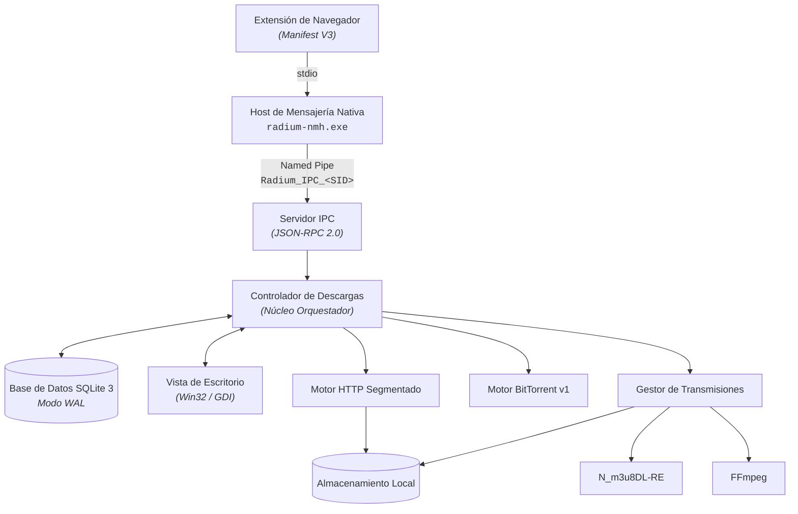

<p align="center">
  
</p>

<p align="center">
  <picture>
    
  </picture>
</p>

<h1 align="center">Radium Download Manager</h1>

<p align="center">
  <a href="README.md">English</a> · <a href="README.ja.md">日本語</a> · <a href="README.zh-CN.md">简体中文</a> · <a href="README.zh-TW.md">繁體中文</a> · <a href="README.ko.md">한국어</a> · <b>Español</b> · <a href="README.fr.md">Français</a> · <a href="README.pt-BR.md">Português</a> · <a href="README.de-DE.md">Deutsch</a> · <a href="README.ru-RU.md">Русский</a> · <a href="README.it-IT.md">Italiano</a> · <a href="README.ar-SA.md">العربية</a>
</p>

<p align="center">
  <b>Gestor de descargas rápido y sencillo para Windows 11 con captura de vídeo integrada.</b><br>
  Acelera descargas multiconexión y descarga vídeos de YouTube, Bilibili y muchos otros sitios web (HLS, DASH y transmisiones web).<br>
  Aplicación nativa C++20 y Win32 ligera, sin sobrecarga de Electron, con mínimo consumo de RAM y silenciosa.
</p>

<p align="center">
  <a href="https://github.com/alve33/Radium-Download-Manager/releases/latest"></a>
  <a href="https://github.com/alve33/Radium-Download-Manager/releases/latest"></a>
  
  
  
  
  <a href="https://github.com/alve33/Radium-Download-Manager/actions/workflows/windows-release.yml"></a>
</p>

<p align="center">
  <a href="#resumen-rápido"><b>Resumen</b></a> ·
  <a href="#descargas-e-instalación"><b>Descargas</b></a> ·
  <a href="#características-principales"><b>Características</b></a> ·
  <a href="#temas-claro-y-oscuro"><b>Temas</b></a> ·
  <a href="#interfaz-multilingüe"><b>Idiomas</b></a> ·
  <a href="#capturas-de-pantalla"><b>Capturas</b></a> ·
  <a href="#pruebas-de-rendimiento"><b>Rendimiento</b></a> ·
  <a href="#motor-de-descarga-de-alto-rendimiento"><b>Motor de Descarga</b></a> ·
  <a href="#descargas-bittorrent"><b>BitTorrent</b></a> ·
  <a href="#canalización-adaptativa-de-transmisiones"><b>Transmisiones</b></a> ·
  <a href="#integración-con-el-navegador"><b>Navegador</b></a> ·
  <a href="#arquitectura-interna"><b>Arquitectura</b></a> ·
  <a href="#pruebas-y-verificación"><b>Verificación</b></a> ·
  <a href="#licencia-y-créditos"><b>Licencia</b></a>
</p>

<br>

<p align="center">
  
  <br>
  <sub>Ventana principal de Radium: Tema oscuro Deep Charcoal, barras de progreso segmentadas en vivo, telemetría de velocidad y filtros de categoría.</sub>
</p>

<br>

## Resumen Rápido

Radium es un gestor de descargas rápido y ligero para Windows 11 diseñado para sustituir alternativas pesadas y llenas de publicidad. Combina descargas segmentadas de alta velocidad con captura de vídeo en navegadores y multiplexación de transmisiones en un solo clic.

<table>
  <tr>
    <td width="25%" valign="top">
      <h3>⚡ Velocidad Nativa</h3>
      Cero sobrecarga de Electron. Escrito puramente en ISO C++20 con Win32 y Direct2D/GDI. Se inicia en milisegundos y mantiene un consumo de RAM mínimo (18–22 MB de pico durante transferencias multigiagbyte).
    </td>
    <td width="25%" valign="top">
      <h3>🔀 Motor Adaptativo</h3>
      Escalado dinámico de conexiones (1 a 32 conexiones) con robo de trabajo adaptativo (work-stealing). Reduce entre un 16.5% y un 19.2% el tiempo frente a IDM en pruebas de 500 MB reales.
    </td>
    <td width="25%" valign="top">
      <h3>🌐 Captura de Navegador</h3>
      Extensión Manifest V3 para Chrome, Brave, Edge y Firefox. Detecta archivos y transmisiones multimedia mediante canalizaciones con nombre (Named Pipes) seguras protegidas por ACL de usuario, sin abrir puertos localhost desprotegidos.
    </td>
    <td width="25%" valign="top">
      <h3>🧲 BitTorrent y Streaming</h3>
      Motor BitTorrent v1 integrado con intercambio de metadatos (BEP 9), anuncios a trackers, verificación de piezas y árbol de archivos interactivo. Procesamiento seguro de transmisiones con N_m3u8DL-RE y FFmpeg en Windows Job Objects aislados.
    </td>
  </tr>
</table>

<br>

## Descargas e Instalación

La versión publicada más reciente es **[v1.0.0](https://github.com/alve33/Radium-Download-Manager/releases/tag/v1.0.0)**. Paquetes para Windows de 64 bits:

| Paquete | Arquitectura | Formato | Descripción |
| :--- | :---: | :---: | :--- |
| **Instalador de Radium (Estándar)** | x64 | [Setup (.exe)](https://github.com/alve33/Radium-Download-Manager/releases/download/v1.0.0/Radium-Setup-x64-1.0.0.exe) | Instalador recomendado para Windows 11 / 10 x64 |
| **Radium Portable Completo** | x64 | [Archivo ZIP](https://github.com/alve33/Radium-Download-Manager/releases/download/v1.0.0/Radium-v1.0.0-Windows-x64-Full.zip) | Paquete portable que incluye las herramientas N_m3u8DL-RE y FFmpeg |
| **Radium Portable Básico** | x64 | [Archivo ZIP](https://github.com/alve33/Radium-Download-Manager/releases/download/v1.0.0/Radium-v1.0.0-Windows-x64-Core.zip) | Paquete básico (herramientas de transmisión requeridas por separado) |
| **Instalador Básico** | x64 | [Setup (.exe)](https://github.com/alve33/Radium-Download-Manager/releases/download/v1.0.0/Radium-Setup-x64-Core-1.0.0.exe) | Instalador ligero sin herramientas de transmisión incluidas |
| **Instalador ARM64** | ARM64 | [Setup (.exe)](https://github.com/alve33/Radium-Download-Manager/releases/download/v1.0.0/Radium-Setup-ARM64-1.0.0.exe) | Instalador nativo para dispositivos Windows 11 en ARM |
| **Radium Portable Completo (ARM64)** | ARM64 | [Archivo ZIP](https://github.com/alve33/Radium-Download-Manager/releases/download/v1.0.0/Radium-v1.0.0-Windows-ARM64-Full.zip) | Paquete portable completo con herramientas para ARM64 |
| **Extensión de Navegador** | Multi-navegador | [código de extensión](extension/) | Extensión Manifest V3 para Chrome, Brave, Edge y Firefox |

Las sumas de comprobación SHA256 están disponibles en [SHA256SUMS.txt](https://github.com/alve33/Radium-Download-Manager/releases/download/v1.0.0/SHA256SUMS.txt).

> [!IMPORTANT]
> ### 🧩 Instalación de la Extensión del Navegador (Carga Manual)
> **La extensión del navegador no está incluida en el instalador.** Debe descargar los archivos de la extensión desde este repositorio y cargarlos manualmente en su navegador:
>
> 1. **Descargue la carpeta de la extensión:**
>    - Descargue o clone el directorio [`extension/`](extension/) de este repositorio (**Code → Download ZIP** y descomprima la carpeta `extension`).
> 2. **Instale y ejecute Radium:**
>    - Ejecute el instalador o inicie Radium para registrar el Host de Mensajería Nativa en el registro de Windows.
> 3. **Cargar en navegadores Chromium (Chrome, Brave, Edge):**
>    - Abra la página de extensiones: `chrome://extensions`, `brave://extensions` o `edge://extensions`.
>    - Active la opción **Modo de desarrollador** (arriba a la derecha).
>    - Haga clic en **Cargar descomprimida** (arriba a la izquierda).
>    - Seleccione la carpeta **`extension`** descargada.
> 4. **Cargar en Firefox:**
>    - Abra `about:debugging#/runtime/this-firefox`.
>    - Haga clic en **Cargar complemento temporal...**.
>    - Seleccione el archivo `manifest.firefox.json` dentro de la carpeta `extension`.
> 5. **Si utiliza la versión Portable:** Ejecute `scripts\register-native-messaging.ps1` desde la carpeta portable antes de cargar la extensión.

<br>

## Características Principales

<table>
  <tr>
    <td width="50%" valign="top">
      
      <br>
      <sub>Diálogo instantáneo con sondeo previo de encabezados, selección de carpeta y comprobación de espacio en disco.</sub>
      <h3>Intercepción Inteligente y Sondeo Previo</h3>
      Tanto si se inicia desde la extensión, el portapapeles o de forma manual, Radium valida la solicitud antes de asignar ancho de banda.
      <br><br>
      <b>Capacidades:</b>
      <ul>
        <li>Inspección de encabezados (<code>HEAD</code>/<code>Range</code>) y decodificación RFC 5987 / 6266</li>
        <li>Cálculo de espacio libre en disco en tiempo real con preasignación segura</li>
        <li>Selección dinámica de calidad de transmisión (Mejor, Solo vídeo, Solo audio)</li>
        <li>Protección contra escalada de directorios (elimina <code>..</code> y flujos NTFS <code>:</code>)</li>
      </ul>
    </td>
    <td width="50%" valign="top">
      
      <br>
      <sub>Diálogo nativo con árbol jerárquico de archivos, inspección de metadatos y verificación de piezas.</sub>
      <h3>Motor Nativo BitTorrent v1</h3>
      Añada archivos .torrent o enlaces magnéticos directamente. Radium examina los metadatos y le permite seleccionar qué archivos descargar.
      <br><br>
      <b>Capacidades:</b>
      <ul>
        <li>Obtención de metadatos BEP 9 para enlaces magnéticos</li>
        <li>Anuncios a trackers HTTP/UDP y descubrimiento de pares vía DHT</li>
        <li>Árbol interactivo con selección de archivos individuales y cálculo de tamaño</li>
        <li>Verificación criptográfica SHA-1 y reanudación resistente a fallos</li>
      </ul>
    </td>
  </tr>
  <tr>
    <td colspan="2" valign="top">
      
      <br>
      <sub>Centro de Configuración: Límites de conexión, enrutamiento por categorías, proxy y estado de integración.</sub>
      <h3>Configuración Profunda e Integración Nativa</h3>
      Personalice cada aspecto: límites de conexiones (1–32), límites de velocidad global, carpetas de descarga por categoría, proxies (Directo, Sistema, Manual) y reglas de captura del navegador.
    </td>
  </tr>
</table>

### Robustez del Núcleo

- **Programación de Descargas:** Franjas horarias locales, reintentos con retardo progresivo, conciliación al reiniciar y acciones automáticas (`SUSPENDER`/`APAGAR`).
- **Límite de Ancho de Banda:** Doble cubo de fichas (token-bucket) en proceso para regular el ancho de banda sin inanición de hilos en HTTP, FTP y BitTorrent.
- **Extractor de Sitios:** Rastreador BFS acotado (profundidad 1–5), extracción de enlaces y estricta defensa SSRF contra redes privadas.
- **Escaneo Antivirus:** Análisis automático con Windows Defender (`MpCmdRun.exe`) con modo estricto (`av_strict_mode`).
- **Categorización Automática:** Reglas deterministas para clasificar y ordenar automáticamente los archivos descargados.

<br>

## Temas Claro y Oscuro

Radium está diseñado para Windows 11 con compatibilidad completa para modos visuales claro y oscuro. Toda la interfaz se adapta de manera uniforme.

<table>
  <tr>
    <td width="50%" valign="top">
      <h3>☀️ Modo Claro (Light Mode)</h3>
      <ul>
        <li><b>Estética:</b> Fondo blanco de alto contraste (<code>#FFFFFF</code>), superficies elevadas neutras (<code>#F5F7F9</code>) y divisores suaves (<code>#E1E8ED</code>).</li>
        <li><b>Acento Principal:</b> Azul cielo elegante (<code>#168BCB</code>) para selecciones, foco y barras de progreso activas.</li>
        <li><b>Tipografía:</b> Texto carbón oscuro (<code>#202124</code>) y metadatos pizarra (<code>#656B73</code>) con legibilidad WCAG AAA.</li>
        <li><b>Integración Nativa:</b> Controles nativos con estilo <code>Explorer</code> y efectos translúcidos.</li>
      </ul>
    </td>
    <td width="50%" valign="top">
      <h3>🌙 Modo Oscuro (Dark Mode)</h3>
      <ul>
        <li><b>Estética:</b> Fondo pizarra espacial profundo (<code>#0F172A</code> / <code>#161618</code>) con superficies azul marino (<code>#1E293B</code> / <code>#28282E</code>).</li>
        <li><b>Acento Principal:</b> Rojo coral característico (<code>#FF4757</code>) e insignias violetas (<code>#8B5CF6</code>).</li>
        <li><b>Tipografía:</b> Texto blanco suave (<code>#F8FAFC</code>) y metadatos grisáceos (<code>#94A3B8</code>) cómodos para la vista.</li>
        <li><b>Integración Nativa:</b> Estilo <code>DarkMode_Explorer</code> completo en ventanas y marcos.</li>
      </ul>
    </td>
  </tr>
</table>

### Cambio Dinámico y Detección de Sistema
- **Sincronización con el Sistema (`system`):** Detecta automáticamente la configuración de Windows (`AppsUseLightTheme`). Al cambiar el tema de Windows, Radium se actualiza sin reiniciar.
- **Modos Fijos (`light` o `dark`):** Fije permanentemente el tema deseado.
- **Botón Dedicado en la Barra de Herramientas:** Conmute al instante entre modo claro y oscuro con un solo clic en la barra principal.
- **Persistencia:** La selección se guarda de inmediato para las siguientes sesiones.

<br>

## Interfaz Multilingüe

Radium está pensado para una audiencia global. La internacionalización está integrada en el núcleo Win32, utilizando catálogos locales sin ninguna dependencia de servicios web externos.

> [!NOTE]
> **Traducciones del README vs. Idiomas de la Aplicación:**
> Para mantener la máxima calidad, la documentación en GitHub cuenta con traducciones completas en **12 idiomas principales** (disponibles en el selector superior). ¡Sin embargo, **la aplicación de escritorio Radium incluye catálogos para 24 idiomas y sistemas de escritura nativos**!

### Capacidades Multilingües
- **Selección en Configuración:** Cambie de idioma al instante desde el **Centro de Configuración** (pestaña `General`) o la barra lateral.
- **Nombres en su Escritura Nativa:** Todos los idiomas se presentan en sus caracteres originales (*Español*, *English*, *日本語*, *简体中文*, *العربية*, etc.).
- **Cambio Inmediato y Preferencias Guardadas:** El cambio se refleja en tiempo real y persiste entre reinicios.
- **Resolución Automática del Idioma:** En el primer inicio consulta `GetUserDefaultLocaleName` para coincidir con Windows.
- **Completamente Autónomo:** Los textos se cargan desde archivos locales JSON (`translations/desktop.json`) con retroceso automático al inglés.
- **Compatibilidad con Escritura RTL:** Diseñado para admitir idiomas con lectura de derecha a izquierda como el árabe (`ar-SA`) y el persa (`fa-IR`).


<br>

## Capturas de Pantalla

<p align="center">
  
  <br>
  <sub><b>Ventana Principal:</b> Panel con visualizadores de segmentos en vivo, telemetría de ancho de banda y filtros.</sub>
</p>

<table>
  <tr>
    <td width="50%" valign="top">
      
      <br>
      <sub><b>Sondeo Previo:</b> Verificación de soporte de rangos, cálculo de espacio en disco y asignación automática.</sub>
    </td>
    <td width="50%" valign="top">
      
      <br>
      <sub><b>Gestión BitTorrent:</b> Selección selectiva en árbol de carpetas, metadatos y verificación de piezas.</sub>
    </td>
  </tr>
  <tr>
    <td colspan="2" valign="top">
      
      <br>
      <sub><b>Centro de Configuración:</b> Selección de idiomas en su grafía nativa, ajustes visuales claro/oscuro, límites y red.</sub>
    </td>
  </tr>
</table>

<br>

## Pruebas de Rendimiento

Radium se compara de forma constante contra **Internet Download Manager (IDM 6.43.15)** y utilidades CLI estándar.

### Frente a Frente: Radium (v0.3.5) vs Internet Download Manager (500 MB en Internet Real)

Descarga de un archivo idéntico de **500,000,000 de bytes** (`https://sg-lg.regxa.com/500MB.test`) en Windows 11. Se realizaron dos pruebas cambiando el orden para equilibrar las condiciones:

| Prueba | Orden | Radium Duración | IDM Duración | Reducción de Tiempo | Rendimiento (Radium / IDM) | Memoria RAM (Radium / IDM) | Ahorro de Memoria |
| :---: | :---: | :---: | :---: | :---: | :---: | :---: | :---: |
| **Prueba 1** | IDM primero, luego Radium | **184.75 s** | 221.21 s | **16.48% más rápido** (-36.46 s) | **2.71 MB/s** / 2.26 MB/s (+19.91%) | **20.5 MB** / 53.8 MB | **61.90%** |
| **Prueba 2** | Radium primero, luego IDM | **140.09 s** | 173.46 s | **19.24% más rápido** (-33.37 s) | **3.57 MB/s** / 2.88 MB/s (+23.96%) | **20.4 MB** / 122.2 MB | **83.31%** |
| **Media** | Media combinada | **162.42 s** | 197.34 s | **17.69% de reducción** (-34.92 s) | **3.14 MB/s** / 2.57 MB/s (+22.18%) | **20.4 MB** / 88.0 MB | **76.76%** |

#### Factores Técnicos de Eficiencia:
1. **División Adaptativa:** Umbral dinámico `clamp(4 × transfer_speed_bps × 0.25 s, 1 MiB, 16 MiB)`. Evita la sobre-segmentación tardía y redujo los datos descartados en un **57.3%** y **42.4%**.
2. **Paralelismo Inmediato:** Distribución homogénea en conexiones de inicio rápido saturando las 8 conexiones asignadas.
3. **E/S Nativa Directa:** Archivos dispersos preasignados y escritura directa asíncrona WinHTTP que prescinde del ensamblado final, requiriendo solo 20 MB de RAM frente a los 122 MB de IDM.

<br>

## Motor de Descarga de Alto Rendimiento

Inspirado en [Brisk](https://github.com/BrisklyDev/brisk), Radium implementa un motor concurrente en proceso con particionamiento histerético.

1. **Sondeo Previo:** Comprueba compatibilidad con rangos de bytes y longitud del contenido.
2. **Generación Inicial:** Abre conexiones hasta el límite establecido (predeterminado 8, máx. 32).
3. **Robo de Trabajo Adaptativo:** Cuando un hilo termina, divide la parte pendiente más grande del trabajo restante.
4. **Reversión Segura:** Si el servidor rechaza peticiones parciales, el rango se devuelve al hilo original sin pérdidas.
5. **Confirmación Atómica:** Guarda en `*.radium.part` y renombra atómicamente al alcanzar el 100%.

<br>

## Descargas BitTorrent

Motor nativo BitTorrent v1 para archivos `.torrent` y enlaces magnet:
- **Metadatos BEP 9:** Extracción instantánea de magnet links.
- **Trackers y DHT:** Soporte completo HTTP/UDP y tabla de hash distribuida.
- **Verificación de Piezas:** Algoritmo End-game y comprobación exhaustiva de hashes SHA-1.
- **Selección de Archivos:** Interfaz en árbol para elegir archivos específicos y estimar peso.
- **Persistencia en SQLite:** Resistencia ante caídas y apagados accidentales.

<br>

## Canalización Adaptativa de Transmisiones

Integración fuera de proceso con [N_m3u8DL-RE](https://github.com/nilaoda/N_m3u8DL-RE) y [FFmpeg](https://ffmpeg.org/):
- **Aislamiento en Job Objects:** Terminación limpia de subprocesos si Radium se cierra.
- **Cero Exposición de Credenciales:** Cookies y cabeceras se escriben en archivos temporales protegidos (`@job.rsp`) y se destruyen inmediatamente tras el proceso.
- **Empaquetado Seguro:** Ensamblado sin pérdidas a contenedores MP4 y MKV estándar.

<br>

## Integración con el Navegador

Extensión Manifest V3 para Google Chrome, Brave, Microsoft Edge y Mozilla Firefox:
- **Comunicación Segura:** Exclusivamente por Named Pipes locales de Windows (`\.\pipe\Radium_IPC_<UserSID>`), sin puertos de red locales abiertos.
- **Deduplicación:** Filtra listas de reproducción maestras y descarta inundaciones de fragmentos `.ts` o `.m4s`.
- **Reanudación Segura:** Si Radium no está en marcha o rechaza la descarga, el navegador la continúa de forma nativa.

<br>

## Arquitectura Interna



<br>

## Compilación desde el Código Fuente

Requisitos: **Windows 11**, **Visual Studio 2022** (Desarrollo para el escritorio con C++) y **CMake 3.25+**:

```powershell
git clone https://github.com/alve33/Radium-Download-Manager.git
cd Radium-Download-Manager
cmake -B build/win-x64 -A x64
cmake --build build/win-x64 --config Release
```

<br>

## Pruebas y Verificación

```powershell
.\build\win-x64\Release\radium_unit_tests.exe
```

- [Matriz de características](docs/FEATURE_MATRIX.md)
- [Matriz de pruebas](docs/TEST_MATRIX.md)
- [Flujo de trabajo de versiones de Windows](https://github.com/alve33/Radium-Download-Manager/actions/workflows/windows-release.yml)

<br>

<br>

## Compatibilidad con Servidores HTTP

Radium utiliza descargas segmentadas únicamente después de que el servidor confirme respuestas válidas de rango 206 Partial Content. Cuando no hay soporte de rangos disponible, utiliza una conexión única de forma segura. Si una solicitud de rango posterior devuelve 200 OK o datos de rango no válidos, Radium rechaza esa respuesta antes de escribirla y devuelve el trabajo no iniciado para una continuación segura. Las reanudaciones utilizan el progreso guardado y validadores remotos cuando están disponibles; los recursos modificados pueden requerir reiniciar. El soporte depende del servidor y del recurso.

<br>

## Contribuir

Los informes de errores y las solicitudes de extracción (Pull Requests) son bienvenidos. Lea [CONTRIBUTING.md](CONTRIBUTING.md) y siga las directrices en [AGENTS.md](AGENTS.md).

<br>

## Licencia y Créditos

Radium Download Manager es software de código abierto publicado bajo la **Licencia Apache, Versión 2.0** ([Apache-2.0](LICENSE)).

Radium utiliza [N_m3u8DL-RE](https://github.com/nilaoda/N_m3u8DL-RE) (MIT), [FFmpeg](https://ffmpeg.org/) (LGPL), [Microsoft WIL](https://github.com/microsoft/wil) (MIT), [SQLite](https://www.sqlite.org/) (Dominio Público) y [nlohmann/json](https://github.com/nlohmann/json) (MIT). Consulta [`THIRD_PARTY_NOTICES.md`](THIRD_PARTY_NOTICES.md) y [`NOTICE`](NOTICE).

<br>

<p align="center">
  <sub>Radium Download Manager · Gestor de descargas nativo, abierto y de alto rendimiento para Windows.</sub><br>
  <sub>Desarrollado en C++20 y Win32. Distribuido bajo licencia Apache-2.0.</sub>
</p>
