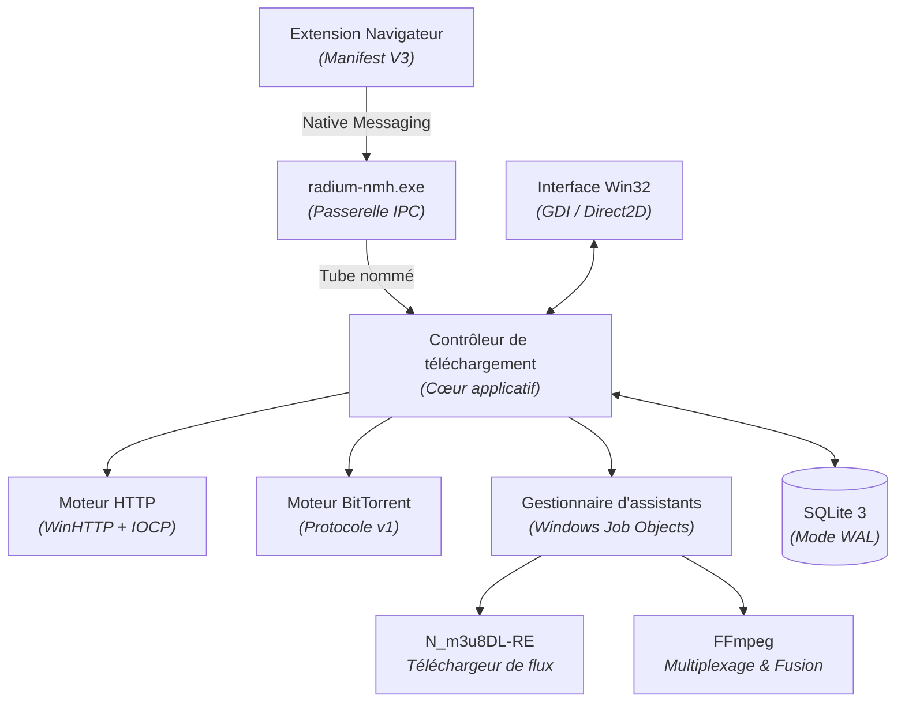

<p align="center">
  
</p>

<p align="center">
  <picture>
    
  </picture>
</p>

<h1 align="center">Radium Download Manager</h1>

<p align="center">
  <a href="README.md">English</a> · <a href="README.ja.md">日本語</a> · <a href="README.zh-CN.md">简体中文</a> · <a href="README.zh-TW.md">繁體中文</a> · <a href="README.ko.md">한국어</a> · <a href="README.es.md">Español</a> · <b>Français</b> · <a href="README.pt-BR.md">Português</a> · <a href="README.de-DE.md">Deutsch</a> · <a href="README.ru-RU.md">Русский</a> · <a href="README.it-IT.md">Italiano</a> · <a href="README.ar-SA.md">العربية</a>
</p>

<p align="center">
  <b>Gestionnaire de téléchargements rapide et fluide pour Windows 11 avec capture vidéo intégrée.</b><br>
  Accélérez vos téléchargements de fichiers grâce au découpage multiconnexion et capturez les vidéos en ligne (HLS, DASH et flux web) en un seul clic.<br>
  Application native C++20 et Win32 ultra-légère, sans le moindre surcoût lié à Electron — consommation minimale de mémoire vive et exécution discrète sans processus d'arrière-plan inutiles.
</p>

<p align="center">
  <a href="https://github.com/sayedalve/Radium-Download-Manager/releases/latest"></a>
  <a href="https://github.com/sayedalve/Radium-Download-Manager/releases/latest"></a>
  
  
  
  
  <a href="https://github.com/sayedalve/Radium-Download-Manager/actions/workflows/windows-release.yml"></a>
</p>

<p align="center">
  <a href="#téléchargements-et-installation"><b>Téléchargements</b></a> ·
  <a href="#fonctionnalités-clés"><b>Fonctionnalités</b></a> ·
  <a href="#thèmes-clair-et-sombre"><b>Thèmes</b></a> ·
  <a href="#interface-multilingue"><b>Langues</b></a> ·
  <a href="#tests-de-performance-benchmarks"><b>Performances</b></a> ·
  <a href="#moteur-de-téléchargement-haute-performance"><b>Moteur de téléchargement</b></a> ·
  <a href="#téléchargements-bittorrent"><b>BitTorrent</b></a> ·
  <a href="#intégration-au-navigateur"><b>Navigateur</b></a> ·
  <a href="#architecture-technique"><b>Architecture</b></a> ·
  <a href="#compilation-du-code-source"><b>Compilation</b></a>
</p>

<br>

<p align="center">
  
</p>

## Vue d'ensemble

Radium est un gestionnaire de téléchargements moderne, performant et open-source conçu spécifiquement pour Windows 11. Conçu pour remplacer les logiciels traditionnels souvent vieillissants, payants ou saturés de publicités, il réunit le téléchargement segmenté multiconnexion et la capture de médias web dans une interface sobre et fluide.

<table>
  <tr>
    <td width="33%" valign="top">
      <h3>⚡ Bande passante saturée</h3>
      Moteur de téléchargement HTTP/HTTPS segmenté basé sur des E/S asynchrones natives (WinHTTP + IOCP), avec division dynamique des plages d'octets et réattribution adaptative du travail restant.
    </td>
    <td width="33%" valign="top">
      <h3>🌐 Capture web intelligente</h3>
      Extension légère Manifest V3 pour Chromium et Firefox. Elle détecte les listes de lecture HLS (.m3u8), les flux DASH (.mpd) et les fichiers directs, tout en affichant un bouton discret au-dessus des lecteurs vidéo.
    </td>
    <td width="33%" valign="top">
      <h3>🧲 BitTorrent & Traitement de flux</h3>
      Moteur BitTorrent v1 intégré avec prise en charge des liens magnet (BEP 9), annonces par trackers et sélection granulaire des fichiers. Les flux vidéo sont traités dans des Job Objects Windows isolés avec N_m3u8DL-RE et FFmpeg.
    </td>
  </tr>
</table>

## Téléchargements et Installation

Radium est distribué sous forme d'archive portable pour Windows x64 ainsi que via des installeurs MSIX et Inno Setup.

| Paquet | Architecture | Lien de téléchargement |
| :--- | :---: | :--- |
| **Radium Portable (Complet)** | x64 | [Archive ZIP](https://github.com/sayedalve/Radium-Download-Manager/releases/latest) |
| **Radium Portable (Cœur léger)** | x64 | [Archive ZIP](https://github.com/sayedalve/Radium-Download-Manager/releases/latest) |

### Installation rapide de l'extension de navigateur

> [!TIP]
> **L'extension navigateur est distribuée de façon modulaire.** Vous pouvez charger le dossier [`extension/`](extension/) directement en mode développeur dans votre navigateur :
> 1. **Navigateurs Chromium (Chrome, Edge, Brave) :** Ouvrez `chrome://extensions`, activez le **Mode développeur** puis cliquez sur **Charger l'extension non empaquetée** et sélectionnez le dossier `extension/`.
> 2. **Firefox :** Ouvrez `about:debugging#/runtime/this-firefox`, cliquez sur **Charger un module temporaire...** et sélectionnez le fichier `manifest.firefox.json` situé dans le dossier `extension/`.
> 3. **Enregistrement de l'hôte Native Messaging :** Exécutez le script PowerShell `scripts/register-native-messaging.ps1` afin d'enregistrer l'hôte IPC local dans le registre Windows.

## Fonctionnalités clés

<p align="center">
  
</p>

### Téléchargement HTTP & HTTPS segmenté
- **Découpage dynamique en vol :** Les connexions actives se scindent dynamiquement pour saturer les plages d'octets restantes dès que des fils de travail se libèrent.
- **Entrées/Sorties asynchrones à faible latence :** Utilise les ports d'achèvement d'E/S Windows (IOCP) et des fichiers partiellement alloués (sparse files) pour éviter tout ralentissement du disque dur.
- **Validation atomique des fichiers :** Les téléchargements s'écrivent dans des fichiers temporaires `*.radium.part` et ne sont renommés qu'après validation complète de leur intégrité.
- **Reprise fiable des téléchargements :** Gestion stricte des en-têtes `Range` et des balises `ETag` pour reprendre un transfert interrompu sans corruption de données.

### Téléchargements BitTorrent
- **Résolution instantanée des liens Magnet :** Récupère les métadonnées en quelques secondes grâce à l'extension BEP 9 sans nécessiter de fichier .torrent préalable.
- **Sélection interactive des fichiers :** Examinez l'arborescence complète du torrent et cochez uniquement les fichiers que vous souhaitez rapatrier.
- **Persistance transactionnelle :** Suivi en temps réel dans SQLite 3 (mode WAL) pour survivre sans perte aux pannes de courant ou arrêts brutaux.

### Sécurité et robustesse du système
- **Isolation dans des Windows Job Objects :** Les processus auxiliaires (FFmpeg, N_m3u8DL-RE) sont rattachés à un Job Object (`JOB_OBJECT_LIMIT_KILL_ON_JOB_CLOSE`) assurant leur fermeture instantanée si Radium quitte.
- **Communication inter-processus sécurisée :** Aucun port réseau local ouvert ; l'extension communique exclusivement par tubes nommés Windows protégés par des listes de contrôle d'accès (`\\.\pipe\Radium_IPC_<UserSID>`).
- **Protection contre les injections de commandes :** Les URL et paramètres système sont rigoureusement assainis avant exécution, et les jetons sensibles transitent par des fichiers de réponse protégés (`@job.rsp`).

## Thèmes Clair et Sombre

Radium intègre une interface moderne conforme aux directives graphiques de Windows 11, avec une prise en charge complète des thèmes clair et sombre :

<div align="center">

| Thème clair (Light) | Thème sombre (Dark) |
| :---: | :---: |
|  |  |

</div>

- **Détection automatique du système :** S'aligne par défaut sur la préférence de couleur d'application configurée dans Windows 11 (`AppsUseLightTheme`).
- **Basculement manuel :** Choisissez librement votre mode d'affichage (`light`, `dark` ou `system`) depuis le centre de paramètres.
- **Rendu fluide et sans scintillement :** Dessin natif à double mémoire tampon (GDI / Direct2D) assurant des animations et des redimensionnements sans artefact visuel.

## Interface Multilingue

Radium propose un catalogue linguistique complet couvrant 12 langues internationales, modifiables instantanément sans redémarrer le logiciel :

- **Changement dynamique :** L'ensemble des textes, boîtes de dialogue et infobulles s'actualisent en direct lors de la sélection d'une langue.
- **Détection automatique :** S'initialise automatiquement sur la langue de l'interface utilisateur de Windows (`GetUserDefaultUILanguage`).
- **Catalogue centralisé :** Toutes les traductions de l'application de bureau sont rigoureusement versionnées dans `translations/desktop.json`.

## Captures d'écran

<div align="center">

| Fenêtre principale et liste des tâches | Centre de configuration et paramètres réseau |
| :---: | :---: |
|  |  |

</div>

## Tests de performance (Benchmarks)

Radium fait l'objet de comparaisons rigoureuses et continues face à **Internet Download Manager (IDM 6.43.15)** et à des utilitaires en ligne de commande, sur des fichiers strictement identiques.

### Face-à-face : Radium (v0.3.5 Dev Build) vs Internet Download Manager (Transfert de 500 Mo sur Internet réel)

Ce banc d'essai a évalué les deux logiciels lors du téléchargement d'un fichier de test identique de **500 000 000 octets** (`https://sg-lg.regxa.com/500MB.test`) sur une machine Windows 11. Deux essais consécutifs ont été réalisés en alternant l'ordre de passage afin d'équilibrer les aléas réseau. Les deux logiciels ont téléchargé avec succès et validé l'empreinte cryptographique exacte (**SHA-256 :** `b16f001a0731c8636f163586c16276b3714b8977242b67ae05fa60b96f685ebc`).

| Essai | Ordre | Durée Radium | Durée IDM | Réduction du temps | Débit (Radium / IDM) | Pic RAM (Radium / IDM) | Gain en mémoire |
| :---: | :---: | :---: | :---: | :---: | :---: | :---: | :---: |
| **Essai 1** | IDM en premier, puis Radium | **184,75 s** | 221,21 s | **16,48%** (-36,46 s) | **2,71 Mo/s** / 2,26 Mo/s (+19,91%) | **20,5 Mo** / 53,8 Mo | **61,90%** |
| **Essai 2** | Radium en premier, puis IDM | **140,09 s** | 173,46 s | **19,24%** (-33,37 s) | **3,57 Mo/s** / 2,88 Mo/s (+23,96%) | **20,4 Mo** / 122,2 Mo | **83,31%** |
| **Moyenne** | Moyenne cumulée des essais | **162,42 s** | 197,34 s | **17,69%** (-34,92 s) | **3,14 Mo/s** / 2,57 Mo/s (+22,18%) | **20,4 Mo** / 88,0 Mo | **76,76%** |

```
Comparaison du temps de transfert de 500 Mo (Le plus court est le meilleur ▼)
─────────────────────────────────────────────────────────────────────────────
Essai 1 (IDM en premier) :
  IDM 6.43.15     ████████████████████████████████████ 221,21 s
  Radium v0.3.5   ████████████████████████████ 184,75 s (-16,48% de temps)

Essai 2 (Radium en premier) :
  IDM 6.43.15     ████████████████████████████ 173,46 s
  Radium v0.3.5   ██████████████████████ 140,09 s (-19,24% de temps)
─────────────────────────────────────────────────────────────────────────────
Moyenne combinée :
  IDM 6.43.15     ████████████████████████████████ 197,34 s
  Radium v0.3.5   ██████████████████████████ 162,42 s (17,69% plus rapide)
```

#### Facteurs techniques expliquant cette efficacité :
1. **Division adaptative des plages :** Calcul dynamique basé sur la vitesse : `clamp(4 × transfer_speed_bps × 0.25 s, 1 MiB, 16 MiB)`. Ce mécanisme a réduit les données de connexion gaspillées de **57,3%** lors du premier essai et de **42,4%** lors du second.
2. **Parallélisation immédiate :** Dès l'amorce du téléchargement, les fils de travail disponibles sont immédiatement affectés à des segments propres, maintenant les 8 connexions à pleine charge.
3. **E/S asynchrones sans réassemblage :** Les écritures directes sur disque évitent la phase de fusion finale qui sature le processeur et la mémoire, stabilisant la consommation de Radium à environ 20 Mo de RAM, contre 54 à 122 Mo pour IDM.

## Moteur de téléchargement haute performance

Inspiré des travaux ouverts de [Brisk](https://github.com/BrisklyDev/brisk), Radium propose un moteur de téléchargement concurrent de pointe :

```
                      ┌────────────────────────────────────────┐
                      │      Fichier cible (ex: 500 Mo)        │
                      └────────────────────────────────────────┘
                       /             |            |                    Worker 0 (0-125Mo)   Worker 1 (125-250Mo)  Worker 2     Worker 3
        [████████████████]   [████████░░░░░░░░]   [████░░░░]   [████████████████]
            (Terminé)             (Actif)          (Actif)         (Terminé)
                                                      ▲
                                                      │ Vole le reste inachevé
                                                 Worker disponible
```

1. **Sondage initial :** Requête rapide pour vérifier la prise en charge des plages d'octets et identifier le nom du fichier.
2. **Ouverture parallèle :** Établissement progressif des connexions jusqu'à la limite choisie (par défaut 8, maximum 32).
3. **Vol de travail adaptatif :** Dès qu'un fil termine sa tâche, il scinde le segment inachevé le plus grand parmi les connexions actives.
4. **Repli sécurisé :** Si un serveur rejette les requêtes partielles, la plage est réassignée au fil d'origine sans perte de données.
5. **Écriture atomique :** Écriture directe dans un fichier sparse préalloué, suivie d'un renommage atomique immédiat.

## Téléchargements BitTorrent

Prise en charge intégrée et native du protocole BitTorrent v1 :
- **Résolution des liens Magnet :** Récupération rapide des métadonnées grâce à l'extension BEP 9.
- **Découverte par Trackers et DHT :** Prise en charge complète des annonces HTTP/UDP et de la table de hachage distribuée (DHT).
- **Vérification d'intégrité par hachage :** Vérification rigoureuse des pièces en SHA-1 avec mode « endgame » pour finaliser rapidement les derniers blocs.
- **Sélection personnalisée des fichiers :** Interface en arborescence permettant d'exclure les éléments superflus avant le lancement.
- **Tolérance aux pannes :** Sauvegarde transactionnelle permanente de l'état dans SQLite.

## Canalisation adaptative de flux vidéo

Pour les flux vidéo modernes segmentés (HLS et DASH), Radium orchestre des outils tiers spécialisés :
- **Cloisonnement dans des Job Objects :** Exécution sous un Job Object Windows garantissant l'arrêt propre de tous les processus fils si Radium est fermé.
- **Confidentialité des identifiants :** Les cookies et en-têtes d'authentification transitent exclusivement par des fichiers de réponses temporaires sécurisés (`@job.rsp`).
- **Assemblage sans perte :** Fusion automatique et remultiplexage sans réencodage vers des conteneurs standard MP4 ou MKV à l'aide de FFmpeg.

*Remarque : Conformément aux règles de conformité légale, Radium ne prend pas en charge et ne contourne aucun mécanisme de chiffrement DRM.*

## Intégration au navigateur

L'extension Manifest V3 assure une passerelle directe et transparente entre vos navigateurs et Radium :

```
┌─────────────────────────────────┐
│ Navigateur (Chromium / Firefox) │
│  ├── Détection webRequest       │
│  └── Bouton flottant sur vidéos │
└───────────────┬─────────────────┘
                │ Stdio (JSON-RPC 32-bit avec préfixe de taille)
┌───────────────▼─────────────────┐
│ radium-nmh.exe (Hôte natif)     │
└───────────────┬─────────────────┘
                │ Tube nommé Windows : \.\pipe\Radium_IPC_<UserSID>
┌───────────────▼─────────────────┐
│ radium.exe (Application bureau) │
└─────────────────────────────────┘
```

- **Aucun port réseau ouvert :** Utilise exclusivement des tubes nommés sécurisés par les listes de contrôle d'accès de votre session utilisateur.
- **Filtrage intelligent des flux :** Isole les listes maîtresses (.m3u8) et ignore les avalanches de fragments temporaires (.ts, .m4s).
- **Repli automatique et transparent :** Si l'application de bureau n'est pas lancée ou si vous annulez, le navigateur reprend automatiquement le téléchargement de manière standard.

## Architecture technique



## Compilation du code source

Prérequis : **Windows 11 x64**, **Visual Studio 2022 (MSVC 19.38+)** avec la charge de travail C++ de bureau et **CMake 3.25+**.

```powershell
# Cloner le dépôt
git clone https://github.com/sayedalve/Radium-Download-Manager.git
cd Radium-Download-Manager

# Compiler l'ensemble des exécutables et créer l'archive portable
powershell -ExecutionPolicy Bypass -File scripts/build-windows-msvc.ps1
```

## Tests et Assurance Qualité

Radium dispose d'une suite de tests complète couvrant les unités de code, l'intégration système et les scénarios de bout en bout :

```powershell
# Exécuter les tests unitaires et d'intégration C++
ctest --test-dir build/win-x64 --output-on-failure -C Release

# Exécuter la suite de tests automatisée de l'extension
npm test
```

## Compatibilité avec les serveurs HTTP

Radium prend en charge tout serveur HTTP/HTTPS conforme à la norme RFC 7233 (`206 Partial Content`). Si un serveur distant ne gère pas les requêtes de plages d'octets, Radium bascule automatiquement sur un téléchargement sécurisé à connexion unique.

## Contribuer

Les contributions au projet sont les bienvenues ! Veuillez consulter notre guide [CONTRIBUTING.md](CONTRIBUTING.md) et vous référer aux principes d'architecture décrits dans [docs/INDEX.md](docs/INDEX.md) avant d'ouvrir une pull request.

## Licence et Crédits

Radium Download Manager est distribué sous la **licence Apache-2.0**. Pour plus de précisions, reportez-vous au fichier [LICENSE](LICENSE).

### Composants tiers et remerciements
- **[Brisk](https://github.com/BrisklyDev/brisk)** – Source d'inspiration pour le moteur de téléchargement segmenté en C++ (GPL-3.0).
- **[N_m3u8DL-RE](https://github.com/nilaoda/N_m3u8DL-RE)** – Assistant de traitement et de téléchargement de flux HLS/DASH (MIT).
- **[FFmpeg](https://ffmpeg.org/)** – Moteur de multiplexage audio et vidéo (LGPL-2.1+ / GPL-3.0).
- **[SQLite 3](https://www.sqlite.org/)** – Base de données transactionnelle embarquée pour l'historique et les états (Domaine public).

---
<p align="center">
  <sub>Radium Download Manager · Gestionnaire de téléchargements natif et performant pour Windows 11</sub>
</p>
