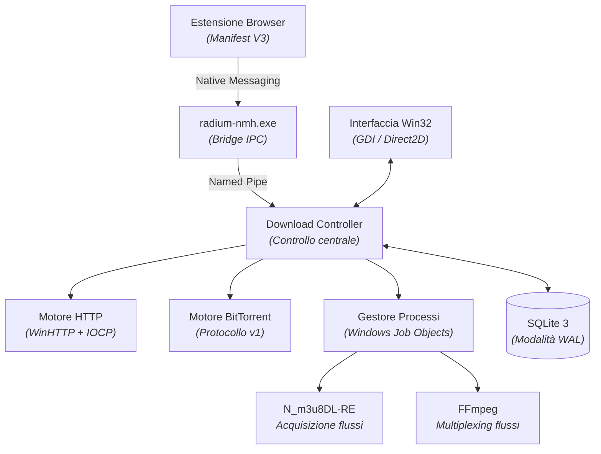

<p align="center">
  
</p>

<p align="center">
  <picture>
    
  </picture>
</p>

<h1 align="center">Radium Download Manager</h1>

<p align="center">
  <a href="README.md">English</a> · <a href="README.ja.md">日本語</a> · <a href="README.zh-CN.md">简体中文</a> · <a href="README.zh-TW.md">繁體中文</a> · <a href="README.ko.md">한국어</a> · <a href="README.es.md">Español</a> · <a href="README.fr.md">Français</a> · <a href="README.pt-BR.md">Português</a> · <a href="README.de-DE.md">Deutsch</a> · <a href="README.ru-RU.md">Русский</a> · <b>Italiano</b> · <a href="README.ar-SA.md">العربية</a>
</p>

<p align="center">
  <b>Download manager veloce e compatto per Windows 11 con acquisizione video integrata.</b><br>
  Accelera il download dei file tramite connessioni multiple e acquisisci video online (flussi HLS, DASH e web media) con un solo clic.<br>
  Applicazione nativa in C++20 e Win32 senza il sovraccarico di Electron — consumo di memoria ridotto al minimo ed esecuzione discreta senza processi di background superflui.
</p>

<p align="center">
  <a href="https://github.com/alve33/Radium-Download-Manager/releases/latest"></a>
  <a href="https://github.com/alve33/Radium-Download-Manager/releases/latest"></a>
  
  
  
  
  <a href="https://github.com/alve33/Radium-Download-Manager/actions/workflows/windows-release.yml"></a>
</p>

<p align="center">
  <a href="#download-e-installazione"><b>Download</b></a> ·
  <a href="#caratteristiche-principali"><b>Caratteristiche</b></a> ·
  <a href="#temi-chiaro-e-scuro"><b>Temi</b></a> ·
  <a href="#interfaccia-multilingue"><b>Lingue</b></a> ·
  <a href="#benchmark-delle-prestazioni"><b>Prestazioni</b></a> ·
  <a href="#motore-di-download-ad-alte-prestazioni"><b>Motore di download</b></a> ·
  <a href="#download-bittorrent"><b>BitTorrent</b></a> ·
  <a href="#integrazione-con-il-browser"><b>Browser</b></a> ·
  <a href="#architettura-tecnica"><b>Architettura</b></a> ·
  <a href="#compilazione-dai-sorgenti"><b>Compilazione</b></a>
</p>

<br>

<p align="center">
  
</p>

## Panoramica

Radium è un download manager open source nativo ad alte prestazioni, sviluppato appositamente per Windows 11. Progettato come alternativa moderna, leggera e priva di annunci pubblicitari rispetto ai software tradizionali, unisce download multiconnessione segmentati e acquisizione intuitiva di contenuti multimediali dai browser web.

<table>
  <tr>
    <td width="33%" valign="top">
      <h3>⚡ Massima velocità di trasferimento</h3>
      Motore HTTP/HTTPS segmentato con I/O asincrono nativo (WinHTTP + IOCP), partizionamento dinamico delle connessioni e riutilizzo adattivo degli intervalli di byte liberi.
    </td>
    <td width="33%" valign="top">
      <h3>🌐 Acquisizione fluida dal browser</h3>
      Estensione Manifest V3 leggera per Chromium e Firefox. Rileva playlist HLS (.m3u8), manifest DASH (.mpd) e file diretti, offrendo comodi pulsanti di download direttamente sui video.
    </td>
    <td width="33%" valign="top">
      <h3>🧲 BitTorrent & Flussi multimediali</h3>
      Motore BitTorrent v1 integrato con supporto per link magnetici BEP 9, annunci ai tracker e selezione dei file. Elaborazione dei flussi in Job Object Windows isolati tramite N_m3u8DL-RE e FFmpeg.
    </td>
  </tr>
</table>

## Download e Installazione

Radium è disponibile sia come pacchetto portatile preconfigurato per Windows x64, sia come programma di installazione standard MSIX / Inno Setup.

| Pacchetto | Architettura | Collegamento |
| :--- | :---: | :--- |
| **Radium Portatile (Completo)** | x64 | [Archivio ZIP](https://github.com/alve33/Radium-Download-Manager/releases/latest) |
| **Radium Portatile (Core)** | x64 | [Archivio ZIP](https://github.com/alve33/Radium-Download-Manager/releases/latest) |

### Configurazione rapida dell'estensione per il browser

> [!TIP]
> **L'estensione per il browser è separata in modo modulare per ragioni di sicurezza.** È possibile caricare la cartella [`extension/`](extension/) direttamente in modalità sviluppatore:
> 1. **Browser basati su Chromium (Chrome, Edge, Brave):** Visita `chrome://extensions`, attiva la **Modalità sviluppatore**, seleziona **Carica estensione non pacchettizzata** e scegli la cartella `extension/`.
> 2. **Firefox:** Visita `about:debugging#/runtime/this-firefox`, fai clic su **Carica componente aggiuntivo temporaneo...** e seleziona il file `manifest.firefox.json` presente nella cartella `extension/`.
> 3. **Registrazione dell'Host Native Messaging:** Esegui lo script `scripts/register-native-messaging.ps1` per configurare l'host IPC locale nel registro di sistema di Windows.

## Caratteristiche Principali

<p align="center">
  
</p>

### Download HTTP e HTTPS segmentati
- **Divisione dinamica dei segmenti:** I thread attivi dividono automaticamente le parti rimanenti del file non appena si rendono disponibili risorse di calcolo.
- **I/O asincrono ad alta efficienza:** Utilizza le porte di completamento I/O native di Windows (IOCP) e file sparse preallocati per azzerare i blocchi di scrittura su disco.
- **Scrittura atomica sicura:** I download vengono salvati provvisoriamente con estensione `*.radium.part` e rinominati atomicamente solo a verifica hash completata.
- **Ripristino intelligente:** Gestione rigorosa degli header `Range` e dei tag `ETag` per consentire la ripresa affidabile dei download interrotti.

### Funzionalità BitTorrent
- **Risoluzione istantanea link Magnet:** Recupero dei metadati in pochi secondi tramite l'estensione del protocollo BEP 9.
- **Selezione interattiva dei file:** Esplora l'albero completo delle cartelle del torrent per selezionare e scaricare solo i file desiderati.
- **Persistenza transazionale:** Registrazione di stato e progresso in tempo reale su SQLite 3 (modalità WAL), resistente a blackout o chiusure impreviste.

### Sicurezza e affidabilità di sistema
- **Isolamento con Windows Job Objects:** I processi ausiliari esterni (FFmpeg, N_m3u8DL-RE) sono vincolati a un Job Object (`JOB_OBJECT_LIMIT_KILL_ON_JOB_CLOSE`), che garantisce la chiusura pulita e immediata di qualsiasi sottoprocesso all'uscita di Radium.
- **Comunicazione sicura tra processi (IPC):** Nessuna porta TCP/HTTP aperta in locale; la comunicazione avviene unicamente tramite Named Pipe protette da ACL Windows (`\\.\pipe\Radium_IPC_<UserSID>`).
- **Protezione contro l'iniezione di comandi:** I parametri di sistema e gli URL sono sottoposti a controlli rigorosi; cookie e token sensibili transitano solo su file di risposta temporanei protetti (`@job.rsp`).

## Temi Chiaro e Scuro

Radium si integra perfettamente nell'esperienza visiva di Windows 11 con il pieno supporto ai temi dell'interfaccia di sistema:

<div align="center">

| Tema chiaro (Light) | Tema scuro (Dark) |
| :---: | :---: |
|  |  |

</div>

- **Rilevamento automatico:** Segue in tempo reale l'impostazione di colore globale di Windows 11 (`AppsUseLightTheme`).
- **Selezione manuale:** Possibilità di forzare l'aspetto desiderato (`light`, `dark` o `system`) dal centro impostazioni.
- **Rendering senza sfarfallio:** Rendering nativo GDI e Direct2D a doppio buffer per animazioni fluide e ridimensionamenti perfetti.

## Interfaccia Multilingue

Radium include un catalogo completo di 12 lingue internazionali, commutabili istantaneamente senza riavviare il programma:

- **Cambio dinamico in tempo reale:** Tutte le stringhe di testo, i menu e i messaggi si aggiornano istantaneamente al cambio di lingua.
- **Rilevamento all'avvio:** Riconosce la lingua dell'interfaccia utente di Windows (`GetUserDefaultUILanguage`) alla prima configurazione.
- **Traduzioni certificate:** Le risorse linguistiche dell'applicazione desktop sono mantenute e validate in `translations/desktop.json`.

## Screenshot

<div align="center">

| Finestra principale e lista download | Centro impostazioni e opzioni di rete |
| :---: | :---: |
|  |  |

</div>

## Benchmark delle Prestazioni

Radium viene continuamente verificato a parità di condizioni rispetto a **Internet Download Manager (IDM 6.43.15)** e ai consueti strumenti da riga di comando.

### Testa a testa: Radium (v0.3.5 Dev Build) vs Internet Download Manager (500 MB su rete reale)

Il test ha valutato il download di un file di prova identico di **500.000.000 byte** (`https://sg-lg.regxa.com/500MB.test`) su Windows 11. Le prove sono state eseguite invertendo l'ordine di partenza per compensare le oscillazioni di rete. Entrambe le applicazioni hanno completato i download con successo con verifica crittografica perfetta (**SHA-256:** `b16f001a0731c8636f163586c16276b3714b8977242b67ae05fa60b96f685ebc`).

| Prova | Ordine | Tempo Radium | Tempo IDM | Risparmio di tempo | Velocità (Radium / IDM) | Picco RAM (Radium / IDM) | Risparmio RAM |
| :---: | :---: | :---: | :---: | :---: | :---: | :---: | :---: |
| **Prova 1** | Prima IDM, poi Radium | **184,75 s** | 221,21 s | **16,48%** (-36,46 s) | **2,71 MB/s** / 2,26 MB/s (+19,91%) | **20,5 MB** / 53,8 MB | **61,90%** |
| **Prova 2** | Prima Radium, poi IDM | **140,09 s** | 173,46 s | **19,24%** (-33,37 s) | **3,57 MB/s** / 2,88 MB/s (+23,96%) | **20,4 MB** / 122,2 MB | **83,31%** |
| **Media** | Media combinata delle prove | **162,42 s** | 197,34 s | **17,69%** (-34,92 s) | **3,14 MB/s** / 2,57 MB/s (+22,18%) | **20,4 MB** / 88,0 MB | **76,76%** |

```
Confronto durata trasferimento 500 MB (Il valore più basso è migliore ▼)
─────────────────────────────────────────────────────────────────────────────
Prova 1 (Prima IDM):
  IDM 6.43.15     ████████████████████████████████████ 221,21 s
  Radium v0.3.5   ████████████████████████████ 184,75 s (-16,48% tempo)

Prova 2 (Prima Radium):
  IDM 6.43.15     ████████████████████████████ 173,46 s
  Radium v0.3.5   ██████████████████████ 140,09 s (-19,24% tempo)
─────────────────────────────────────────────────────────────────────────────
Media combinata:
  IDM 6.43.15     ████████████████████████████████ 197,34 s
  Radium v0.3.5   ██████████████████████████ 162,42 s (17,69% più veloce)
```

#### Fattori chiave dell'efficienza nel trasferimento:
1. **Divisione adattiva dei range:** Formula impiegata: `clamp(4 × transfer_speed_bps × 0.25 s, 1 MiB, 16 MiB)`. Grazie a dimensioni minime di partizionamento, i dati scartati sono scesi del **57,3%** nella Prova 1 e del **42,4%** nella Prova 2.
2. **Parallelizzazione immediata dei worker:** All'avvio, i worker disponibili vengono ripartiti sui limiti esatti dei segmenti, mantenendo le 8 connessioni sempre al massimo regime.
3. **I/O streaming senza ricombinazione finale:** La scrittura diretta asincrona elimina la fase conclusiva di unione dei file temporanei, riducendo l'uso di memoria a circa 20 MB di RAM rispetto ai 54-122 MB richiesti da IDM.

## Motore di Download ad Alte Prestazioni

Ispirato a progetti aperti d'eccellenza come [Brisk](https://github.com/BrisklyDev/brisk), Radium adotta un motore con bilanciamento del carico avanzato:

```
                      ┌────────────────────────────────────────┐
                      │        File di destinazione (500 MB)   │
                      └────────────────────────────────────────┘
                       /             |            |                    Worker 0 (0-125MB)   Worker 1 (125-250MB)  Worker 2     Worker 3
        [████████████████]   [████████░░░░░░░░]   [████░░░░]   [████████████████]
           (Completato)           (Attivo)         (Attivo)       (Completato)
                                                      ▲
                                                      │ Ruba la porzione rimanente
                                                 Worker libero
```

1. **Sondaggio preventivo:** Verifica con richiesta `Range` il supporto del server alle parti parziali e ottiene il nome del file.
2. **Attivazione progressiva:** Apertura simultanea delle connessioni fino al limite impostato (predefinito 8, massimo 32).
3. **Furto di lavoro adattivo (Work-Stealing):** Quando un thread termina, suddivide la porzione incompleta più grande tra le connessioni ancora in corso.
4. **Ripristino sicuro:** Se un server rifiuta una richiesta frammentata, l'intervallo viene restituito senza perdite al thread proprietario.
5. **Scrittura atomica:** Flusso diretto su disco con preallocazione sparse e rinomina atomica finale istantanea.

## Download BitTorrent

Stack v1 completamente nativo per file torrent e link magnetici:
- **Estensione BEP 9:** Risoluzione ultra-rapida dei magnet link direttamente nello sciame peer.
- **Tracker & DHT:** Supporto sia per gli annunci HTTP/UDP che per la rete decentralizzata DHT.
- **Verifica crittografica dei blocchi:** Algoritmo endgame e verifica continua con hash SHA-1.
- **Selezione mirata dei file:** Visualizzazione ad albero per escludere facilmente i file non desiderati.
- **Persistenza sicura:** Stato e avanzamento salvati in tempo reale su SQLite.

## Pipeline Adattiva per Flussi Multimediali

Per i flussi video frammentati moderni (HLS e DASH), Radium gestisce processi di supporto dedicati:
- **Isolamento completo:** Gestione tramite Job Object di Windows con chiusura istantanea di tutti i processi dipendenti se Radium si chiude.
- **Riservatezza delle credenziali:** Cookie e chiavi di autorizzazione non vengono mai mostrati negli argomenti di riga di comando, transitando tramite file protetti (`@job.rsp`).
- **Muxing senza perdite:** Ricombinazione diretta delle tracce audio e video in contenitori standard MP4 o MKV tramite FFmpeg.

*Nota di conformità legale: Radium rispetta le normative vigenti e non supporta né implementa strumenti di violazione o decifrazione di DRM.*

## Integrazione con il Browser

L'estensione Manifest V3 funge da ponte sicuro e diretto tra i browser web e Radium:

```
┌─────────────────────────────────┐
│ Browser Web (Chromium / Firefox)│
│  ├── Rilevamento webRequest     │
│  └── Pulsante rapido sui video  │
└───────────────┬─────────────────┘
                │ Stdio (JSON-RPC a 32-bit con prefisso di lunghezza)
┌───────────────▼─────────────────┐
│ radium-nmh.exe (Host nativo)    │
└───────────────┬─────────────────┘
                │ Named Pipe Windows: \.\pipe\Radium_IPC_<UserSID>
┌───────────────▼─────────────────┐
│ radium.exe (App desktop)        │
└─────────────────────────────────┘
```

- **Nessuna porta TCP aperta:** La comunicazione si appoggia unicamente a Named Pipe con ACL di sistema dell'utente.
- **Filtraggio intelligente dei flussi:** Isola i manifest master ed elimina il sovraccarico causato dalle centinaia di frammenti (.ts, .m4s).
- **Fallback trasparente:** In caso di mancata risposta dell'applicazione desktop, il browser gestisce il download normalmente senza mostrare errori.

## Architettura Tecnica



## Compilazione dai Sorgenti

Requisiti: **Windows 11 x64**, **Visual Studio 2022 (MSVC 19.38+)** con carico di lavoro desktop C++ e **CMake 3.25+**.

```powershell
# Clona il repository
git clone https://github.com/alve33/Radium-Download-Manager.git
cd Radium-Download-Manager

# Compila i binari e prepara il pacchetto portatile
powershell -ExecutionPolicy Bypass -File scripts/build-windows-msvc.ps1
```

## Test e Verifica

Il software è corredato da test automatizzati unitari, di integrazione e scenari end-to-end:

```powershell
# Esecuzione dei test C++
ctest --test-dir build/win-x64 --output-on-failure -C Release

# Esecuzione dei test dell'estensione del browser
npm test
```

## Compatibilità con i Server HTTP

Radium supporta tutti i server HTTP/HTTPS conformi allo standard RFC 7233 (`206 Partial Content`). Qualora un server non gestisca la richiesta di parti parziali, il programma passa in automatico alla modalità di download sicuro a singola connessione.

## Contribuire

I contributi sono sempre benvenuti! Prima di inviare una pull request, consulta la guida [CONTRIBUTING.md](CONTRIBUTING.md) e la documentazione architetturale in [docs/INDEX.md](docs/INDEX.md).

## Licenza e Crediti

Radium Download Manager è rilasciato sotto licenza **Apache-2.0**. I dettagli completi sono disponibili nel file [LICENSE](LICENSE).

### Componenti di terze parti e ringraziamenti
- **[Brisk](https://github.com/BrisklyDev/brisk)** – Ispirazione per l'architettura del motore di download segmentato in C++ (GPL-3.0).
- **[N_m3u8DL-RE](https://github.com/nilaoda/N_m3u8DL-RE)** – Strumento specializzato nel download dei flussi HLS e DASH (MIT).
- **[FFmpeg](https://ffmpeg.org/)** – Suite di elaborazione e ricombinazione audio/video (LGPL-2.1+ / GPL-3.0).
- **[SQLite 3](https://www.sqlite.org/)** – Database transazionale integrato per stati e cronologia (Dominio pubblico).

---
<p align="center">
  <sub>Radium Download Manager · Download manager nativo e ad alte prestazioni per Windows 11</sub>
</p>
