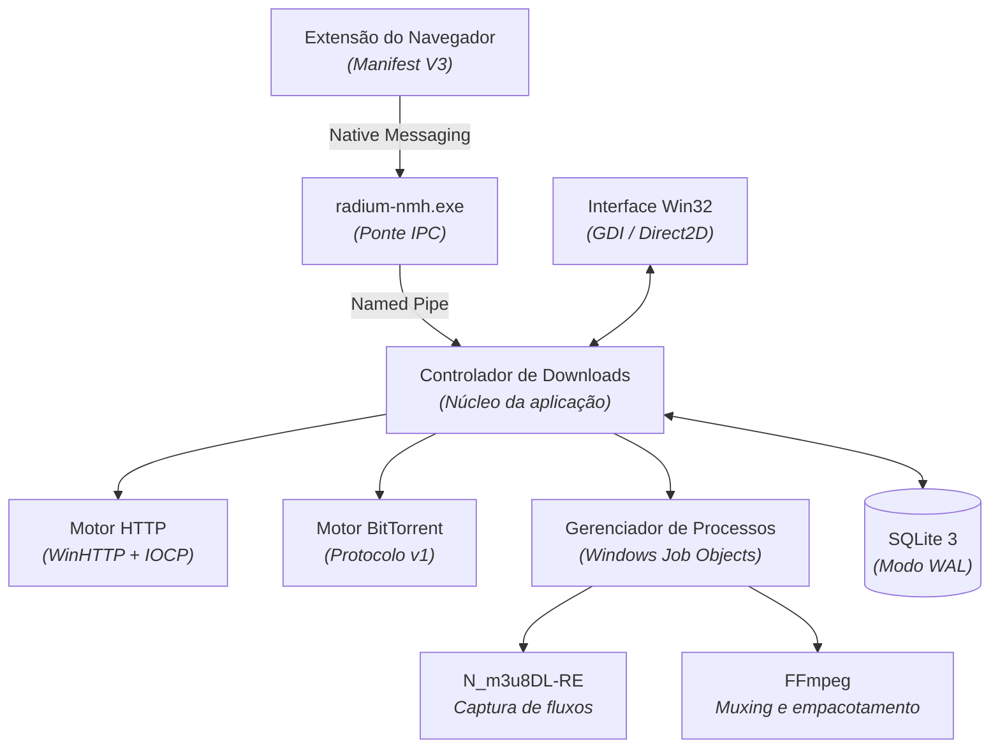

<p align="center">
  
</p>

<p align="center">
  <picture>
    
  </picture>
</p>

<h1 align="center">Radium Download Manager</h1>

<p align="center">
  <a href="README.md">English</a> · <a href="README.ja.md">日本語</a> · <a href="README.zh-CN.md">简体中文</a> · <a href="README.zh-TW.md">繁體中文</a> · <a href="README.ko.md">한국어</a> · <a href="README.es.md">Español</a> · <a href="README.fr.md">Français</a> · <b>Português</b> · <a href="README.de-DE.md">Deutsch</a> · <a href="README.ru-RU.md">Русский</a> · <a href="README.it-IT.md">Italiano</a> · <a href="README.ar-SA.md">العربية</a>
</p>

<p align="center">
  <b>Gerenciador de downloads rápido e leve para Windows 11 com captura integrada de vídeos e mídias.</b><br>
  Acelere o download de arquivos com múltiplas conexões simultâneas e capture vídeos da web (HLS, DASH e transmissões online) com um único clique.<br>
  Desenvolvido nativamente em C++20 e Win32, sem a sobrecarga do Electron — com consumo mínimo de memória RAM e sem processos desnecessários em segundo plano.
</p>

<p align="center">
  <a href="https://github.com/sayedalve/Radium-Download-Manager/releases/latest"></a>
  <a href="https://github.com/sayedalve/Radium-Download-Manager/releases/latest"></a>
  
  
  
  
  <a href="https://github.com/sayedalve/Radium-Download-Manager/actions/workflows/windows-release.yml"></a>
</p>

<p align="center">
  <a href="#downloads-e-instalação"><b>Downloads</b></a> ·
  <a href="#recursos-principais"><b>Recursos</b></a> ·
  <a href="#temas-claro-e-escuro"><b>Temas</b></a> ·
  <a href="#interface-multilíngue"><b>Idiomas</b></a> ·
  <a href="#testes-de-desempenho-benchmarks"><b>Desempenho</b></a> ·
  <a href="#motor-de-download-de-alto-desempenho"><b>Motor de download</b></a> ·
  <a href="#downloads-via-bittorrent"><b>BitTorrent</b></a> ·
  <a href="#integração-com-o-navegador"><b>Navegador</b></a> ·
  <a href="#arquitetura-técnica"><b>Arquitetura</b></a> ·
  <a href="#compilação-a-partir-do-código-fonte"><b>Compilação</b></a>
</p>

<br>

<p align="center">
  
</p>

## Visão Geral

O Radium é um gerenciador de downloads nativo de alta performance e código aberto, desenvolvido sob medida para o Windows 11. Criado para substituir programas tradicionais sobrecarregados de propaganda e lentidão, ele combina aceleração multiconexão de arquivos e captura de vídeos da internet em uma interface moderna e ágil.

<table>
  <tr>
    <td width="33%" valign="top">
      <h3>⚡ Máxima utilização de banda</h3>
      Motor HTTP/HTTPS segmentado com E/S assíncrona nativa (WinHTTP + IOCP), particionamento dinâmico de conexões e realocação inteligente de intervalos de bytes ociosos.
    </td>
    <td width="33%" valign="top">
      <h3>🌐 Captura web transparente</h3>
      Extensão leve Manifest V3 para Chromium e Firefox. Detecta playlists HLS (.m3u8), manifestos DASH (.mpd) e arquivos diretos, adicionando botões de download direto sobre os reprodutores de vídeo.
    </td>
    <td width="33%" valign="top">
      <h3>🧲 BitTorrent & Processamento de fluxos</h3>
      Suporte nativo ao protocolo BitTorrent v1 com resolução de links magnet via BEP 9, anúncios em trackers e seleção seletiva de arquivos. Processamento de transmissões em Job Objects isolados do Windows com N_m3u8DL-RE e FFmpeg.
    </td>
  </tr>
</table>

## Downloads e Instalação

O Radium é disponibilizado em pacotes portáteis pré-configurados para Windows x64 e também por meio de instaladores tradicionais Inno Setup e MSIX.

| Pacote | Arquitetura | Download |
| :--- | :---: | :--- |
| **Radium Portátil (Completo)** | x64 | [Arquivo ZIP](https://github.com/sayedalve/Radium-Download-Manager/releases/latest) |
| **Radium Portátil (Core)** | x64 | [Arquivo ZIP](https://github.com/sayedalve/Radium-Download-Manager/releases/latest) |

### Instalação rápida da extensão para o navegador

> [!TIP]
> **A extensão do navegador é separada de forma modular para sua segurança.** Você pode carregar a pasta [`extension/`](extension/) diretamente no modo de desenvolvedor do seu navegador:
> 1. **Navegadores baseados no Chromium (Chrome, Edge, Brave):** Acesse `chrome://extensions`, ative o **Modo do desenvolvedor**, clique em **Carregar sem compactação** e selecione a pasta `extension/`.
> 2. **Firefox:** Acesse `about:debugging#/runtime/this-firefox`, clique em **Carregar extensão temporária...** e selecione o arquivo `manifest.firefox.json` na pasta `extension/`.
> 3. **Registro do Host de Mensagens Nativas:** Execute o script `scripts/register-native-messaging.ps1` para registrar o host IPC local no registro do Windows.

## Recursos Principais

<p align="center">
  
</p>

### Download HTTP e HTTPS Segmentado
- **Divisão dinâmica em tempo real:** As conexões em andamento subdividem automaticamente as partes restantes do arquivo assim que recursos livres são detectados.
- **E/S assíncrona de alto rendimento:** Utiliza as portas de conclusão de E/S do Windows (IOCP) e arquivos esparsos pré-alocados para eliminar travamentos e gargalos no disco rígido.
- **Gravação atômica segura:** Os dados são gravados provisoriamente em arquivos `*.radium.part` e renomeados de forma atômica apenas após a verificação total de integridade.
- **Retomada confiável de transferências:** Gerenciamento rigoroso de cabeçalhos `Range` e `ETag` para retomar downloads interrompidos sem corrupção de dados.

### Recursos BitTorrent
- **Resolução instantânea de Links Magnet:** Obtenha metadados em poucos segundos através da extensão BEP 9, sem precisar de um arquivo .torrent inicial.
- **Seleção granular de arquivos:** Visualize a árvore completa de pastas do torrent para escolher e baixar somente os itens que você precisa.
- **Persistência transacional:** Registro do progresso em tempo real no SQLite 3 (modo WAL), imune a quedas de energia e fechamentos repentinos do sistema.

### Segurança e Robustez do Sistema
- **Isolamento via Windows Job Objects:** Utilitários auxiliares (FFmpeg, N_m3u8DL-RE) operam estritamente vinculados a um Job Object (`JOB_OBJECT_LIMIT_KILL_ON_JOB_CLOSE`), garantindo que nenhum processo órfão permaneça aberto se o Radium for encerrado.
- **Comunicação Segura entre Processos (IPC):** Sem portas de rede TCP/HTTP locais abertas; a extensão se comunica exclusivamente por Named Pipes protegidos pelas permissões de usuário do Windows (`\\.\pipe\Radium_IPC_<UserSID>`).
- **Prevenção contra Injeção de Comandos:** Todos os parâmetros e links são sanitizados; dados confidenciais (cookies e tokens) são repassados por arquivos de resposta temporários protegidos (`@job.rsp`).

## Temas Claro e Escuro

O Radium possui uma interface elegante construída de acordo com as diretrizes de design do Windows 11, suportando perfeitamente os modos claro e escuro:

<div align="center">

| Tema Claro (Light) | Tema Escuro (Dark) |
| :---: | :---: |
|  |  |

</div>

- **Detecção automática do sistema:** Sincroniza em tempo real com a preferência de cor de aplicativo do Windows 11 (`AppsUseLightTheme`).
- **Alternância manual:** Escolha facilmente o modo desejado (`light`, `dark` ou `system`) na central de configurações.
- **Renderização sem cintilação:** Desenho nativo com buffer duplo em GDI e Direct2D para animações e redimensionamentos suaves.

## Interface Multilíngue

O Radium inclui suporte nativo a 12 idiomas, com troca imediata sem necessidade de reiniciar o programa:

- **Atualização instantânea:** Todos os menus, botões, caixas de diálogo e notificações mudam de idioma em tempo real.
- **Detecção no primeiro início:** Reconhece o idioma padrão configurado na interface do Windows (`GetUserDefaultUILanguage`).
- **Traduções validadas:** Todo o catálogo de idiomas é centralizado e mantido no arquivo `translations/desktop.json`.

## Capturas de Tela

<div align="center">

| Janela Principal e Fila de Downloads | Central de Configurações e Rede |
| :---: | :---: |
|  |  |

</div>

## Testes de Desempenho (Benchmarks)

O Radium é submetido a testes comparativos constantes contra o **Internet Download Manager (IDM 6.43.15)** e utilitários de linha de comando com arquivos idênticos.

### Frente a Frente: Radium (v0.3.5 Dev Build) vs Internet Download Manager (500 MB na Internet Real)

O teste avaliou o download de uma carga de teste idêntica de **500.000.000 bytes** (`https://sg-lg.regxa.com/500MB.test`) em um computador com Windows 11. Duas rodadas consecutivas foram executadas alternando a ordem para equilibrar as variações de trânsito na rede. Ambos os downloads foram concluídos com sucesso e aprovados na verificação criptográfica (**SHA-256:** `b16f001a0731c8636f163586c16276b3714b8977242b67ae05fa60b96f685ebc`).

| Rodada | Ordem | Tempo Radium | Tempo IDM | Redução de Tempo | Taxa (Radium / IDM) | Pico de RAM (Radium / IDM) | Economia de RAM |
| :---: | :---: | :---: | :---: | :---: | :---: | :---: | :---: |
| **Rodada 1** | IDM primeiro, depois Radium | **184,75 s** | 221,21 s | **16,48%** (-36,46 s) | **2,71 MB/s** / 2,26 MB/s (+19,91%) | **20,5 MB** / 53,8 MB | **61,90%** |
| **Rodada 2** | Radium primeiro, depois IDM | **140,09 s** | 173,46 s | **19,24%** (-33,37 s) | **3,57 MB/s** / 2,88 MB/s (+23,96%) | **20,4 MB** / 122,2 MB | **83,31%** |
| **Média** | Média combinada das rodadas | **162,42 s** | 197,34 s | **17,69%** (-34,92 s) | **3,14 MB/s** / 2,57 MB/s (+22,18%) | **20,4 MB** / 88,0 MB | **76,76%** |

```
Comparação do tempo de transferência de 500 MB (Menor é melhor ▼)
─────────────────────────────────────────────────────────────────────────────
Rodada 1 (IDM primeiro):
  IDM 6.43.15     ████████████████████████████████████ 221,21 s
  Radium v0.3.5   ████████████████████████████ 184,75 s (-16,48% tempo)

Rodada 2 (Radium primeiro):
  IDM 6.43.15     ████████████████████████████ 173,46 s
  Radium v0.3.5   ██████████████████████ 140,09 s (-19,24% tempo)
─────────────────────────────────────────────────────────────────────────────
Média Combinada:
  IDM 6.43.15     ████████████████████████████████ 197,34 s
  Radium v0.3.5   ██████████████████████████ 162,42 s (17,69% mais veloz)
```

#### Fatores técnicos da eficiência alcançada:
1. **Divisão adaptativa de partes:** Expressão utilizada: `clamp(4 × transfer_speed_bps × 0.25 s, 1 MiB, 16 MiB)`. A imposição de tamanhos mínimos de divisão reduziu os dados descartados em **57,3%** na Rodada 1 e em **42,4%** na Rodada 2.
2. **Paralelismo imediato de conexões:** Na partida inicial, as threads disponíveis são alocadas uniformemente sobre fronteiras exatas de segmentos, mantendo todas as 8 conexões em saturação total.
3. **E/S contínua sem pós-processamento:** As gravações diretas no disco evitam a etapa pesada de junção dos arquivos temporários após o término, mantendo o consumo de memória estável em cerca de 20 MB de RAM, em comparação com os 54 a 122 MB demandados pelo IDM.

## Motor de Download de Alto Desempenho

Inspirado na arquitetura do projeto de código aberto [Brisk](https://github.com/BrisklyDev/brisk), o Radium opera um motor de download segmentado de última geração:

```
                      ┌────────────────────────────────────────┐
                      │       Arquivo de destino (ex: 500 MB)  │
                      └────────────────────────────────────────┘
                       /             |            |                    Worker 0 (0-125MB)   Worker 1 (125-250MB)  Worker 2     Worker 3
        [████████████████]   [████████░░░░░░░░]   [████░░░░]   [████████████████]
           (Concluído)            (Ativo)          (Ativo)        (Concluído)
                                                      ▲
                                                      │ Assume a parte incompleta
                                                 Worker livre
```

1. **Sondagem inicial:** Verificação com cabeçalho `Range` para confirmar suporte a partes fracionadas e identificar o nome do arquivo.
2. **Disparo simultâneo:** Abertura progressiva de conexões até o limite estipulado (padrão 8, máximo 32).
3. **Roubo de trabalho adaptativo:** Ao concluir sua fatia, cada thread divide o maior trecho restante entre as conexões ativas.
4. **Recuo seguro:** Caso um servidor rejeite solicitações parciais, o intervalo é devolvido com segurança à conexão de origem sem perda de dados.
5. **Gravação atômica:** Dados escritos em arquivos pré-alocados seguidos de renomeação atômica instantânea.

## Downloads via BitTorrent

Implementação nativa e completa do protocolo BitTorrent v1:
- **Resolução de Links Magnet:** Obtenção rápida de metadados diretamente no enxame peer através da extensão BEP 9.
- **Trackers e DHT:** Compatibilidade total com anúncios HTTP/UDP e com a rede distribuída DHT.
- **Verificação de integridade:** Algoritmo endgame e checagem contínua de blocos com hash SHA-1.
- **Seleção seletiva:** Interface em árvore para desmarcar conteúdos desnecessários antes de começar.
- **Persistência transacional:** Estado do torrent salvo continuamente no banco de dados SQLite.

## Processamento Adaptativo de Transmissões

Para fluxos de vídeo modernos transmitidos em blocos (HLS e DASH), o Radium gerencia processos de apoio independentes:
- **Isolamento de Processos:** Executados sob um Job Object do Windows, garantindo finalização automática de processos filhos caso o Radium seja fechado.
- **Sigilo de Credenciais:** Cookies e cabeçalhos de autenticação nunca são expostos na linha de comando, trafegando exclusivamente em arquivos de resposta protegidos (`@job.rsp`).
- **Muxing sem Perdas:** Unificação direta de vídeo e áudio em arquivos MP4 ou MKV padrão utilizando o FFmpeg.

*Aviso de conformidade: O Radium respeita as leis de proteção de direitos autorais e não possui recursos de remoção ou quebra de proteções DRM.*

## Integração com o Navegador

A extensão Manifest V3 conecta os navegadores diretamente ao aplicativo de forma simples e segura:

```
┌─────────────────────────────────┐
│ Navegador (Chromium / Firefox)  │
│  ├── Captura via webRequest     │
│  └── Botão flutuante nos vídeos │
└───────────────┬─────────────────┘
                │ Stdio (JSON-RPC de 32 bits com prefixo de tamanho)
┌───────────────▼─────────────────┐
│ radium-nmh.exe (Host nativo)    │
└───────────────┬─────────────────┘
                │ Named Pipe do Windows: \.\pipe\Radium_IPC_<UserSID>
┌───────────────▼─────────────────┐
│ radium.exe (App desktop)        │
└─────────────────────────────────┘
```

- **Sem portas de rede locais abertas:** Comunicação segura realizada exclusivamente por Named Pipes com ACL do usuário do Windows.
- **Filtro de transmissões inteligente:** Isola listas principais (.m3u8) e descarta o excesso de requisições de fragmentos individuais (.ts, .m4s).
- **Recuo seguro e transparente:** Se o Radium estiver fechado ou se o download for cancelado, o próprio navegador assume o download normalmente.

## Arquitetura Técnica



## Compilação a partir do Código-Fonte

Requisitos: **Windows 11 x64**, **Visual Studio 2022 (MSVC 19.38+)** com suporte a desenvolvimento desktop em C++ e **CMake 3.25+**.

```powershell
# Clonar o repositório
git clone https://github.com/sayedalve/Radium-Download-Manager.git
cd Radium-Download-Manager

# Compilar os executáveis e gerar o pacote portátil
powershell -ExecutionPolicy Bypass -File scripts/build-windows-msvc.ps1
```

## Testes e Controle de Qualidade

O projeto dispõe de uma suíte abrangente de testes automatizados unitários, de integração e de ponta a ponta:

```powershell
# Executar os testes em C++
ctest --test-dir build/win-x64 --output-on-failure -C Release

# Executar a bateria de testes da extensão do navegador
npm test
```

## Compatibilidade com Servidores HTTP

O Radium é compatível com qualquer servidor HTTP/HTTPS aderente ao padrão RFC 7233 (`206 Partial Content`). Caso um servidor não aceite requisições fracionadas, o sistema alterna automaticamente para um download seguro de conexão única.

## Como Contribuir

Contribuições da comunidade são muito bem-vindas! Antes de submeter uma pull request, leia nosso guia [CONTRIBUTING.md](CONTRIBUTING.md) e consulte os princípios de arquitetura em [docs/INDEX.md](docs/INDEX.md).

## Licença e Agradecimentos

O Radium Download Manager é distribuído sob a licença **Apache-2.0**. Consulte o arquivo [LICENSE](LICENSE) para termos completos.

### Componentes de Terceiros e Créditos
- **[Brisk](https://github.com/BrisklyDev/brisk)** – Inspiração para o motor de download segmentado multiconexão em C++ (GPL-3.0).
- **[N_m3u8DL-RE](https://github.com/nilaoda/N_m3u8DL-RE)** – Utilitário para captura e download de transmissões HLS e DASH (MIT).
- **[FFmpeg](https://ffmpeg.org/)** – Conjunto de ferramentas de muxing e conversão multimídia (LGPL-2.1+ / GPL-3.0).
- **[SQLite 3](https://www.sqlite.org/)** – Banco de dados transacional embarcado para armazenamento de tarefas e histórico (Domínio público).

---
<p align="center">
  <sub>Radium Download Manager · Gerenciador de downloads nativo de alta performance para Windows 11</sub>
</p>
