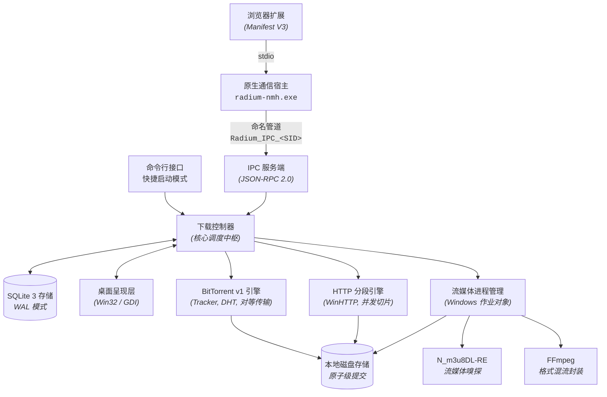

<p align="center">
  
</p>

<p align="center">
  <picture>
    
  </picture>
</p>

<h1 align="center">Radium Download Manager</h1>

<p align="center">
  <a href="README.md">English</a> · <a href="README.ja.md">日本語</a> · <b>简体中文</b> · <a href="README.zh-TW.md">繁體中文</a> · <a href="README.ko.md">한국어</a> · <a href="README.es.md">Español</a> · <a href="README.fr.md">Français</a> · <a href="README.pt-BR.md">Português</a> · <a href="README.de-DE.md">Deutsch</a> · <a href="README.ru-RU.md">Русский</a> · <a href="README.it-IT.md">Italiano</a> · <a href="README.ar-SA.md">العربية</a>
</p>

<p align="center">
  <b>快速、简洁的 Windows 11 下载管理器，内置强大的网页视频抓取功能。</b><br>
  加速多连接文件下载，一键捕获主流浏览器中的在线视频（HLS、DASH 和 Web 媒体流）。<br>
  原生 C++20 &amp; Win32 构建，无任何 Electron 臃肿组件，占用极低内存，后台零干扰。
</p>

<p align="center">
  <a href="https://github.com/sayedalve/Radium-Download-Manager/releases/latest"></a>
  <a href="https://github.com/sayedalve/Radium-Download-Manager/releases/latest"></a>
  
  
  
  
  <a href="https://github.com/sayedalve/Radium-Download-Manager/actions/workflows/windows-release.yml"></a>
</p>

<p align="center">
  <a href="#快速概览"><b>概览</b></a> ·
  <a href="#下载与安装"><b>下载</b></a> ·
  <a href="#核心特性"><b>特性</b></a> ·
  <a href="#浅色与深色主题"><b>主题</b></a> ·
  <a href="#多语言界面"><b>多语言</b></a> ·
  <a href="#界面预览"><b>截图</b></a> ·
  <a href="#性能基准测试"><b>基准测试</b></a> ·
  <a href="#高性能分段下载引擎"><b>下载引擎</b></a> ·
  <a href="#bittorrent-下载"><b>BitTorrent</b></a> ·
  <a href="#自适应流媒体处理管道"><b>流媒体管道</b></a> ·
  <a href="#浏览器集成"><b>浏览器集成</b></a> ·
  <a href="#底层架构"><b>架构</b></a> ·
  <a href="#测试与验证"><b>测试</b></a> ·
  <a href="#开源许可与致谢"><b>开源许可</b></a>
</p>

<br>

<p align="center">
  
  <br>
  <sub>Radium 主窗口界面：深炭黑模式、实时多连接分段进度条、传输速度与大小监控，以及分类导航。</sub>
</p>

<br>

## 快速概览

Radium 是一款专为 Windows 11 打造的高性能、轻量化下载管理器，旨在彻底替代臃肿且充斥广告的传统工具。它将极速多连接文件下载与一键式浏览器音视频嗅探及封装完美融为一体。

<table>
  <tr>
    <td width="25%" valign="top">
      <h3>⚡ 原生极致速度</h3>
      完全摒弃 Electron 框架。采用纯 ISO C++20 与原生 Win32 / Direct2D 构建，毫秒级冷启动，在多任务千兆传输下峰值内存常年维持在 18–22 MB。
    </td>
    <td width="25%" valign="top">
      <h3>🔀 自适应调度引擎</h3>
      支持 1 至 32 连接动态扩缩，具备自适应工作窃取（Work-stealing）与迟滞分割算法。在 500 MB 真实互联网对比测试中，消除连接碎片，完成时间比 IDM 快 16.5% 至 19.2%。
    </td>
    <td width="25%" valign="top">
      <h3>🌐 浏览器无缝捕获</h3>
      面向 Chrome、Brave、Edge 及 Firefox 的 Manifest V3 扩展。通过 ACL 保护的 Windows 命名管道与本地主机通信，不开放任何未经授权的本地 HTTP 端口。
    </td>
    <td width="25%" valign="top">
      <h3>🧲 BitTorrent 与流媒体</h3>
      内置 BitTorrent v1 引擎，支持磁力元数据交换（BEP 9）、Tracker 公告、分片校验与按需选文件。流媒体任务在独立的 Windows Job Object 隔离沙箱中由 N_m3u8DL-RE 与 FFmpeg 进程高效完成。
    </td>
  </tr>
</table>

<br>

## 下载与安装

最新公开发行版本为 **[v1.0.0](https://github.com/sayedalve/Radium-Download-Manager/releases/tag/v1.0.0)**。为 Windows 64 位平台提供以下安装包：

| 软件包 | 架构 | 格式 | 说明 |
| :--- | :---: | :---: | :--- |
| **Radium 标准安装包** | x64 | [Setup (.exe)](https://github.com/sayedalve/Radium-Download-Manager/releases/download/v1.0.0/Radium-Setup-x64-1.0.0.exe) | 推荐适用于 Windows 11 / 10 x64 的完整安装程序 |
| **Radium 便携完整版** | x64 | [ZIP 归档](https://github.com/sayedalve/Radium-Download-Manager/releases/download/v1.0.0/Radium-v1.0.0-Windows-x64-Full.zip) | 免安装便携包，内置 N_m3u8DL-RE 与 FFmpeg 工具 |
| **Radium 便携核心版** | x64 | [ZIP 归档](https://github.com/sayedalve/Radium-Download-Manager/releases/download/v1.0.0/Radium-v1.0.0-Windows-x64-Core.zip) | 核心轻量包（流媒体工具需单独配置） |
| **Radium 核心安装包** | x64 | [Setup (.exe)](https://github.com/sayedalve/Radium-Download-Manager/releases/download/v1.0.0/Radium-Setup-x64-Core-1.0.0.exe) | 不含流媒体外部依赖的小体积安装包 |
| **Radium ARM64 安装包** | ARM64 | [Setup (.exe)](https://github.com/sayedalve/Radium-Download-Manager/releases/download/v1.0.0/Radium-Setup-ARM64-1.0.0.exe) | 专为 ARM 架构 Windows 11 设备原生编译 |
| **Radium ARM64 便携版** | ARM64 | [ZIP 归档](https://github.com/sayedalve/Radium-Download-Manager/releases/download/v1.0.0/Radium-v1.0.0-Windows-ARM64-Full.zip) | 包含 ARM64 流媒体工具的完整便携包 |
| **浏览器扩展源码** | 跨浏览器 | [extension 目录](extension/) | 适用于 Chrome、Edge、Firefox 等浏览器的 MV3 扩展 |

发布构件的 SHA256 校验和见 [SHA256SUMS.txt](https://github.com/sayedalve/Radium-Download-Manager/releases/download/v1.0.0/SHA256SUMS.txt)。

> [!IMPORTANT]
> ### 🧩 浏览器扩展安装指南（需手动加载）
> **浏览器扩展并未打包进安装程序内部。** 您需要从本仓库下载扩展文件并在浏览器中手动加载：
>
> 1. **获取扩展目录：**
>    - 从本仓库下载或克隆 [`extension/`](extension/) 目录（可通过页面右上角 **Code → Download ZIP** 下载后解压）。
> 2. **安装并运行 Radium：**
>    - 运行安装程序或启动一次 Radium，完成 Native Messaging Host 的 Windows 注册表写入。
> 3. **在 Chromium 内核浏览器中加载（Chrome、Edge、Brave 等）：**
>    - 访问扩展管理页面（如 `chrome://extensions` 或 `edge://extensions`）。
>    - 打开右上角的 **开发者模式** 开关。
>    - 点击左上角的 **加载已解压的扩展程序**。
>    - 选择刚才准备好的 **`extension`** 文件夹。
> 4. **在 Firefox 中加载：**
>    - 访问 `about:debugging#/runtime/this-firefox`。
>    - 点击 **临时加载附加组件...**。
>    - 选中 `extension` 目录下的 `manifest.firefox.json` 文件。
> 5. **若使用便携版：** 在加载扩展前，请在便携包内运行一次 `scripts\register-native-messaging.ps1` 完成注册。

<br>

## 核心特性

<table>
  <tr>
    <td width="50%" valign="top">
      
      <br>
      <sub>智能新建任务提示：支持预检探测、目标目录自动规划与磁盘空间保护。</sub>
      <h3>智能请求嗅探与网络预检</h3>
      无论是从扩展拦截、剪贴板监控触发还是手动输入，Radium 在分配带宽前都会先校验目标资源。
      <br><br>
      <b>能力清单：</b>
      <ul>
        <li>标头预检（<code>HEAD</code>/<code>Range</code>）及 RFC 5987 / 6266 文件名精准解码</li>
        <li>磁盘分区剩余空间实时计算与安全文件预分配机制</li>
        <li>流媒体画质动态挑选（最佳、仅视频、仅音频）</li>
        <li>目录遍历路径清洗（防御 <code>..</code> 与 NTFS 附加数据流 <code>:</code>）</li>
      </ul>
    </td>
    <td width="50%" valign="top">
      
      <br>
      <sub>原生 Torrent 对话框：展示完整文件树结构、元数据信息与分片校验。</sub>
      <h3>原生 BitTorrent v1 引擎</h3>
      支持直接解析 <code>.torrent</code> 文件与磁力链接。智能拉取元数据，展示完整目录树，并允许自由挑选文件。
      <br><br>
      <b>能力清单：</b>
      <ul>
        <li>磁力链接 BEP 9 扩展元数据秒级检索</li>
        <li>HTTP/UDP 双协议 Tracker 汇报与分布式哈希表（DHT）节点发现</li>
        <li>交互式文件目录树，按需选择下载项并统计大小</li>
        <li>严格的 SHA-1 分片完整性校验与防崩溃恢复记录</li>
      </ul>
    </td>
  </tr>
  <tr>
    <td colspan="2" valign="top">
      
      <br>
      <sub>全局设置中心：涵盖并发连接数、文件分类目录规则、代理路由以及浏览器集成状态。</sub>
      <h3>深度自定义与原生系统融合</h3>
      细致调整各项传输参数：自定义连接数上限（1–32）、全局带宽限制、按文件类型设置默认存储路径、代理规则（直连、系统、手动）与浏览器规则。
    </td>
  </tr>
</table>

### 底层系统强化

- **任务计划管理：** 灵活的开始/暂停计划时段、错误指数退避重试、重启时离线时间补偿，以及下载完成动作（`睡眠`/`关机`）。
- **双令牌桶限速：** 采用无锁双令牌桶算法，在 HTTP、FTP 和 BitTorrent 之间精确调配总带宽，绝无线程饥饿。
- **整站抓取工具：** 具备可控递归深度（1–5）的广度优先爬虫，支持 HTML/CSS 资源提取与重定向修正，严格防御内部私网 SSRF 攻击。
- **杀毒集成扫描：** 下载完成后自动调用 Windows Defender（`MpCmdRun.exe`）进行静态与动态威胁检测，支持严苛模式（`av_strict_mode`）。
- **智能文件归类：** 确定性规则优先级（站点规则 > 自定义后缀 > 标准文件名 > MIME 类型 > 通用类别），自动整理下载文件。

<br>

## 浅色与深色主题

Radium 深度贴合 Windows 11 设计语言，提供一流的浅色（Light）与深色（Dark）外观支持。无论白天处于光线充足的环境，还是深夜在暗光下作业，从表格、进度指示条到弹窗控件均能优雅呈现。

<table>
  <tr>
    <td width="50%" valign="top">
      <h3>☀️ 浅色模式 (Light Mode)</h3>
      <ul>
        <li><b>视觉质感：</b> 明亮通透的纯白背景（<code>#FFFFFF</code>），配合柔和的灰白卡片层级（<code>#F5F7F9</code>）与精致微边框（<code>#E1E8ED</code>）。</li>
        <li><b>主色调强调：</b> 优雅的天空蓝（<code>#168BCB</code>），应用于选中项目、焦点框以及活动下载进度条。</li>
        <li><b>排版印刷：</b> 采用深炭黑字体（<code>#202124</code>）与低饱和副标题（<code>#656B73</code>），完全满足 WCAG AAA 级高对比度可读性要求。</li>
        <li><b>系统原生质感：</b> 完美适配 Windows 原生 <code>Explorer</code> 控件样式及现代亚克力微透光泽。</li>
      </ul>
    </td>
    <td width="50%" valign="top">
      <h3>🌙 深色模式 (Dark Mode)</h3>
      <ul>
        <li><b>视觉质感：</b> 深空沉浸式板岩黑背景（<code>#0F172A</code> / <code>#161618</code>），搭配深海蓝高层级面板（<code>#1E293B</code> / <code>#28282E</code>）。</li>
        <li><b>主色调强调：</b> 延续 Radium 标志性的珊瑚红（<code>#FF4757</code>）及媒体流的梦幻紫（<code>#8B5CF6</code>）徽章。</li>
        <li><b>排版印刷：</b> 柔和纯白字体（<code>#F8FAFC</code>）与石板灰次级文本（<code>#94A3B8</code>），夜间阅读柔和不刺眼。</li>
        <li><b>系统原生质感：</b> 原生 <code>DarkMode_Explorer</code> 深色窗口修饰，边缘带有考究的阴影与微光。</li>
      </ul>
    </td>
  </tr>
</table>

### 动态主题切换与系统自动同步
- **跟随系统 (`system`)：** 自动监测 Windows 系统的“选择默认应用模式”（注册表项 `AppsUseLightTheme`）。系统切换浅色/深色时，Radium 立即跟随响应，无需重启。
- **固定模式 (`light` 或 `dark`)：** 无论操作系统如何配置，强制锁定为指定的浅色或深色主题。
- **主工具栏一键切换：** 主界面工具栏提供了专属的**主题切换按钮**，单次点击即可即时在浅色与深色之间往复切换，并伴随流畅的按压交互反馈。
- **永久保存：** 所选的主题配置会立即持久化写入本地配置，下次启动自动恢复。

<br>

## 多语言界面

Radium 为全球化而设计。国际化框架深度集成于 Win32 原生桌面端核心，采用标准化语言文件，离线运作，零网络请求。

> [!NOTE]
> **README 翻译与桌面端界面语言说明：**
> 为保证 GitHub 仓库精简高效，项目主页提供 **12 种核心语言** 的 README 完整翻译（可通过顶部选择器切换）。而 **Radium 桌面客户端实际内置了多达 24 种国家和地区的语言包及原生书写系统**！

### 核心多语言特性
- **设置中心便捷切换：** 可在**设置中心**（`常规` 页面）或侧边栏语言菜单随时选择界面语言。
- **母语原生展示：** 所有的语言选项均采用该语言自身的书写方式展示（如 *简体中文*、*English*、*日本語*、*한국어*、*العربية*、*Русский* 等），直观易懂。
- **即时生效与记忆保存：** 切换语言无需重启主进程，所有界面组件动态刷新，并自动保存偏好。
- **首发系统区域匹配：** 首次启动时自动调用 Windows `GetUserDefaultLocaleName`，自动优先呈现匹配的本地语言。
- **纯本地化离线支持：** 文本字典直接从本地 JSON 目录（`translations/desktop.json`）加载，对于未定义字段平滑回退至英文。
- **全字符集与排版方向感知：** 核心构建在 Unicode 体系上，在阿拉伯语（`ar-SA`）与波斯语（`fa-IR`）下自动开启从右到左（RTL）镜像排版适配。

### 客户端语言包支持状态表

下表记录了 Radium 桌面客户端代码（`src/ui/localization.cpp` 及 `translations/desktop.json`）中的语言支持现状：

| 语言名称 | 本地原生名称 | 语言代码 | 界面状态 | 对应 README |
| :--- | :--- | :---: | :---: | :---: |
| **英语 (English)** | English | `en` | **已支持 (基准语言)** | [README.md](README.md) |
| **日语** | 日本語 | `ja` | **已支持** | [README.ja.md](README.ja.md) |
| **简体中文** | 简体中文 | `zh-CN` | **已支持** | [README.zh-CN.md](README.zh-CN.md) |
| **繁体中文** | 繁體中文 | `zh-TW` | **已支持** | [README.zh-TW.md](README.zh-TW.md) |
| **韩语** | 한국어 | `ko` | **已支持** | [README.ko.md](README.ko.md) |
| **西班牙语** | Español | `es` | **已支持** | [README.es.md](README.es.md) |
| **法语** | Français | `fr` | **已支持** | [README.fr.md](README.fr.md) |
| **巴西葡萄牙语** | Português (Brasil) | `pt-BR` | **已支持** | [README.pt-BR.md](README.pt-BR.md) |
| **德语** | Deutsch | `de-DE` | **已支持** | [README.de-DE.md](README.de-DE.md) |
| **俄语** | Русский | `ru-RU` | **已支持** | [README.ru-RU.md](README.ru-RU.md) |
| **意大利语** | Italiano | `it-IT` | **已支持** | [README.it-IT.md](README.it-IT.md) |
| **阿拉伯语** | العربية | `ar-SA` | **已支持 (RTL)** | [README.ar-SA.md](README.ar-SA.md) |
| **越南语** | Tiếng Việt | `vi` | **已支持** | 计划中 |
| **荷兰语** | Nederlands | `nl-NL` | **已支持** | 计划中 |
| **波兰语** | Polski | `pl-PL` | **已支持** | 计划中 |
| **土耳其语** | Türkçe | `tr-TR` | **已支持** | 计划中 |
| **印尼语** | Bahasa Indonesia | `id-ID` | **已支持** | 计划中 |
| **波斯语** | فارسی | `fa-IR` | **已支持 (RTL)** | 计划中 |
| **乌克兰语** | Українська | `uk-UA` | **已支持** | 计划中 |
| **捷克语** | Čeština | `cs-CZ` | **已支持** | 计划中 |
| **罗马尼亚语** | Română | `ro-RO` | **已支持** | 计划中 |
| **泰语** | ไทย | `th-TH` | **已支持** | 计划中 |
| **瑞典语** | Svenska | `sv-SE` | **已支持** | 计划中 |
| **希腊语** | Ελληνικά | `el-GR` | **已支持** | 计划中 |

<br>

## 界面预览

<p align="center">
  
  <br>
  <sub><b>主程序界面：</b> 密集型任务监控面板、多连接分段图形化渲染、实时带宽速率曲线与分类导航栏。</sub>
</p>

<table>
  <tr>
    <td width="50%" valign="top">
      
      <br>
      <sub><b>预检探测窗口：</b> 服务器分段支持验证、实时剩余存储测算与智能归类。</sub>
    </td>
    <td width="50%" valign="top">
      
      <br>
      <sub><b>种子管理对话框：</b> 树状目录结构展开、文件过滤挑选与哈希校验。</sub>
    </td>
  </tr>
  <tr>
    <td colspan="2" valign="top">
      
      <br>
      <sub><b>设置中心：</b> 原生文字多语言挑选、浅色/深色主题设定、连接数调控与代理网络路由。</sub>
    </td>
  </tr>
</table>

<br>

## 性能基准测试

Radium 持续与行业老牌工具 **Internet Download Manager (IDM 6.43.15)** 及主流 CLI 在公网和受控回环环境下展开逐字节的严苛实测。

### 实测对抗: Radium (v0.3.5 研发构件) vs Internet Download Manager (500 MB 真实公网)

测试选取真实的公网新加坡高速节点（`https://sg-lg.regxa.com/500MB.test`），传输字节量为精确的 **500,000,000 字节**。为了抵消公网线路波动，测试按相反顺序执行两轮：

> [!NOTE]
> **测试版本说明：** 参与实测的 Radium 为先行搭载自适应分段算法的构建版本，该特性现已作为 **v1.0.0** 正式版的出厂标配。基准对照版本为 **v0.3.2**。

两个软件均顺利完成下载，并通过严格的 SHA-256 哈希值验证（`b16f001a0731c8636f163586c16276b3714b8977242b67ae05fa60b96f685ebc`）。

| 测试轮次 | 执行顺序 | Radium 耗时 | IDM 耗时 | 耗时缩减幅度 | 吞吐量 (Radium / IDM) | 峰值内存 (Radium / IDM) | 内存节省率 |
| :---: | :---: | :---: | :---: | :---: | :---: | :---: | :---: |
| **第 1 轮** | IDM 先跑，随后 Radium | **184.75 秒** | 221.21 秒 | **节省 16.48% 时间** (-36.46 秒) | **2.71 MB/s** / 2.26 MB/s (+19.91%) | **20.5 MB** / 53.8 MB | **61.90%** |
| **第 2 轮** | Radium 先跑，随后 IDM | **140.09 秒** | 173.46 秒 | **节省 19.24% 时间** (-33.37 秒) | **3.57 MB/s** / 2.88 MB/s (+23.96%) | **20.4 MB** / 122.2 MB | **83.31%** |
| **平均** | 两轮综合均值 | **162.42 秒** | 197.34 秒 | **平均缩减 17.69% 耗时** (-34.92 秒) | **3.14 MB/s** / 2.57 MB/s (+22.18%) | **20.4 MB** / 88.0 MB | **76.76%** |

#### 提升传输能效的技术关键点:
1. **自适应动态切片策略：** 动态计算切片阈值 `clamp(4 × transfer_speed_bps × 0.25 s, 1 MiB, 16 MiB)`。在爬坡期以 256 KiB、连接满载后以 1 MiB 为分割保底，消除连接争抢与废弃流量，实测两轮测试中废弃数据分别骤降 **57.3%** 与 **42.4%**。
2. **连接瞬间并发：** 建立阶段直接将可用线程派发至均匀分段，保持 8 条工作线程全生命周期高速饱和。
3. **低开销直接异步 I/O：** 借助稀疏文件预分配与异步 WinHTTP 流式直写，规避了下载完毕后的二次组装合并过程，因此 Radium 仅需 20 MB 内存，而 IDM 在合并期内存飙升至 122 MB。

<br>

## 高性能分段下载引擎

Radium 的核心是一款并发分段 HTTP/HTTPS 传输引擎，吸纳了开源先驱 [Brisk](https://github.com/BrisklyDev/brisk) 的架构思想，并加入了独特的迟滞防震荡切片机制。

```
                      ┌────────────────────────────────────────┐
                      │       目标下载文件 (例如: 500 MB)      │
                      └────────────────────────────────────────┘
                       /             |            |                    Worker 0 (0-125MB)   Worker 1 (125-250MB)  Worker 2     Worker 3
        [████████████████]   [████████░░░░░░░░]   [████░░░░]   [██░░░░░░]
                                      │
                      Worker 0 率先完成自身任务！
                      从 Worker 1 剩余数据中窃取 50%:
                      Worker 0: [187.5 - 250 MB] ──► 立即发起新的物理连接
```

1. **预检嗅探:** 发送轻量 Range 探测请求确认断点续传支持、内容体积并提取标头建议的文件名。
2. **多路连接并行:** 若远端服务响应 206 状态，引擎迅速派发分段工作者直至达到设定的连接限制（默认 8，最高 32）。
3. **自适应工作窃取:** 率先空闲的连接自动从当前剩余体积最大的工作块中窃取后半部分，平稳收敛。
4. **服务异常平稳回退:** 若服务端拒绝后续分段（返回 200 或 416），已窃取区间自动物归原主，确保数据分毫不差。
5. **原子化提交:** 传输期间持续直写独立的 `*.radium.part` 文件，全部校验无误后毫秒级原子重命名为目标路径。

<br>

## BitTorrent 下载

内置完整的 BitTorrent v1 协议栈，兼容主流种子与磁链：

- **磁链元数据抓取：** 实现 BEP 9 协议扩展，磁力链接秒速解析为文件清单。
- **Tracker 与 DHT 发现：** 完整兼容 HTTP/UDP Tracker 通告与去中心化 DHT 节点寻址。
- **分片安全检验：** 支持 Endgame 模式加速终局分片，落盘时经过强校验 SHA-1 哈希比对。
- **文件自由勾选：** 直观查看种子内的目录层级，可精准勾选指定文件并预览预估尺寸。
- **掉电恢复：** 任务进度和分片状态由 SQLite 实时持久化，系统异常关机后开机即刻续传。

<br>

## 自适应流媒体处理管道

针对采用 HLS 或 DASH 封装的现代网页媒体流，Radium 调度外部独立工具 [N_m3u8DL-RE](https://github.com/nilaoda/N_m3u8DL-RE) 与 [FFmpeg](https://ffmpeg.org/)：

- **Windows 作业对象沙箱：** 外部工具均运行在 Windows Job Object（设置了 `JOB_OBJECT_LIMIT_KILL_ON_JOB_CLOSE`）环境，主程序关闭时子进程即刻收敛，绝无孤儿进程驻留。
- **凭据零命令行暴露：** Cookie、认证令牌等敏感信息绝不通过命令行明文传递，而是写入带 ACL 权限的临时应答文件（`@job.rsp`），并在任务结束后立即安全覆写删除。
- **流解析与无损封装：** 探测并筛选画质、音轨与外挂字幕，切片下载完成后由 FFmpeg 混流重封装为标准的 MP4 / MKV 容器。

*注意：Radium 遵守版权合规政策，不破坏亦不支持任何 DRM 加密流的解密。*

<br>

## 浏览器集成

配套轻巧纯净的 Manifest V3 扩展，完美兼容 Google Chrome、Brave、Microsoft Edge 及 Mozilla Firefox。

```
┌─────────────────────────────────┐
│ 网页浏览器 (Chromium / Firefox) │
│  ├── webRequest 媒体智能嗅探    │
│  └── 网页悬浮快捷下载条         │
└───────────────┬─────────────────┘
                │ 本地消息传递 stdio (32-bit 长度前缀 JSON)
┌───────────────▼─────────────────┐
│ radium-nmh.exe (原生桥接主机)   │
└───────────────┬─────────────────┘
                │ Windows 命名管道: \.\pipe\Radium_IPC_<UserSID>
┌───────────────▼─────────────────┐
│ radium.exe (核心引擎进程)       │
│  ├── 原生 Win32 / GDI 界面      │
│  ├── 内置并发分段下载引擎       │
│  └── SQLite 3 状态持久化 (WAL)  │
└─────────────────────────────────┘
```

- **双重来源安全鉴权：** 原生配置清单同时信任应用商店 ID 与开发者本地密钥，便携调试永不断联。
- **杜绝开放本地端口：** 彻底摒弃传统下载器监听本地无保护 HTTP 端口的安全隐患，全程走系统 ACL 隔离的命名管道。
- **智能聚合去重：** 智能识别媒体主索引播放列表，有效过滤无休止的 `.ts` 或 `.m4s` 切片请求。
- **安全降级保证：** 借助 Chromium 的 `onDeterminingFilename` 机制，若 Radium 离线或用户取消，浏览器无缝接管原有下载，绝无丢失风险。

<br>

## 底层架构



### 设计理念
- **极致的原生效率：** 采用 MSVC 19.38+ 严格编译（`/std:c++20`, `/permissive-`, `/W4`, `/WX`）。Win32 边界均采用 `std::wstring`，内部逻辑全局统一为 UTF-8。
- **进程级安全隔离：** 繁重不稳定的网络流解析及音视频解码运行于隔离进程中，即便意外崩溃也绝不会牵连主程序或破坏其他下载。
- **状态零臆测恢复：** 下载进度、分片断点与哈希状态均由 SQLite 3（WAL 模式）精细维护，突发断电后随时原地复原。
- **单例进程防冲突：** 重复启动 `radium.exe` 时自动聚焦并唤醒现有窗口，避免多实例资源争夺。

<br>

## 从源码构建

如需自行编译 Radium，请准备 **Windows 11** 环境、**Visual Studio 2022**（包含 C++ 桌面开发工作负载）以及 **CMake 3.25 或更高版本**：

```powershell
git clone https://github.com/sayedalve/Radium-Download-Manager.git
cd Radium-Download-Manager
cmake -B build/win-x64 -A x64
cmake --build build/win-x64 --config Release
```

编译产物将生成在 `build/win-x64/Release/` 目录下。更多细节请参考 [`docs/DEVELOPMENT_SETUP.md`](docs/DEVELOPMENT_SETUP.md)。

<br>

## 测试与验证

项目包含严密的自动化单元测试与集成测试套件，全面覆盖分段调度、工作窃取、BitTorrent 解析与状态读写：

```powershell
.\build\win-x64\Release\radium_unit_tests.exe
```

- [功能矩阵](docs/FEATURE_MATRIX.md)
- [测试矩阵](docs/TEST_MATRIX.md)
- [Windows 发布工作流](https://github.com/sayedalve/Radium-Download-Manager/actions/workflows/windows-release.yml)

<br>

## HTTP 服务端兼容性

Radium 仅在服务端正确响应 `206 Partial Content` 时启用多连接分段下载。对于不支持分段的服务器，自动降级为安全单连接；如遇异常响应则及时拦截报错，保护文件完整性。

## 参与贡献

欢迎提交 Issue 报告缺陷或提出宝贵的 Pull Request。提交代码前请仔细阅读 [CONTRIBUTING.md](CONTRIBUTING.md) 与 [AGENTS.md](AGENTS.md)。

<br>

## 开源许可与致谢

Radium Download Manager 遵循 **Apache License, Version 2.0** ([Apache-2.0](LICENSE)) 开源。

### 第三方开源组件
本项目集成或调用了以下优秀的第三方开源库：

| 组件名称 | 项目源链接 | 开源协议 | 在 Radium 中的职责 |
|---|---|---|---|
| **流媒体抽取** | [N_m3u8DL-RE](https://github.com/nilaoda/N_m3u8DL-RE) | MIT | 外部进程执行 HLS/DASH 媒体流切片下载 |
| **容器格式混流** | [FFmpeg](https://ffmpeg.org/) | LGPL-2.1+ / LGPL-3.0 | 音视频切片提取、无损重封装与格式校验 |
| **RAII 资源包装** | [Microsoft WIL](https://github.com/microsoft/wil) | MIT | 提供异常安全的 Windows 原生资源句柄托管 |
| **持久化数据库** | [SQLite](https://www.sqlite.org/) | Public Domain | 具备 WAL 日志的高可靠嵌入式状态存储 |
| **JSON 序列化** | [nlohmann/json](https://github.com/nlohmann/json) | MIT | IPC 通信协议与任务配置的解析与序列化 |

详见 [`THIRD_PARTY_NOTICES.md`](THIRD_PARTY_NOTICES.md) 与 [`NOTICE`](NOTICE)。

<br>

<p align="center">
  <sub>Radium Download Manager · 专为 Windows 打造的原生高性能开源下载利器</sub><br>
  <sub>基于 C++20 与 Win32 构建 · 采用 Apache-2.0 协议开源</sub>
</p>
