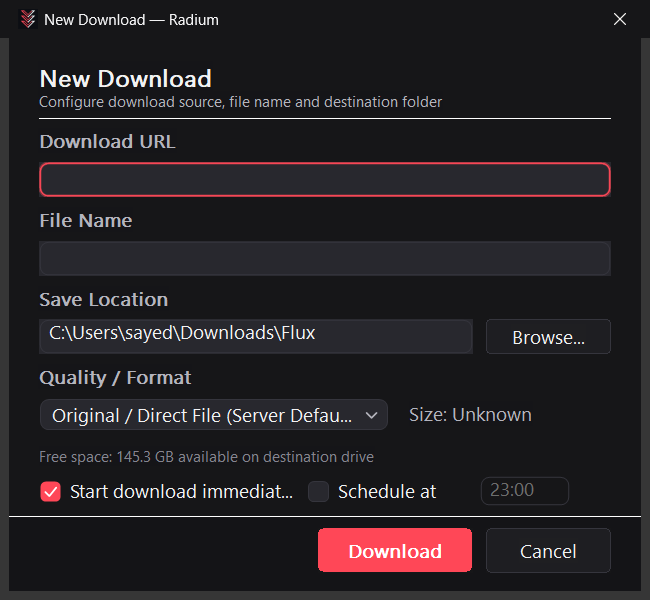
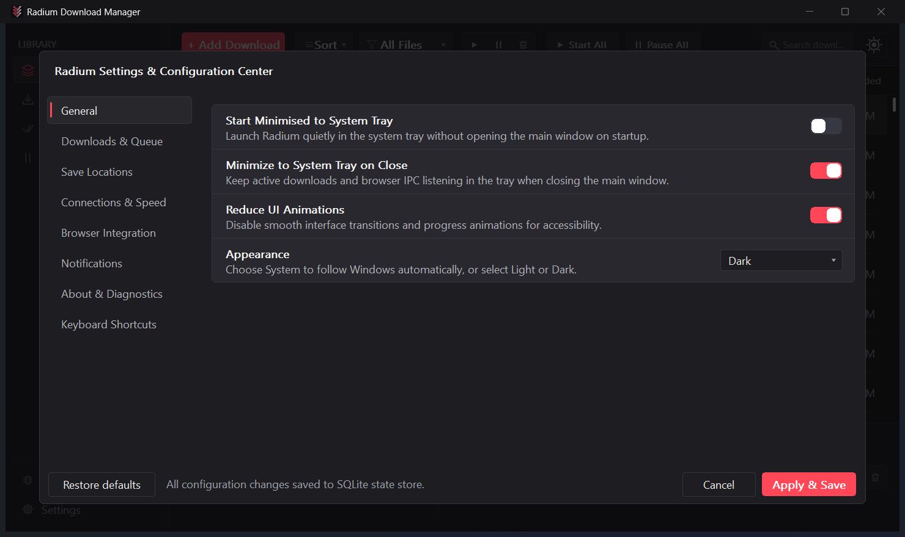
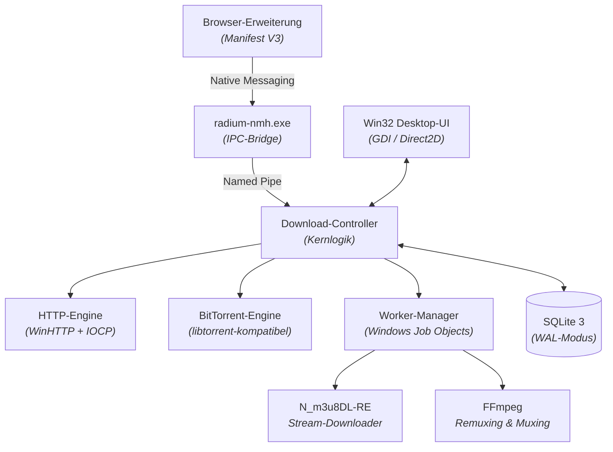

<p align="center">
  
</p>

<p align="center">
  <picture>
    
  </picture>
</p>

<h1 align="center">Radium Download Manager</h1>

<p align="center">
  <a href="../../README.md">English</a> · <a href="README.ja.md">日本語</a> · <a href="README.zh-CN.md">简体中文</a> · <a href="README.zh-TW.md">繁體中文</a> · <a href="README.ko.md">한국어</a> · <a href="README.es.md">Español</a> · <a href="README.fr.md">Français</a> · <a href="README.pt-BR.md">Português</a> · <b>Deutsch</b> · <a href="README.ru-RU.md">Русский</a> · <a href="README.it-IT.md">Italiano</a> · <a href="README.ar-SA.md">العربية</a>
</p>

<p align="center">
  <b>Schneller, schlanker Windows 10 / 11 Download-Manager mit integrierter Video- und Medienerfassung.</b><br>
  Beschleunigen Sie Dateidownloads über dynamische Mehrfachverbindungen und laden Sie Videos von YouTube, Bilibili und vielen weiteren Websites herunter (HLS, DASH und Web-Streams).<br>
  Native C++20- und Win32-Architektur ohne Electron-Overhead – minimaler Arbeitsspeicherverbrauch, ressourcenschonend und ohne störende Hintergrundprozesse.
</p>

<p align="center">
  <a href="https://github.com/alve33/Radium-Download-Manager/releases/latest"></a>
  <a href="https://github.com/alve33/Radium-Download-Manager/releases/latest"></a>
  
  
  
  
  <a href="https://github.com/alve33/Radium-Download-Manager/actions/workflows/windows-release.yml"></a>
</p>

<p align="center">
  <a href="#downloads--installation"><b>Downloads</b></a> ·
  <a href="#hauptmerkmale"><b>Merkmale</b></a> ·
  <a href="#helles-und-dunkles-design"><b>Designs</b></a> ·
  <a href="#mehrsprachige-benutzeroberfläche"><b>Sprachen</b></a> ·
  <a href="#leistungs-benchmarks"><b>Benchmarks</b></a> ·
  <a href="#leistungsstarke-download-engine"><b>Download-Engine</b></a> ·
  <a href="#bittorrent-downloads"><b>BitTorrent</b></a> ·
  <a href="#browser-integration"><b>Browser-Integration</b></a> ·
  <a href="#technische-architektur"><b>Architektur</b></a> ·
  <a href="#quellcode-kompilieren"><b>Kompilierung</b></a>
</p>

<br>

<p align="center">
  
</p>

## Überblick

Radium ist ein nativer, quelloffener Hochleistungs-Download-Manager für Windows 10 / 11, der als schlanker, werbefreier Ersatz für überladene Altwerkzeuge konzipiert wurde. Er kombiniert segmentierte HTTP/HTTPS-Dateidownloads mit automatischer Browser-Erfassung für Videos und Audio-Streams.

<table>
  <tr>
    <td width="33%" valign="top">
      <h3>⚡ Maximale Bandbreitenausnutzung</h3>
      Segmentierte HTTP/HTTPS-Engine mit asynchronem I/O (WinHTTP + IOCP), dynamischer Verbindungsaufteilung und adaptiver Wiederverwendung ungenutzter Byte-Bereiche.
    </td>
    <td width="33%" valign="top">
      <h3>🌐 Nahtlose Browser-Erfassung</h3>
      Schlanke Manifest V3-Browser-Erweiterung für Chromium und Firefox. Erkennt HLS-Playlists (.m3u8), DASH-Manifeste (.mpd) sowie direkte Mediendateien und bietet Download-Buttons direkt auf Videoplayern.
    </td>
    <td width="33%" valign="top">
      <h3>🧲 BitTorrent & Stream-Pipeline</h3>
      Integrierte BitTorrent v1-Engine mit BEP 9-Magnet-Link-Unterstützung, Tracker-Ankündigungen und selektiver Dateiauswahl. Stream-Verarbeitung in isolierten Windows Job Objects über N_m3u8DL-RE und FFmpeg.
    </td>
  </tr>
</table>

## Downloads & Installation

Die neueste veröffentlichte Version ist **[v1.0.0](https://github.com/alve33/Radium-Download-Manager/releases/tag/v1.0.0)**. Folgende Pakete sind für Windows verfügbar:

| Paket | Architektur | Format | Beschreibung |
| :--- | :---: | :---: | :--- |
| **Radium Installer (Standard)** | x64 | [Setup (.exe)](https://github.com/alve33/Radium-Download-Manager/releases/download/v1.0.0/Radium-Setup-x64-1.0.0.exe) | Empfohlener Installer für die meisten Nutzer (Windows 11 / 10 x64) |
| **Radium Portable (Vollversion)** | x64 | [ZIP-Archiv](https://github.com/alve33/Radium-Download-Manager/releases/download/v1.0.0/Radium-v1.0.0-Windows-x64-Full.zip) | Portables Paket mit gebündeltem N_m3u8DL-RE und FFmpeg |
| **Radium Portable (Kern)** | x64 | [ZIP-Archiv](https://github.com/alve33/Radium-Download-Manager/releases/download/v1.0.0/Radium-v1.0.0-Windows-x64-Core.zip) | Basispaket (Stream-Tools müssen separat bereitstehen) |
| **Radium Core Installer** | x64 | [Setup (.exe)](https://github.com/alve33/Radium-Download-Manager/releases/download/v1.0.0/Radium-Setup-x64-Core-1.0.0.exe) | Leichtgewichtiger Installer ohne gebündelte Stream-Tools |
| **Radium Installer (ARM64)** | ARM64 | [Setup (.exe)](https://github.com/alve33/Radium-Download-Manager/releases/download/v1.0.0/Radium-Setup-ARM64-1.0.0.exe) | Nativer Installer für Windows 10 / 11 auf ARM |
| **Radium Portable Vollversion (ARM64)** | ARM64 | [ZIP-Archiv](https://github.com/alve33/Radium-Download-Manager/releases/download/v1.0.0/Radium-v1.0.0-Windows-ARM64-Full.zip) | Portables Komplettpaket mit ARM64-Stream-Tools |

SHA256-Prüfsummen für alle veröffentlichten Dateien finden Sie in [SHA256SUMS.txt](https://github.com/alve33/Radium-Download-Manager/releases/download/v1.0.0/SHA256SUMS.txt).

### Schnelleinrichtung der Browser-Erweiterung

> [!TIP]
> **Die Browser-Erweiterung ist aus Sicherheitsgründen modular getrennt.** Sie können das Verzeichnis [`extension/`](../../extension/) direkt im Entwicklermodus Ihres Browsers laden:
> 1. **Chromium (Chrome, Edge, Brave):** Öffnen Sie `chrome://extensions`, aktivieren Sie den **Entwicklermodus** und klicken Sie auf **Entpackte Erweiterung laden**. Wählen Sie das Verzeichnis `extension/` aus.
> 2. **Firefox:** Öffnen Sie `about:debugging#/runtime/this-firefox`, klicken Sie auf **Temporäres Add-on laden...** und wählen Sie die Datei `manifest.firefox.json` im Verzeichnis `extension/` aus.
> 3. **Native Messaging Host registrieren:** Führen Sie das Skript `scripts/register-native-messaging.ps1` aus, um den IPC-Host in der Windows-Registrierung für Ihre Browser anzumelden.

## Hauptmerkmale

<p align="center">
  
</p>

### HTTP & HTTPS Segmentierung
- **Dynamische Segment-Aufteilung:** Verbindungen teilen automatisch die verbleibenden Byte-Bereiche auf, wenn freie Worker-Kapazitäten verfügbar sind.
- **Ressourcenschonendes Asynchrones I/O:** Nutzt native Windows I/O Completion Ports (IOCP) und sparse vorreservierte Dateien ohne blockierende Festplattenzugriffe.
- **Atomare Fertigstellung:** Downloads werden mit der Endung `*.radium.part` geschrieben und erst nach kryptografischer Hash-Prüfung atomar in die Zieldatei umbenannt.
- **Intelligente Wiederaufnahme:** Unterstützt `Range`-Header und `ETag`-Validierung zur fehlerfreien Fortsetzung unterbrochener Downloads.

### BitTorrent-Funktionalität
- **BEP 9 Magnet-Erweiterung:** Schnelle Metadaten-Auflösung von Magnet-Links ohne vorherige Torrent-Datei.
- **Dateibaum-Auswahl:** Vorschau aller Dateien im Torrent mit individueller Auswahl und Priorisierung vor dem Start.
- **Robuste Persistenz:** Transaktionale Zustandsverwaltung in SQLite 3 (WAL-Modus) gewährleistet sofortige Fortsetzung nach Stromausfällen.

### Kernarchitektur & Systemhärtung
- **Job-Object-Isolation:** Externe Hilfsprozesse (FFmpeg, N_m3u8DL-RE) laufen in Windows Job Objects (`JOB_OBJECT_LIMIT_KILL_ON_JOB_CLOSE`), wodurch verwaiste Hintergrundprozesse ausgeschlossen sind.
- **Sichere IPC:** Kommunikation zwischen Browser-Erweiterung und Desktop erfolgt über ACL-geschützte Windows Named Pipes (`\.\pipe\Radium_IPC_<UserSID>`) anstelle unsicherer unauthentifizierter HTTP-Ports.
- **Schutz vor Command Injection:** Datei- und Befehlszeilenparameter werden vor der Ausführung strikt validiert und über temporäre Antwortdateien (`@job.rsp`) übergeben, um Anmeldedaten im Task-Manager zu verbergen.

## Helles und Dunkles Design

Radium bietet eine konsistente, flüssige Windows 10 / 11 Fluent-Benutzeroberfläche mit nativer Unterstützung für helle und dunkle Systemdesigns:

<div align="center">

| Helles Design (Light) | Dunkles Design (Dark) |
| :---: | :---: |
|  |  |

</div>

- **Automatische Systemerkennung:** Passt sich standardmäßig den Windows 10 / 11 App-Farbeinstellungen an (`AppsUseLightTheme`).
- **Manueller Wechsel:** Umschalten jederzeit über das Einstellungszentrum (`light`, `dark` oder `system`).
- **Flackerfreies Rendering:** Vollständig doppelt gepuffertes GDI/Direct2D-Zeichnen garantiert ruckelfreie Animationen und Fenstergrößenänderungen.

## Mehrsprachige Benutzeroberfläche

Radium enthält einen integrierten Sprachkatalog für 12 Weltsprachen, der zur Laufzeit ohne Neustart der Anwendung umgeschaltet werden kann:

- **Dynamischer Sprachwechsel:** Alle Menüs, Beschriftungen, Tooltips und Statusmeldungen aktualisieren sich sofort bei Sprachauswahl.
- **Automatische Erkennung:** Erkennt die Windows-Benutzergebietsschema-Einstellung (`GetUserDefaultUILanguage`) beim ersten Start.
- **Verifizierte Übersetzungen:** Alle Textressourcen werden im Projektverzeichnis `translations/desktop.json` versioniert und validiert.

## Screenshots

<div align="center">

| Hauptfenster & Download-Liste | Einstellungszentrum & Netzwerkkonfiguration |
| :---: | :---: |
|  |  |

</div>

## Leistungs-Benchmarks

Radium wird kontinuierlich im direkten Vergleich mit **Internet Download Manager (IDM 6.43.15)** und gängigen Open-Source-Tools auf identischen Netzwerkstrecken getestet.

### Kopf-an-Kopf: Radium (v0.3.5 Dev Build) vs. Internet Download Manager (500 MB Live-Internet)

Der Test evaluierte den Download einer **500.000.000 Byte** großen Testdatei (`https://sg-lg.regxa.com/500MB.test`) unter Windows 11. Die Reihenfolge wurde gewechselt, um Netzwerkschwankungen auszugleichen. Beide Downloads bestanden die kryptografische Prüfung (**SHA-256:** `b16f001a0731c8636f163586c16276b3714b8977242b67ae05fa60b96f685ebc`).

| Durchlauf | Reihenfolge | Radium Dauer | IDM Dauer | Zeitersparnis | Durchsatz (Radium / IDM) | Spitzen-RAM (Radium / IDM) | RAM-Einsparung |
| :---: | :---: | :---: | :---: | :---: | :---: | :---: | :---: |
| **Test 1** | IDM zuerst, dann Radium | **184,75 s** | 221,21 s | **16,48%** (-36,46 s) | **2,71 MB/s** / 2,26 MB/s (+19,91%) | **20,5 MB** / 53,8 MB | **61,90%** |
| **Test 2** | Radium zuerst, dann IDM | **140,09 s** | 173,46 s | **19,24%** (-33,37 s) | **3,57 MB/s** / 2,88 MB/s (+23,96%) | **20,4 MB** / 122,2 MB | **83,31%** |
| **Mittelwert** | Über beide Durchläufe | **162,42 s** | 197,34 s | **17,69%** (-34,92 s) | **3,14 MB/s** / 2,57 MB/s (+22,18%) | **20,4 MB** / 88,0 MB | **76,76%** |

```
500 MB Transfer-Dauervergleich (Niedriger ist besser ▼)
─────────────────────────────────────────────────────────────────────────────
Test 1 (IDM zuerst):
  IDM 6.43.15     ████████████████████████████████████ 221,21 s
  Radium v0.3.5   ████████████████████████████ 184,75 s (-16,48% Zeit)

Test 2 (Radium zuerst):
  IDM 6.43.15     ████████████████████████████ 173,46 s
  Radium v0.3.5   ██████████████████████ 140,09 s (-19,24% Zeit)
─────────────────────────────────────────────────────────────────────────────
Kombinierter Mittelwert:
  IDM 6.43.15     ████████████████████████████████ 197,34 s
  Radium v0.3.5   ██████████████████████████ 162,42 s (17,69% kürzere Transferzeit)
```

#### Hauptfaktoren der hohen Transfereffizienz:
1. **Adaptive Bereichsteilung:** Formel: `clamp(4 × transfer_speed_bps × 0.25 s, 1 MiB, 16 MiB)`. Durch Mindestteilungsgrößen sanken verworfene Verbindungsdaten in Test 1 um **57,3%** und in Test 2 um **42,4%**.
2. **Sofortige Worker-Parallelisierung:** Schnelle Zuweisung verfügbarer Threads zu sauberen Segmentgrenzen; alle 8 Verbindungen blieben kontinuierlich ausgelastet.
3. **Natives Streaming-I/O:** Direkte Datenträger-Commits verhindern aufwendige Zusammenführungsdurchläufe nach Downloadende und halten den Speicherbedarf bei schlanken ~20 MB RAM.

## Leistungsstarke Download-Engine

Inspiriert von [Brisk](https://github.com/BrisklyDev/brisk) implementiert Radium ein hocheffizientes segmentiertes Download-Verfahren:

```
                      ┌────────────────────────────────────────┐
                      │       Zieldatei (z. B. 500 MB)         │
                      └────────────────────────────────────────┘
                       /             |            |                    Worker 0 (0-125MB)   Worker 1 (125-250MB)  Worker 2     Worker 3
        [████████████████]   [████████░░░░░░░░]   [████░░░░]   [████████████████]
             (Fertig)            (Aktiv)           (Aktiv)          (Fertig)
                                                      ▲
                                                      │ Stielt unfertigen Bereich
                                                 Freier Worker
```

1. **Vorab-Prüfung:** Schneller `HEAD`/`Range`-Check validiert Server-Unterstützung und extrahiert den Dateinamen.
2. **Parallele Initialisierung:** Startet Verbindungen bis zum konfigurierten Limit (Standard: 8, Maximum: 32).
3. **Adaptives Work-Stealing:** Beendete Worker teilen den größten verbleibenden Restbereich aktiver Verbindungen auf.
4. **Fehlertoleranz:** Verweigert ein Server Teilbereichsanfragen, wird der Bereich verlustfrei an den Ursprungsworker zurückgegeben.
5. **Atomares Schreiben:** Daten landen in einer sparse vorreservierten Datei; nach Vollendung erfolgt die atomare Umbenennung.

## BitTorrent Downloads

Vollständige native Implementierung des BitTorrent v1-Protokolls:
- **Magnet-Auflösung:** Schneller BEP 9 Metadatenaustausch direkt im Peer-Schwarm.
- **Tracker & DHT:** Unterstützung für HTTP/UDP-Tracker und verteilte Routingtabellen (Kademlia DHT).
- **Integritätsprüfung:** Schnelle SHA-1-Prüfung einzelner Blöcke mit End-Game-Algorithmus zur Vermeidung von Verzögerungen.
- **Selektiver Download:** Interaktive Baumansicht zur Abwahl nicht benötigter Dateien.
- **Absturzsichere Speicherung:** Fortschritt wird transaktionssicher in SQLite persistiert.

## Adaptive Stream-Pipeline

Für adaptive Videostreams (HLS / DASH) steuert Radium eigenständige Hilfsprozesse aus:
- **Prozessisolation:** Ausführung in Windows Job Objects mit automatischem Bereinigen beim Beenden von Radium.
- **Sichere Anmeldedaten:** Cookies und Autorisierungs-Header werden ausschließlich über zugriffsgeschützte temporäre Antwortdateien übergeben.
- **Verlustfreies Muxing:** Automatische Zusammenführung von Audio- und Videospuren in standardkonforme MP4- oder MKV-Dateien über FFmpeg.

*Hinweis: Radium unterstützt im Einklang mit gesetzlichen Bestimmungen keine Umgehung von DRM-Kopierschutzsystemen.*

## Browser-Integration

Die Manifest V3-Erweiterung verbindet Chromium- und Firefox-Browser direkt mit dem Desktop:

```
┌─────────────────────────────────┐
│ Webbrowser (Chromium / Firefox) │
│  ├── webRequest Sniffer         │
│  └── Video-Overlay-Button       │
└───────────────┬─────────────────┘
                │ Stdio (32-Bit JSON-RPC)
┌───────────────▼─────────────────┐
│ radium-nmh.exe (Native Host)    │
└───────────────┬─────────────────┘
                │ Windows Named Pipe: \.\pipe\Radium_IPC_<UserSID>
┌───────────────▼─────────────────┐
│ radium.exe (Desktop-Anwendung)  │
└─────────────────────────────────┘
```

- **Keine offenen Netzwerkports:** Kommuniziert über benannte Pipes im Benutzerkontext.
- **Intelligente Stream-Erkennung:** Filtert Segmentfluten (.ts/.m4s) und extrahiert Master-Playlists.
- **Sicherer Fallback:** Ist Radium offline, übernimmt der Browser den Download ohne Fehlermeldung.

## Technische Architektur



## Quellcode kompilieren

Voraussetzungen: **Windows 10 / 11 x64**, **Visual Studio 2022 (MSVC 19.38+)** mit C++20-Desktop-Workload und **CMake 3.25+**.

```powershell
# Repository klonen
git clone https://github.com/alve33/Radium-Download-Manager.git
cd Radium-Download-Manager

# Kompilieren und portables Paket erstellen
powershell -ExecutionPolicy Bypass -File scripts/build-windows-msvc.ps1
```

## Tests und Qualitätssicherung

Radium verfügt über eine umfassende Testsuite aus Unit-, Integrations- und End-to-End-Tests:

```powershell
# C++ Unit- und Integrationstests ausführen
ctest --test-dir build/win-x64 --output-on-failure -C Release

# Browser-Erweiterungstests ausführen
npm test
```

## HTTP-Server-Kompatibilität

Radium unterstützt Standard-Webserver mit RFC 7233-Unterstützung (`206 Partial Content`). Antwortet ein Server ohne Range-Unterstützung, fällt Radium automatisch auf einen zuverlässigen Einzelverbindungs-Download zurück.

## Mitwirken

Beiträge zur Weiterentwicklung sind herzlich willkommen! Bitte lesen Sie vor dem Erstellen von Pull Requests unsere [CONTRIBUTING.md](../../CONTRIBUTING.md) und beachten Sie die Architekturrichtlinien in [docs/INDEX.md](../../docs/INDEX.md).

## Lizenz und Danksagungen

Radium Download Manager steht unter der **Apache-2.0-Lizenz**. Einzelheiten finden Sie in der Datei [LICENSE](../../LICENSE).

### Drittanbieter-Komponenten
Radium nutzt [Brisk](https://github.com/BrisklyDev/brisk) (GPL-3.0), [N_m3u8DL-RE](https://github.com/nilaoda/N_m3u8DL-RE) (MIT), [FFmpeg](https://ffmpeg.org/) (LGPL/GPL) und [SQLite 3](https://www.sqlite.org/) (Public Domain).

---
<p align="center">
  <sub>Radium Download Manager · Nativer Hochleistungs-Download-Manager für Windows 10 / 11</sub>
</p>
