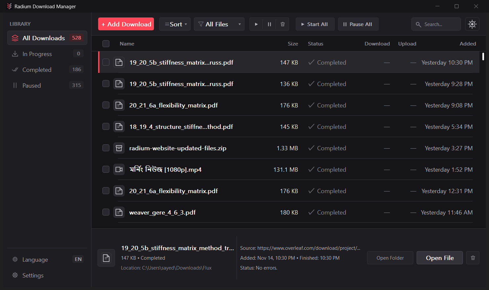
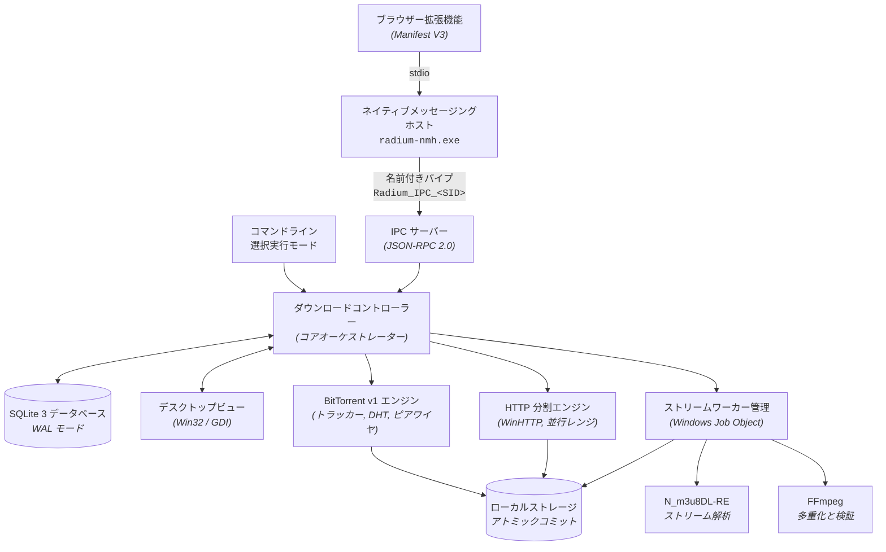

<p align="center">
  
</p>

<p align="center">
  <picture>
    
  </picture>
</p>

<h1 align="center">Radium Download Manager</h1>

<p align="center">
  <a href="../../README.md">English</a> · <b>日本語</b> · <a href="README.zh-CN.md">简体中文</a> · <a href="README.zh-TW.md">繁體中文</a> · <a href="README.ko.md">한국어</a> · <a href="README.es.md">Español</a> · <a href="README.fr.md">Français</a> · <a href="README.pt-BR.md">Português</a> · <a href="README.de-DE.md">Deutsch</a> · <a href="README.ru-RU.md">Русский</a> · <a href="README.it-IT.md">Italiano</a> · <a href="README.ar-SA.md">العربية</a>
</p>

<p align="center">
  <b>動画ダウンロード機能を内蔵した、高速でシンプルな Windows 10 / 11 向けダウンロードマネージャー。</b><br>
  複数接続による高速ファイルダウンロードに加え、YouTube、Bilibili をはじめ多くの Web サイトから動画（HLS、DASH、Web ストリーム）をダウンロード可能。<br>
  Electron による余分なオーバーヘッドがなく、最小限のメモリ消費とバックグラウンド動作を誇るネイティブ C++20 &amp; Win32 アプリケーション。
</p>

<p align="center">
  <a href="https://github.com/alve33/Radium-Download-Manager/releases/latest"></a>
  <a href="https://github.com/alve33/Radium-Download-Manager/releases/latest"></a>
  
  
  
  
  <a href="https://github.com/alve33/Radium-Download-Manager/actions/workflows/windows-release.yml"></a>
</p>

<p align="center">
  <a href="#概要"><b>概要</b></a> ·
  <a href="#ダウンロードとインストール"><b>ダウンロード</b></a> ·
  <a href="#主な機能"><b>主な機能</b></a> ·
  <a href="#ライトモードとダークモードのテーマ"><b>テーマ</b></a> ·
  <a href="#多言語インターフェース"><b>多言語対応</b></a> ·
  <a href="#スクリーンショット"><b>スクリーンショット</b></a> ·
  <a href="#パフォーマンスベンチマーク"><b>ベンチマーク</b></a> ·
  <a href="#高性能ダウンロードエンジン"><b>ダウンロードエンジン</b></a> ·
  <a href="#bittorrent-ダウンロード"><b>BitTorrent</b></a> ·
  <a href="#適応型ストリームパイプライン"><b>ストリームパイプライン</b></a> ·
  <a href="#ブラウザー連携"><b>ブラウザー連携</b></a> ·
  <a href="#アーキテクチャ"><b>アーキテクチャ</b></a> ·
  <a href="#テストと検証"><b>テストと検証</b></a> ·
  <a href="#ライセンスとクレジット"><b>ライセンス</b></a>
</p>

<br>

<p align="center">
  
  <br>
  <sub>Radium メインアプリケーション画面：ディープチャコールのダークテーマ、リアルタイムの分割プログレスバー、速度・容量のテレメトリ、カテゴリフィルター。</sub>
</p>

<br>

## 概要

Radium は、広告が多く肥大化した従来ツールに代わる、軽量・高速な Windows 10 / 11 向けダウンロードマネージャーです。高速な複数接続ファイルダウンロードと、ワンクリックでのブラウザー動画キャプチャおよびストリーム結合を統合しています。

<table>
  <tr>
    <td width="25%" valign="top">
      <h3>⚡ ネイティブの超高速性</h3>
      Electron を一切排除。純粋な C++20、Win32、Direct2D/GDI で開発。瞬時に起動し、複数ギガバイトの転送中でもピーク時メモリ消費量はわずか 18〜22 MB です。
    </td>
    <td width="25%" valign="top">
      <h3>🔀 適応型エンジン</h3>
      適応型ワークスティーリングとヒステリシス分割を備えた動的接続スケーリング（1〜32接続）。終盤の接続チャーンを排除することで、500MB の実転送テストで IDM より完了時間を 16.5%〜19.2% 短縮しました。
    </td>
    <td width="25%" valign="top">
      <h3>🌐 ブラウザーキャプチャ</h3>
      Chrome、Brave、Edge、Firefox 向けの Manifest V3 拡張機能。認証なしの localhost ポートを開かず、ユーザーごとの ACL で保護された名前付きパイプを通じてメディアストリームを安全に検出します。
    </td>
    <td width="25%" valign="top">
      <h3>🧲 BitTorrent とストリーム</h3>
      メタデータ交換（BEP 9）、トラッカーアナウンス、ピース検証、ファイル選択ダウンロードを備えた内蔵 BitTorrent v1 エンジン。分離された Windows Job Object 内で N_m3u8DL-RE と FFmpeg による安全なプロセス外結合を実行。
    </td>
  </tr>
</table>

<br>

## ダウンロードとインストール

最新の公開リリースは **[v1.0.0](https://github.com/alve33/Radium-Download-Manager/releases/tag/v1.0.0)** です。64-bit Windows 向けに以下のパッケージが提供されています：

| パッケージ | アーキテクチャ | 形式 | 説明 |
| :--- | :---: | :---: | :--- |
| **Radium インストーラー (通常版)** | x64 | [Setup (.exe)](https://github.com/alve33/Radium-Download-Manager/releases/download/v1.0.0/Radium-Setup-x64-1.0.0.exe) | Windows 11 / 10 x64 推奨インストーラー |
| **Radium ポータブル フル版** | x64 | [ZIP アーカイブ](https://github.com/alve33/Radium-Download-Manager/releases/download/v1.0.0/Radium-v1.0.0-Windows-x64-Full.zip) | N_m3u8DL-RE と FFmpeg ワーカーを同梱したポータブル版 |
| **Radium ポータブル コア版** | x64 | [ZIP アーカイブ](https://github.com/alve33/Radium-Download-Manager/releases/download/v1.0.0/Radium-v1.0.0-Windows-x64-Core.zip) | コアのみ（ストリームツールは別途準備が必要） |
| **Radium コアインストーラー** | x64 | [Setup (.exe)](https://github.com/alve33/Radium-Download-Manager/releases/download/v1.0.0/Radium-Setup-x64-Core-1.0.0.exe) | ストリームツールを含まない軽量インストーラー |
| **Radium インストーラー (ARM64)** | ARM64 | [Setup (.exe)](https://github.com/alve33/Radium-Download-Manager/releases/download/v1.0.0/Radium-Setup-ARM64-1.0.0.exe) | Windows 10 / 11 on ARM 向けネイティブインストーラー |
| **Radium ポータブル フル版 (ARM64)** | ARM64 | [ZIP アーカイブ](https://github.com/alve33/Radium-Download-Manager/releases/download/v1.0.0/Radium-v1.0.0-Windows-ARM64-Full.zip) | ARM64 向けストリームツール同梱のポータブル版 |
| **ブラウザー拡張機能** | 各種ブラウザー | [拡張機能ソース](../../extension/) | Chrome、Brave、Edge、Firefox 向け Manifest V3 拡張機能 |

リリースバイナリの暗号化チェックサムは [SHA256SUMS.txt](https://github.com/alve33/Radium-Download-Manager/releases/download/v1.0.0/SHA256SUMS.txt) で確認できます。

> [!IMPORTANT]
> ### 🧩 ブラウザー拡張機能のセットアップ手順（手動設定が必要）
> **ブラウザー拡張機能はインストーラー内に自動インストールされません。** 本リポジトリから拡張機能フォルダーをダウンロードし、ブラウザーへ手動で読み込む必要があります。
>
> 1. **拡張機能フォルダーのダウンロード:**
>    - 本リポジトリの [`extension/`](../../extension/) ディレクトリをお使いの PC にダウンロードまたはクローンします（GitHub の **Code → Download ZIP** から展開可能）。
> 2. **Radium のインストールと起動:**
>    - Radium インストーラーを実行するか Radium を一度起動して、Native Messaging Host を Windows レジストリに登録します。
> 3. **Chromium 系ブラウザー（Chrome、Brave、Edge）への導入:**
>    - ブラウザーの拡張機能管理ページ（`chrome://extensions`、`brave://extensions`、または `edge://extensions`）を開きます。
>    - 右上の **デベロッパー モード** をオンにします。
>    - 左上の **パッケージ化されていない拡張機能を読み込む** をクリックします。
>    - ダウンロードした **`extension`** フォルダーを選択します。
> 4. **Firefox への導入:**
>    - `about:debugging#/runtime/this-firefox` を開きます。
>    - **一時的なアドオンを読み込む...** をクリックします。
>    - ダウンロードした `extension` フォルダー内の `manifest.firefox.json` を選択します。
> 5. **ポータブル版をお使いの場合:** 拡張機能を読み込む前に、ポータブルフォルダー内の `scripts\register-native-messaging.ps1` を実行してレジストリ登録を行ってください。

<br>

## 主な機能

<table>
  <tr>
    <td width="50%" valign="top">
      
      <br>
      <sub>事前検証、保存先フォルダー選択、ディスク空き容量チェックを備えたダウンロード追加画面。</sub>
      <h3>スマートなリクエスト傍受と事前プローブ</h3>
      ブラウザー拡張機能、クリップボード URL 検出、または手動入力のいずれからトリガーされた場合でも、帯域を割り当てる前にリクエストを検証します。
      <br><br>
      <b>機能:</b>
      <ul>
        <li>ヘッダー検査（<code>HEAD</code>/<code>Range</code>）および RFC 5987 / 6266 ファイル名デコード</li>
        <li>リアルタイムの空き容量計算と安全なディスク領域事前割り当て</li>
        <li>動的ストリーム品質選択（最高品質、動画のみ、音声のみ）</li>
        <li>パストラバーサル防御（<code>..</code> や NTFS 代替データストリーム <code>:</code> を自動除去）</li>
      </ul>
    </td>
    <td width="50%" valign="top">
      
      <br>
      <sub>個別ファイル選択、メタデータ確認、容量見積もりが可能なネイティブ BitTorrent ダイアログ。</sub>
      <h3>ネイティブ BitTorrent v1 エンジン</h3>
      .torrent ファイルやマグネットリンクを直接追加。メタデータを解析し、ファイル階層ツリーを表示して必要なファイルのみを選択してダウンロードできます。
      <br><br>
      <b>機能:</b>
      <ul>
        <li>マグネットリンク向け BEP 9 メタデータ取得</li>
        <li>HTTP/UDP トラッカーアナウンスおよび DHT ピア探索</li>
        <li>個別ファイル選択と容量計算が可能な対話型ファイルツリー</li>
        <li>SHA-1 ピース検証とクラッシュ耐性のある再開状態管理</li>
      </ul>
    </td>
  </tr>
  <tr>
    <td colspan="2" valign="top">
      
      <br>
      <sub>包括的な設定センター：接続数上限、カテゴリごとのフォルダー振り分け、プロキシ設定、ブラウザー連携状態。</sub>
      <h3>詳細な環境設定とネイティブシステム統合</h3>
      転送動作のあらゆる側面をカスタマイズ：接続数制限（1〜32）、全体速度制限、ファイル種類別の保存先、プロキシ（直接、システム、手動）、ブラウザー自動検知ルールなどを自在に構成可能。
    </td>
  </tr>
</table>

### コアサブシステムの堅牢化

- **ダウンロードスケジュール:** ローカルの開始/停止時間枠設定、エラー分類による再試行バックオフ、再起動時の経過時間枠調整、キュー完了後アクション（`スリープ`/`シャットダウン`）。
- **帯域幅制限:** HTTP、FTP、BitTorrent の全並行接続にわたり、スレッド飢餓を起こさず総帯域幅を抑制するインプロセスデュアルトークンバケットレートリミッター。
- **サイトグラバー:** 探索深度（1〜5）とページ数上限を備えた BFS クローラー。HTML/CSS リンク抽出、リダイレクト基底 URL 解決、プライベート/ループバック宛先に対する厳格な SSRF 防御。
- **ウイルススキャン:** ダウンロード完了後の Windows Defender（`MpCmdRun.exe`）による検証。脅威検知時の stdout 識別と、未検証ファイルを隔離する厳格モード（`av_strict_mode`）。
- **自動カテゴリ分類:** 決定論的ルール優先順位（サイトルール > カスタム拡張子 > 標準ファイル名 > MIME タイプ > 一般）と安全化されたパスルーティング。

<br>

## ライトモードとダークモードのテーマ

Radium は Windows 10 / 11 の外観に調和するよう設計されており、ライトテーマとダークテーマの双方をファーストクラスでサポートしています。昼間の明るい作業環境でも、夜間の暗い作業環境でも、一覧グリッドから進捗ゲージ、設定画面に至るまで美しく適応します。

<table>
  <tr>
    <td width="50%" valign="top">
      <h3>☀️ ライトモード</h3>
      <ul>
        <li><b>デザイン:</b> 高コントラストで清潔感のあるホワイトキャンバス（<code>#FFFFFF</code>）、明るいニュートラルサーフェス（<code>#F5F7F9</code>）、柔らかな境界線（<code>#E1E8ED</code>）。</li>
        <li><b>プライマリアクセント:</b> スカイブルー（<code>#168BCB</code>）を選択状態、フォーカスリング、アクティブな進捗バーに採用。</li>
        <li><b>タイポグラフィ:</b> ディープチャコール（<code>#202124</code>）とスレートセカンダリ（<code>#656B73</code>）による高い可読性。</li>
        <li><b>ネイティブ Windows 統合:</b> Windows <code>Explorer</code> テーマコントロールと半透明ガラス効果のシームレスな統合。</li>
      </ul>
    </td>
    <td width="50%" valign="top">
      <h3>🌙 ダークモード</h3>
      <ul>
        <li><b>デザイン:</b> ディープスペーススレートキャンバス（<code>#0F172A</code> / <code>#161618</code>）とネイビーサーフェス（<code>#1E293B</code> / <code>#28282E</code>）。</li>
        <li><b>プライマリアクセント:</b> Radium 伝統のシグネチャーコーラルレッド（<code>#FF4757</code>）とバイオレット（<code>#8B5CF6</code>）のストリームバッジ。</li>
        <li><b>タイポグラフィ:</b> 目に優しいクリアなオフホワイト（<code>#F8FAFC</code>）とスレートグレー（<code>#94A3B8</code>）。</li>
        <li><b>ネイティブ Windows 統合:</b> <code>DarkMode_Explorer</code> コントロールによるダークウィンドウフレームと繊細なエッジライティング。</li>
      </ul>
    </td>
  </tr>
</table>

### 動的テーマ切り替えとシステム検知
- **システム同期 (`system`):** Windows システム全体のアプリテーマ（レジストリの `AppsUseLightTheme`）を自動検知して追従。OS のテーマ変更に再起動なしで即座に反応します。
- **明示的指定 (`light` または `dark`):** OS 設定に関わらず、好みのテーマに固定できます。
- **専用ツールバー切り替えボタン:** メインツールバー上のテーマ切り替えボタンを押すだけで、ライトモードとダークモードを即座にワンクリックで切り替えられます。
- **設定の永続化:** 選択されたテーマはローカル設定に即時保存され、次回起動時にも確実に維持されます。

<br>

## 多言語インターフェース

Radium は世界中のユーザーに向けて設計されています。国際化は Win32 ネイティブデスクトップアプリのコア部分に組み込まれており、外部 Web サービスへの依存ゼロで動作するオフライン言語カタログを使用しています。

> [!NOTE]
> **README 翻訳と言語カタログの違い:**
> GitHub の保守性を維持するため、リポジトリのドキュメントは **12 の主要言語**（上部のセレクターからアクセス可能）で完全翻訳されています。一方、**Radium デスクトップアプリ本体** は、すでに **24 のネイティブ言語および表記体系** の内蔵インターフェースカタログを備えています！

### 主な多言語機能
- **設定画面からの切り替え:** **設定センター**（`一般` タブ）またはサイドバーの言語アイコンから、ワンクリックで言語を変更可能。
- **ネイティブ表記での言語名表示:** すべての言語が各言語固有の表記（*日本語*、*English*、*한국어*、*العربية*、*Русский* など）で一覧表示され、母国語を直感的に選択可能。
- **即時切り替えと設定保存:** 言語を変更するとインターフェースが動的に更新され、アプリ再起動後も保持されます。
- **システムロケールの自動検出:** 初回起動時、Windows の `GetUserDefaultLocaleName` を照会してシステムの表示言語と自動的にマッチング。
- **完全オフライン動作:** 言語データはローカルの JSON カタログ（`translations/desktop.json`）から読み込まれ、未定義キーは英語に自動フォールバック。
- **高度な Unicode パイプライン:** 内部 UTF-8、Win32 境界 `std::wstring` を採用し、アラビア語（`ar-SA`）やペルシア語（`fa-IR`）などの右横書き（RTL）言語にも対応。


<br>

## スクリーンショット

<p align="center">
  
  <br>
  <sub><b>メインアプリケーション画面:</b> リアルタイムのマルチセグメント可視化、帯域テレメトリ、カテゴリナビゲーション。</sub>
</p>

<table>
  <tr>
    <td width="50%" valign="top">
      
      <br>
      <sub><b>事前検証ダイアログ:</b> サーバーの Range 応答確認、リアルタイム空き容量計算、カテゴリ振り分け。</sub>
    </td>
    <td width="50%" valign="top">
      
      <br>
      <sub><b>BitTorrent 管理:</b> ファイル階層ツリー、メタデータ確認、ピース検証。</sub>
    </td>
  </tr>
  <tr>
    <td colspan="2" valign="top">
      
      <br>
      <sub><b>設定センター:</b> ネイティブ表記での言語選択、ライト/ダーク外観切り替え、接続制限、ネットワーク構成。</sub>
    </td>
  </tr>
</table>

<br>

## パフォーマンスベンチマーク

Radium は、実際のインターネット環境および制御されたローカルループバック環境において、**Internet Download Manager (IDM 6.43.15)** および標準 CLI ツールとの間で継続的なバイト単位の厳密な比較評価を行っています。

### 直接対決: Radium (v0.3.5 開発ビルド) vs Internet Download Manager (500 MB 実インターネット転送)

検証テストでは、Windows 11 ホスト上で同一の **500,000,000 バイト** のテストファイル（`https://sg-lg.regxa.com/500MB.test`）を両ソフトでダウンロードしました。ネットワーク変動を平準化するため、実行順序を入れ替えて連続 2 回実施しています。

> [!NOTE]
> **ビルド情報:** テストされた Radium は、現在 **v1.0.0** に標準搭載されている適応型レンジ分割ポリシーを先行実装した開発ビルドです。比較ベースラインは **v0.3.2** です。

両ソフトともダウンロードを完了し、完全一致する暗号化ハッシュ検証（**SHA-256:** `b16f001a0731c8636f163586c16276b3714b8977242b67ae05fa60b96f685ebc`）に合格しました。

| テスト | 順序 | Radium 所要時間 | IDM 所要時間 | 所要時間の削減率 | スループット (Radium / IDM) | ピークメモリ (Radium / IDM) | メモリ削減率 |
| :---: | :---: | :---: | :---: | :---: | :---: | :---: | :---: |
| **テスト 1** | IDM先行、次にRadium | **184.75 秒** | 221.21 秒 | **16.48% 短縮** (-36.46 秒) | **2.71 MB/s** / 2.26 MB/s (+19.91%) | **20.5 MB** / 53.8 MB | **61.90%** |
| **テスト 2** | Radium先行、次にIDM | **140.09 秒** | 173.46 秒 | **19.24% 短縮** (-33.37 秒) | **3.57 MB/s** / 2.88 MB/s (+23.96%) | **20.4 MB** / 122.2 MB | **83.31%** |
| **平均** | 両テストの合算平均 | **162.42 秒** | 197.34 秒 | **17.69% 短縮** (-34.92 秒) | **3.14 MB/s** / 2.57 MB/s (+22.18%) | **20.4 MB** / 88.0 MB | **76.76%** |

#### 転送効率を向上させた主な技術要因:
1. **適応型レンジ分割:** 速度ベースの閾値計算式 `clamp(4 × transfer_speed_bps × 0.25 s, 1 MiB, 16 MiB)` を採用。接続確立初期は 256 KiB、並行数上限到達後は 1 MiB の最小フロアを適用することで、テスト 1 で破棄データ量を **57.3%**（4.76MB → 2.04MB）、テスト 2 で **42.4%** 削減。
2. **即時ワーカー並列化:** 初期ランプアップ時に利用可能なワーカーを分割境界へ均等に割り当て、全ワーカーが転送終了まで高負荷を維持。
3. **低オーバーヘッドなネイティブ I/O:** 事前割り当てスパースファイルと非同期 WinHTTP I/O によるストリーミング書き込みにより、IDM の 53.8〜122.2 MB に対し、Radium はピーク時わずか 20.4〜20.5 MB の RAM に抑制。結合後処理のオーバーヘッドもありません。

<br>

## 高性能ダウンロードエンジン

Radium は、[Brisk](https://github.com/BrisklyDev/brisk) に着想を得て開発された、プロセス内並行分割 HTTP/HTTPS ダウンロードエンジンと適応型ヒステリシス分割アルゴリズムを採用しています。

```
                      ┌────────────────────────────────────────┐
                      │       対象ファイル (例: 500 MB)        │
                      └────────────────────────────────────────┘
                       /             |            |                    Worker 0 (0-125MB)   Worker 1 (125-250MB)  Worker 2     Worker 3
        [████████████████]   [████████░░░░░░░░]   [████░░░░]   [██░░░░░░]
                                      │
                      Worker 0 が早期に完了！
                      Worker 1 の残り 50% をスティール:
                      Worker 0: [187.5 - 250 MB] ──► 即座に新規接続を開始
```

1. **事前プローブ:** バイトレンジリクエストを送信してサーバーの Range 対応、ファイル容量、Content-Disposition ファイル名を検証。
2. **初期スケーリング:** 初期接続を開始後、Range 対応が確認されれば設定された接続上限（既定 8、最大 32）までワーカーを動的に展開。
3. **適応型ワークスティーリング:** ワーカーが自身の担当ブロックを完了すると、最大残余ブロックを持つワーカーから領域を分割して処理を引き継ぎます。
4. **拒否時の安全ロールバック:** サーバーが分割リクエストを拒否（HTTP 200 や 416 を返却）した場合、スティールした領域を安全に元ワーカーへ差し戻し、破損を防ぎます。
5. **アトミックコミット:** ダウンロードデータは独立した `*.radium.part` ファイルに直接書き込まれ、100% 完了時に最終ファイル名へアトミックに変更されます。

<br>

## BitTorrent ダウンロード

ローカルの `.torrent` ファイルおよびマグネットリンクに対応した BitTorrent v1 エンジンを搭載：

- **マグネットメタデータ取得:** BEP 9 拡張プロトコルにより、マグネットリンクから即座にメタデータを取得。
- **トラッカーと DHT 探索:** HTTP/UDP トラッカープロトコルおよび分散ハッシュテーブル（DHT）ピア探索に対応。
- **ピース検証:** エンドゲームモード処理と、ブロック完成時の厳格な SHA-1 ピースハッシュ検証。
- **選択的ダウンロード:** ファイルツリー階層から必要なファイルのみをチェックしてダウンロード可能。
- **クラッシュリカバリ:** タスク状態と検証済みピースビットフィールドは SQLite に保存され、再起動後も即座に再開可能。

<br>

## 適応型ストリームパイプライン

HLS や DASH などの Web 動画ストリームに対しては、[N_m3u8DL-RE](https://github.com/nilaoda/N_m3u8DL-RE) と [FFmpeg](https://ffmpeg.org/) をプロセス外ワーカーとして連携実行します：

- **Job Object サンドボックス:** ワーカーは Windows Job Object（`JOB_OBJECT_LIMIT_KILL_ON_JOB_CLOSE`）内で動作し、Radium 終了時に子プロセスも確実に終了。
- **認証情報の漏洩防止:** Cookie や認証ヘッダーをコマンドライン引数に直接渡さず、ユーザー限定 ACL の一時設定ファイル（`@job.rsp`）を経由させて終了後に即時削除。
- **トラック解析とコンテナ結合:** マニフェストを解析して動画・音声・字幕トラックを選択し、ダウンロード完了後に FFmpeg が標準 MP4 / MKV コンテナへ多重化します。

※ DRM 保護されたストリームは非対応です。Radium は暗号化回避を行わず、DRM 検出時は安全にエラーを返します。

<br>

## ブラウザー連携

Google Chrome、Brave、Microsoft Edge、Mozilla Firefox に対応した Manifest V3 拡張機能を提供しています。

```
┌─────────────────────────────────┐
│ ブラウザー (Chromium / Firefox) │
│  ├── webRequest メディア検知    │
│  └── コンテンツスクリプト表示   │
└───────────────┬─────────────────┘
                │ Native Messaging stdio (32-bit 長さ付き JSON)
┌───────────────▼─────────────────┐
│ radium-nmh.exe (ネイティブホスト)│
└───────────────┬─────────────────┘
                │ 名前付きパイプ: \.\pipe\Radium_IPC_<UserSID>
┌───────────────▼─────────────────┐
│ radium.exe (デスクトップ本体)   │
│  ├── ネイティブ Win32 / GDI UI  │
│  ├── プロセス内分割エンジン     │
│  └── SQLite 3 状態保存 (WAL)    │
└─────────────────────────────────┘
```

- **安全な二重オリジン認証:** ストア公開用 ID とローカル開発用キーの双方を許可。
- **ローカルポート非開放:** 脆弱性となりやすい認証なしの `localhost` HTTP ポートを開かず、Windows のアクセス制御付き名前付きパイプ（`\.\pipe\Radium_IPC_<UserSID>`）でのみ通信。
- **メディアの重複排除:** 動画ストリームのマスタープレイリストを適切に検知し、大量のセグメントファイル（`.ts`、`.m4s`）による UI 氾濫を防止。
- **安全なフォールバック:** Chromium の `onDeterminingFilename` を活用し、Radium が未起動またはリクエストを辞退した場合は通常のブラウザダウンロードへとシームレスに継続されます。

<br>

## アーキテクチャ



### 設計原則
- **ネイティブの実行効率:** MSVC 19.38+（`/std:c++20`, `/permissive-`, `/W4`, `/WX`）でコンパイル。境界では `std::wstring`、内部では UTF-8 を徹底。
- **プロセス分離設計:** ストリーム処理と動画結合は独立したプロセスで実行されるため、万が一エンコーダーが異常終了しても本体は安定して動作を継続します。
- **確実な状態復元:** 進捗、オフセット、セグメント情報は SQLite（WAL モード）に随時コミットされ、不意の電源遮断時でも正確に復旧可能です。
- **単一インスタンス管理:** すでにアプリが起動している場合、新たな起動要求は既存ウィンドウをアクティブにして前面に表示します。

<br>

## ソースコードからのビルド

ソースコードからビルドするには、**Windows 10 / 11**、**Visual Studio 2022**（C++ によるデスクトップ開発）、および **CMake 3.25 以上** が必要です：

```powershell
git clone https://github.com/alve33/Radium-Download-Manager.git
cd Radium-Download-Manager
cmake -B build/win-x64 -A x64
cmake --build build/win-x64 --config Release
```

コンパイルされたバイナリは `build/win-x64/Release/` に出力されます。詳細は [`docs/DEVELOPMENT_SETUP.md`](docs/DEVELOPMENT_SETUP.md) を参照してください。

<br>

## テストと検証

Radium では、ダウンロードエンジン、ワークスティーリングスケジューラ、BitTorrent パーサー、ストレージ層を網羅する自動テストを実装しています：

```powershell
.\build\win-x64\Release\radium_unit_tests.exe
```

- [機能マトリックス](docs/FEATURE_MATRIX.md)
- [テストマトリックス](docs/TEST_MATRIX.md)
- [Windows リリースワークフロー](https://github.com/alve33/Radium-Download-Manager/actions/workflows/windows-release.yml)

<br>

## HTTP サーバー互換性

Radium は、リモートサーバーが正常な `206 Partial Content` レスポンスを返した場合にのみ分割ダウンロードを実施します。サーバーが Range に非対応の場合は安全に 1 接続に切り替えます。

## コントリビューション

バグ報告やプルリクエストを歓迎します。[CONTRIBUTING.md](CONTRIBUTING.md) および [AGENTS.md](AGENTS.md) のガイドラインをご確認ください。

<br>

## ライセンスとクレジット

Radium Download Manager は **Apache License, Version 2.0** ([Apache-2.0](LICENSE)) の下で公開されているオープンソースソフトウェアです。

### サードパーティ製コンポーネント
[N_m3u8DL-RE](https://github.com/nilaoda/N_m3u8DL-RE) (MIT)、[FFmpeg](https://ffmpeg.org/) (LGPL)、[Microsoft WIL](https://github.com/microsoft/wil) (MIT)、[SQLite](https://www.sqlite.org/) (Public Domain)、[nlohmann/json](https://github.com/nlohmann/json) (MIT) を使用しています。詳細は [`THIRD_PARTY_NOTICES.md`](THIRD_PARTY_NOTICES.md) および [`NOTICE`](NOTICE) をご覧ください。

<br>

<p align="center">
  <sub>Radium Download Manager · Windows 向け高性能ネイティブオープンソースダウンロードマネージャー</sub><br>
  <sub>C++20 &amp; Win32 で構築。Apache-2.0 ライセンス。</sub>
</p>
