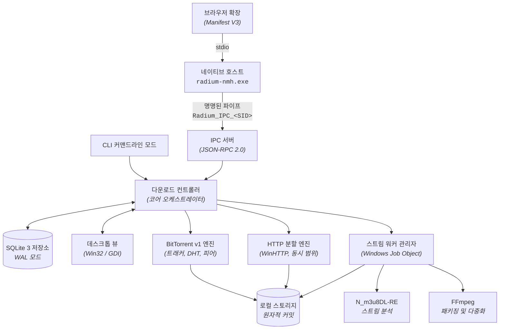

<p align="center">
  
</p>

<p align="center">
  <picture>
    
  </picture>
</p>

<h1 align="center">Radium Download Manager</h1>

<p align="center">
  <a href="../../README.md">English</a> · <a href="README.ja.md">日本語</a> · <a href="README.zh-CN.md">简体中文</a> · <a href="README.zh-TW.md">繁體中文</a> · <b>한국어</b> · <a href="README.es.md">Español</a> · <a href="README.fr.md">Français</a> · <a href="README.pt-BR.md">Português</a> · <a href="README.de-DE.md">Deutsch</a> · <a href="README.ru-RU.md">Русский</a> · <a href="README.it-IT.md">Italiano</a> · <a href="README.ar-SA.md">العربية</a>
</p>

<p align="center">
  <b>동영상 다운로드 기능을 내장한 빠르고 간결한 Windows 10 / 11 다운로드 매니저.</b><br>
  다중 연결 파일 다운로드를 가속화하고 YouTube, Bilibili 등 다양한 웹사이트의 동영상(HLS, DASH 및 웹 스트림)을 다운로드할 수 있습니다.<br>
  Electron이 없는 순수 C++20 및 Win32 네이티브 앱으로, 가벼운 메모리 점유율과 쾌적한 사용성을 보장합니다.
</p>

<p align="center">
  <a href="https://github.com/alve33/Radium-Download-Manager/releases/latest"></a>
  <a href="https://github.com/alve33/Radium-Download-Manager/releases/latest"></a>
  
  
  
  
  <a href="https://github.com/alve33/Radium-Download-Manager/actions/workflows/windows-release.yml"></a>
</p>

<p align="center">
  <a href="#개요"><b>개요</b></a> ·
  <a href="#다운로드-및-설치"><b>다운로드</b></a> ·
  <a href="#주요-기능"><b>기능</b></a> ·
  <a href="#라이트-및-다크-테마"><b>테마</b></a> ·
  <a href="#다국어-인터페이스"><b>다국어 지원</b></a> ·
  <a href="#스크린샷"><b>스크린샷</b></a> ·
  <a href="#성능-벤치마크"><b>벤치마크</b></a> ·
  <a href="#고성능-분할-다운로드-엔진"><b>다운로드 엔진</b></a> ·
  <a href="#bittorrent-다운로드"><b>BitTorrent</b></a> ·
  <a href="#적응형-스트림-파이프라인"><b>스트림 파이프라인</b></a> ·
  <a href="#브라우저-통합"><b>브라우저 연동</b></a> ·
  <a href="#아키텍처"><b>아키텍처</b></a> ·
  <a href="#테스트-및-검증"><b>검증</b></a> ·
  <a href="#라이선스-및-크레딧"><b>라이선스</b></a>
</p>

<br>

<p align="center">
  
  <br>
  <sub>Radium 메인 창: 딥 차콜 다크 테마, 실시간 세그먼트 진행 표시줄, 전송 속도 및 카테고리 필터.</sub>
</p>

<br>

## 개요

Radium은 복잡하고 광고가 많은 기존 다운로드 프로그램을 대체하기 위해 설계된 가볍고 빠른 Windows 10 / 11 다운로드 관리자입니다. 초고속 다중 연결 분할 다운로드와 원클릭 브라우저 비디오 캡처 기능을 하나로 결합했습니다.

<table>
  <tr>
    <td width="25%" valign="top">
      <h3>⚡ 순수 네이티브 속도</h3>
      Electron 프레임워크가 없습니다. 순수 ISO C++20과 Win32 / Direct2D로 빌드되어 수 밀리초 만에 실행되며 대용량 전송 중에도 피크 메모리가 18–22 MB에 불과합니다.
    </td>
    <td width="25%" valign="top">
      <h3>🔀 적응형 스케줄러</h3>
      적응형 작업 가로채기(Work-stealing) 알고리즘을 통해 1~32개의 연결을 동적으로 조절합니다. 500 MB 실제 네트워크 테스트에서 연결 병목을 제거하여 IDM 대비 완료 시간을 16.5% ~ 19.2% 단축했습니다.
    </td>
    <td width="25%" valign="top">
      <h3>🌐 안전한 브라우저 캡처</h3>
      Chrome, Brave, Edge 및 Firefox용 Manifest V3 확장 프로그램. 인증 없는 로컬호스트 포트를 열지 않고 사용자별 ACL로 보호되는 명명된 파이프(Named Pipe)를 통해 미디어를 감지합니다.
    </td>
    <td width="25%" valign="top">
      <h3>🧲 BitTorrent 및 스트림</h3>
      메타데이터 교환(BEP 9), 트래커 알림, 조각 검증 및 선택적 파일 트리를 지원하는 BitTorrent v1 엔진 내장. N_m3u8DL-RE 및 FFmpeg 프로세스를 분리된 Windows Job Object 내에서 안전하게 격리 실행합니다.
    </td>
  </tr>
</table>

<br>

## 다운로드 및 설치

최신 공식 릴리스는 **[v1.0.0](https://github.com/alve33/Radium-Download-Manager/releases/tag/v1.0.0)** 입니다. 64비트 Windows용 패키지가 제공됩니다:

| 패키지 | 아키텍처 | 형식 | 설명 |
| :--- | :---: | :---: | :--- |
| **Radium 표준 설치 프로그램** | x64 | [Setup (.exe)](https://github.com/alve33/Radium-Download-Manager/releases/download/v1.0.0/Radium-Setup-x64-1.0.0.exe) | Windows 11 / 10 x64 권장 설치 파일 |
| **Radium 포터블 풀 패키지** | x64 | [ZIP 압축](https://github.com/alve33/Radium-Download-Manager/releases/download/v1.0.0/Radium-v1.0.0-Windows-x64-Full.zip) | N_m3u8DL-RE 및 FFmpeg 도구가 포함된 무설치 포터블 패키지 |
| **Radium 포터블 코어** | x64 | [ZIP 압축](https://github.com/alve33/Radium-Download-Manager/releases/download/v1.0.0/Radium-v1.0.0-Windows-x64-Core.zip) | 코어 패키지 (스트림 도구 별도 준비 필요) |
| **Radium 코어 설치 프로그램** | x64 | [Setup (.exe)](https://github.com/alve33/Radium-Download-Manager/releases/download/v1.0.0/Radium-Setup-x64-Core-1.0.0.exe) | 외부 도구가 포함되지 않은 가벼운 인스톨러 |
| **Radium ARM64 설치 프로그램** | ARM64 | [Setup (.exe)](https://github.com/alve33/Radium-Download-Manager/releases/download/v1.0.0/Radium-Setup-ARM64-1.0.0.exe) | ARM 기반 Windows 10 / 11 기기를 위한 네이티브 설치 파일 |
| **Radium ARM64 포터블 풀 패키지** | ARM64 | [ZIP 압축](https://github.com/alve33/Radium-Download-Manager/releases/download/v1.0.0/Radium-v1.0.0-Windows-ARM64-Full.zip) | ARM64용 스트림 도구가 포함된 포터블 패키지 |
| **브라우저 확장 소스** | 크로스 브라우저 | [extension 소스](../../extension/) | Chrome, Edge, Brave, Firefox용 Manifest V3 확장 프로그램 |

SHA256 체크섬은 [SHA256SUMS.txt](https://github.com/alve33/Radium-Download-Manager/releases/download/v1.0.0/SHA256SUMS.txt)에서 확인하실 수 있습니다.

> [!IMPORTANT]
> ### 🧩 브라우저 확장 프로그램 설치 안내 (수동 로드 필요)
> **브라우저 확장은 인스톨러에 자동으로 포함되지 않습니다.** 본 GitHub 저장소에서 확장 프로그램을 받아 브라우저에 수동으로 로드해야 합니다:
>
> 1. **확장 프로그램 폴더 다운로드:**
>    - 본 리포지토리의 [`extension/`](../../extension/) 폴더를 다운로드하거나 클론합니다 (**Code → Download ZIP**으로 다운로드 후 압축 해제).
> 2. **Radium 설치 및 실행:**
>    - Radium을 실행하여 Native Messaging Host가 Windows 레지스트리에 등록되도록 합니다.
> 3. **Chromium 기반 브라우저에 로드 (Chrome, Edge, Brave):**
>    - 브라우저의 확장 관리 페이지(`chrome://extensions` 또는 `edge://extensions`)로 이동합니다.
>    - 우측 상단의 **개발자 모드** 토글을 켭니다.
>    - 좌측 상단의 **압축해제된 확장 프로그램을 로드합니다**를 클릭합니다.
>    - 다운로드한 **`extension`** 폴더를 선택합니다.
> 4. **Firefox에 로드:**
>    - `about:debugging#/runtime/this-firefox`로 이동합니다.
>    - **임시 부가 기능 로드...**를 클릭합니다.
>    - 다운로드한 `extension` 폴더 안의 `manifest.firefox.json` 파일을 선택합니다.
> 5. **포터블 버전 사용 시:** 확장 프로그램을 로드하기 전 포터블 폴더의 `scripts\register-native-messaging.ps1`을 실행하여 호스트를 등록하세요.

<br>

## 주요 기능

<table>
  <tr>
    <td width="50%" valign="top">
      
      <br>
      <sub>사전 헤더 분석, 저장 폴더 지정 및 여유 공간 계산을 지원하는 다운로드 추가 화면.</sub>
      <h3>지능형 가로채기 및 사전 검증</h3>
      확장 프로그램이나 클립보드 링크 감지, 수동 입력 등 어떤 경로로 진입하더라도 대역폭을 할당하기 전 유효성을 먼저 확인합니다.
      <br><br>
      <b>핵심 역량:</b>
      <ul>
        <li>사전 헤더 검사(<code>HEAD</code>/<code>Range</code>) 및 RFC 5987 / 6266 파일명 디코딩</li>
        <li>드라이브 실시간 잔여 공간 계산 및 안전한 사전 디스크 할당</li>
        <li>동적 스트림 화질 선택 (최고 화질, 비디오만, 오디오만)</li>
        <li>경로 탐색 공격 차단 (<code>..</code> 및 NTFS 대체 데이터 스트림 <code>:</code> 자동 제거)</li>
      </ul>
    </td>
    <td width="50%" valign="top">
      
      <br>
      <sub>선택적 파일 트리 계층 구조, 메타데이터 검사 및 조각 검증을 제공하는 토렌트 추가 화면.</sub>
      <h3>네이티브 BitTorrent v1 엔진</h3>
      토렌트 파일이나 마그넷 링크를 즉시 처리합니다. 메타데이터를 파싱하여 트리 형태로 파일 목록을 제공하며 원하는 파일만 골라 다운로드할 수 있습니다.
      <br><br>
      <b>핵심 역량:</b>
      <ul>
        <li>마그넷 링크용 BEP 9 메타데이터 고속 교환</li>
        <li>HTTP/UDP 트래커 공지 및 DHT 피어 탐색</li>
        <li>선택 다운로드 및 용량 집계가 가능한 인터랙티브 파일 트리</li>
        <li>정밀한 SHA-1 조각 검증 및 비정상 종료 시 복구 상태 관리</li>
      </ul>
    </td>
  </tr>
  <tr>
    <td colspan="2" valign="top">
      
      <br>
      <sub>종합 설정 센터: 연결 수 제어, 카테고리별 디렉터리 라우팅, 프록시 설정, 브라우저 연동 상태.</sub>
      <h3>심층 환경설정 및 시스템 네이티브 통합</h3>
      다운로드 동작의 모든 세부 항목을 맞춤 설정할 수 있습니다: 연결 수 제한(1~32), 전역 속도 제한, 파일 유형별 기본 폴더, 프록시 경로(직접 연결, 시스템 프록시, 수동 지정) 및 브라우저 규칙을 지원합니다.
    </td>
  </tr>
</table>

### 핵심 서브시스템 강화

- **스케줄링:** 정밀한 시작/중지 시간표, 오류별 재시도 백오프, 재부팅 시 경과 시간 자동 보정, 대기열 완료 후 동작(`절전 모드`/`시스템 종료`).
- **속도 제어:** HTTP, FTP, BitTorrent 전반에 걸쳐 스레드 기아 현상 없이 총 대역폭을 통제하는 듀얼 토큰 버킷 레이트 리미터.
- **사이트 그래버:** 탐색 깊이(1–5)와 페이지 한도를 지정하는 BFS 웹 크롤러. 리다이렉트 베이스 URL 보정과 내부망 SSRF 방어.
- **백신 연동 검사:** 다운로드 완료 후 Windows Defender(`MpCmdRun.exe`)를 호출하여 위협을 정밀 진단하며 엄격 모드(`av_strict_mode`)를 지원.
- **자동 카테고리 분류:** 결정론적 규칙 우선순위(사이트 규칙 > 사용자 정의 확장자 > 표준 파일명 > MIME 타입 > 일반)를 통한 안전한 폴더 정리.

<br>

## 라이트 및 다크 테마

Radium은 Windows 10 / 11 디자인 가이드에 맞춰 라이트(Light)와 다크(Dark) 테마를 완벽하게 기본 지원합니다. 밝은 낮 환경이나 어두운 작업 공간 모두에서 표, 진행 표시줄, 설정 창까지 일관되고 깔끔하게 적응합니다.

<table>
  <tr>
    <td width="50%" valign="top">
      <h3>☀️ 라이트 모드 (Light Mode)</h3>
      <ul>
        <li><b>시각적 특징:</b> 깨끗하고 현대적인 고대비 화이트 캔버스(<code>#FFFFFF</code>), 은은한 카드 표면(<code>#F5F7F9</code>), 부드러운 구분선(<code>#E1E8ED</code>).</li>
        <li><b>포인트 컬러:</b> 스카이 블루(<code>#168BCB</code>)를 항목 선택, 포커스 링, 활성 진행률 게이지에 적용.</li>
        <li><b>타이포그래피:</b> 딥 차콜 텍스트(<code>#202124</code>)와 슬레이트 보조 메타데이터(<code>#656B73</code>)로 WCAG AAA 가독성 충족.</li>
        <li><b>Windows 시스템 통합:</b> Windows <code>Explorer</code> 테마 컨트롤 및 반투명 아크릴 효과와 자연스럽게 어우러짐.</li>
      </ul>
    </td>
    <td width="50%" valign="top">
      <h3>🌙 다크 모드 (Dark Mode)</h3>
      <ul>
        <li><b>시각적 특징:</b> 딥 스페이스 슬레이트 배경(<code>#0F172A</code> / <code>#161618</code>), 안정감 있는 네이비 표면(<code>#1E293B</code> / <code>#28282E</code>).</li>
        <li><b>포인트 컬러:</b> Radium 고유의 코랄 레드(<code>#FF4757</code>) 및 미디어 스트림용 바이올렛(<code>#8B5CF6</code>) 배지.</li>
        <li><b>타이포그래피:</b> 눈이 편안한 오프화이트 텍스트(<code>#F8FAFC</code>)와 슬레이트 그레이 메타데이터(<code>#94A3B8</code>).</li>
        <li><b>Windows 시스템 통합:</b> <code>DarkMode_Explorer</code> 컨트롤을 활용한 다크 창 프레임 및 섬세한 엣지 조명.</li>
      </ul>
    </td>
  </tr>
</table>

### 동적 테마 전환 및 시스템 감지
- **시스템 동기화 (`system`):** Windows 시스템의 "기본 앱 모드 선택"(레지스트리 `AppsUseLightTheme`)을 실시간 감지하여 OS 테마 변경 시 재시작 없이 즉시 반영합니다.
- **고정 모드 (`light` 또는 `dark`):** OS 설정과 무관하게 사용자가 선호하는 테마를 영구 고정할 수 있습니다.
- **툴바 전용 원클릭 토글 버튼:** 메인 툴바의 전용 테마 전환 버튼을 클릭하여 언제든 라이트 모드와 다크 모드를 손쉽게 전환할 수 있습니다.
- **영구 보존:** 선택한 테마는 로컬 구성에 즉시 저장되어 다음 실행 시에도 그대로 유지됩니다.

<br>

## 다국어 인터페이스

Radium은 전 세계 사용자를 위해 설계되었습니다. 다국어 처리는 외부 웹 API 없이 로컬 언어 카탈로그를 기반으로 Win32 네이티브 데스크톱 앱 내부에 완벽히 구현되어 있습니다.

> [!NOTE]
> **README 번역본과 애플리케이션 지원 언어의 차이:**
> 저장소 관리를 간결하게 유지하기 위해 GitHub 설명서는 **12개 주요 언어**로 완역되어 상단 선택기를 통해 제공됩니다. 반면 **Radium 데스크톱 애플리케이션 자체에는 총 24개의 고유 언어 및 문자 체계**가 이미 내장되어 있습니다!

### 주요 다국어 지원 기능
- **설정 센터에서 손쉬운 변경:** **설정 센터**(`일반` 탭) 또는 사이드바 언어 메뉴에서 언제든 인터페이스 언어를 전환할 수 있습니다.
- **고유 문자 표기:** 모든 언어 목록은 해당 언어 고유의 문자 체계(*한국어*, *English*, *日本語*, *简体中文*, *العربية*, *Русский* 등)로 직관적으로 표시됩니다.
- **즉시 적용 및 설정 유지:** 언어 변경 시 재시작 없이 즉각 UI가 갱신되며 설정이 영구 보존됩니다.
- **시스템 언어 자동 감지:** 첫 실행 시 Windows의 `GetUserDefaultLocaleName`을 확인하여 시스템 언어와 일치하는 번역을 자동 적용합니다.
- **완전한 오프라인 환경:** 로컬 JSON 파일(`translations/desktop.json`)에서 번역을 읽어오며 번역이 없는 항목은 영어로 자연스럽게 폴백됩니다.
- **유니코드 및 RTL 지원:** UTF-8과 Win32 `std::wstring`을 기반으로 구축되었으며 아랍어(`ar-SA`) 및 페르시아어(`fa-IR`)를 위한 우측에서 좌측으로(RTL) 읽기 레이아웃을 지원합니다.


<br>

## 스크린샷

<p align="center">
  
  <br>
  <sub><b>메인 작업 대시보드:</b> 직관적인 다중 세그먼트 시각화, 실시간 속도 그래프 및 카테고리 탐색기.</sub>
</p>

<table>
  <tr>
    <td width="50%" valign="top">
      
      <br>
      <sub><b>사전 분석 화면:</b> 서버 세그먼트 지원 검사, 디스크 용량 계산 및 자동 카테고리 지정.</sub>
    </td>
    <td width="50%" valign="top">
      
      <br>
      <sub><b>토렌트 관리 화면:</b> 파일 트리 구조 탐색, 선택적 다운로드 및 조각 검증.</sub>
    </td>
  </tr>
  <tr>
    <td colspan="2" valign="top">
      
      <br>
      <sub><b>설정 센터:</b> 고유 문자 표기 다국어 선택, 라이트/다크 테마 환경설정, 연결 한도 및 프록시 구성.</sub>
    </td>
  </tr>
</table>

<br>

## 성능 벤치마크

Radium은 실제 인터넷 및 로컬 루프백 환경에서 **Internet Download Manager (IDM 6.43.15)** 및 표준 CLI 툴과 바이트 단위의 정밀한 성능 평가를 진행하고 있습니다.

### 실전 테스트: Radium (v0.3.5 개발 빌드) vs Internet Download Manager (500 MB 실제 공용 인터넷)

동일한 Windows 11 환경에서 공용 인터넷 싱가포르 미러(`https://sg-lg.regxa.com/500MB.test`)의 **500,000,000 바이트** 페이로드를 다운로드했습니다. 네트워크 경로 편차를 보정하기 위해 실행 순서를 바꾸어 2회 연속 테스트했습니다:

> [!NOTE]
> **빌드 정보:** 테스트된 Radium 실행 파일은 현재 **v1.0.0**의 표준으로 자리 잡은 적응형 세그먼트 분할 정책을 탑재한 빌드입니다. 비교 기준 이전 버전은 **v0.3.2**입니다.

두 프로그램 모두 성공적으로 다운로드를 마쳤으며, 암호화 해시 검증(**SHA-256:** `b16f001a0731c8636f163586c16276b3714b8977242b67ae05fa60b96f685ebc`)을 통과했습니다.

| 테스트 | 순서 | Radium 소요 시간 | IDM 소요 시간 | 시간 단축 비율 | 전송률 (Radium / IDM) | 피크 RAM (Radium / IDM) | 메모리 절감률 |
| :---: | :---: | :---: | :---: | :---: | :---: | :---: | :---: |
| **테스트 1** | IDM 먼저, 이후 Radium | **184.75 초** | 221.21 초 | **16.48% 단축** (-36.46 초) | **2.71 MB/s** / 2.26 MB/s (+19.91%) | **20.5 MB** / 53.8 MB | **61.90%** |
| **테스트 2** | Radium 먼저, 이후 IDM | **140.09 초** | 173.46 초 | **19.24% 단축** (-33.37 초) | **3.57 MB/s** / 2.88 MB/s (+23.96%) | **20.4 MB** / 122.2 MB | **83.31%** |
| **평균** | 2회 종합 평균 | **162.42 초** | 197.34 초 | **17.69% 시간 단축** (-34.92 초) | **3.14 MB/s** / 2.57 MB/s (+22.18%) | **20.4 MB** / 88.0 MB | **76.76%** |

#### 전송 효율 향상 핵심 요인:
1. **적응형 범위 분할:** 속도 기반 임계값 공식 `clamp(4 × transfer_speed_bps × 0.25 s, 1 MiB, 16 MiB)` 적용. 초반에는 256 KiB, 전체 연결 활성화 후에는 1 MiB를 최소 단위로 사용하여 버려지는 중복 데이터를 테스트 1에서 **57.3%**, 테스트 2에서 **42.4%** 줄였습니다.
2. **신속한 작업자 병렬화:** 초기 연결 시 사용 가능한 스레드를 분할 지점에 균등 배치하여 8개 작업자가 끝까지 완전한 포화 상태를 유지합니다.
3. **오버헤드 없는 네이티브 I/O:** 희소 파일(Sparse file) 사전 할당과 비동기 WinHTTP 직접 스트리밍을 통해 다운로드 후 별도의 파일 병합 과정이 없으므로, IDM이 최대 122.2 MB를 사용하는 동안 Radium은 20 MB 대의 메모리만 사용합니다.

<br>

## 고성능 분할 다운로드 엔진

Radium은 [Brisk](https://github.com/BrisklyDev/brisk)의 기술적 아이디어를 발전시켜 프로세스 내에서 동시 다중 분할 HTTP/HTTPS 다운로드를 구현합니다.

```
                      ┌────────────────────────────────────────┐
                      │        대상 파일 (예: 500 MB)          │
                      └────────────────────────────────────────┘
                       /             |            |                    Worker 0 (0-125MB)   Worker 1 (125-250MB)  Worker 2     Worker 3
        [████████████████]   [████████░░░░░░░░]   [████░░░░]   [██░░░░░░]
                                      │
                      Worker 0이 먼저 작업을 완료함!
                      Worker 1의 남은 구간 중 50%를 가로챔:
                      Worker 0: [187.5 - 250 MB] ──► 즉시 신규 연결 생성
```

1. **사전 프로브:** 바이트 범위 요청을 보내 서버의 범위 지원 여부와 파일 크기를 확인합니다.
2. **동적 확장:** 206 Partial Content가 확인되면 지정된 한도(기본 8, 최대 32)까지 연결을 확장합니다.
3. **작업 가로채기:** 먼저 끝난 스레드가 가장 많은 작업이 남은 스레드의 영역을 분할해 가져옵니다.
4. **거부 시 안전 롤백:** 서버가 분할 요청을 거부할 경우 안전하게 원래 스레드로 복원합니다.
5. **원자적 완료:** `*.radium.part` 파일에 스트리밍 후 100% 완료 시 즉시 최종 파일명으로 원자적 변경을 수행합니다.

<br>

## BitTorrent 다운로드

로컬 `.torrent` 파일 및 마그넷 링크를 처리하는 네이티브 BitTorrent v1 엔진:

- **마그넷 메타데이터 수신:** BEP 9 프로토콜로 마그넷 주소에서 메타데이터를 신속히 수신.
- **트래커 및 DHT:** HTTP/UDP 트래커 공지 및 분산 해시 테이블(DHT) 피어 검색.
- **조각 검증:** 엔드게임 모드와 블록 조립 후 정밀한 SHA-1 조각 해시 검증.
- **선택적 파일 다운로드:** 대화상자에서 원하는 파일만 골라 다운로드할 수 있는 트리 뷰 제공.
- **복구 안정성:** 작업 상태와 검증된 조각 정보를 SQLite에 실시간 저장하여 중단 시에도 안전하게 이어받기 지원.

<br>

## 적응형 스트림 파이프라인

HLS나 DASH 미디어 스트림을 위해 [N_m3u8DL-RE](https://github.com/nilaoda/N_m3u8DL-RE) 및 [FFmpeg](https://ffmpeg.org/) 프로세스를 안전하게 호출합니다:

- **Job Object 격리:** 모든 외부 프로세스는 Windows Job Object(`JOB_OBJECT_LIMIT_KILL_ON_JOB_CLOSE`) 내에서 실행되어 부모 프로세스 종료 시 잔류 없이 정리됩니다.
- **인증 정보 노출 차단:** 쿠키와 토큰을 커맨드라인에 직접 노출하지 않고 ACL로 보호된 임시 응답 파일(`@job.rsp`)에 기록한 뒤 작업 즉시 안전하게 삭제합니다.
- **트랙 감지 및 다중화:** 스트림 매니페스트를 분석하여 비디오, 오디오, 자막을 감지하고 완료 후 FFmpeg로 표준 MP4/MKV 컨테이너에 무손실 패키징합니다.

*참고: Radium은 DRM 보호 콘텐츠의 우회 또는 복호화를 지원하지 않습니다.*

<br>

## 브라우저 연동

Chrome, Brave, Edge 및 Firefox를 완벽하게 지원하는 Manifest V3 확장 프로그램을 제공합니다.

```
┌─────────────────────────────────┐
│ 웹 브라우저 (Chromium / Firefox)│
│  ├── webRequest 미디어 감지     │
│  └── 웹페이지 오버레이 버튼     │
└───────────────┬─────────────────┘
                │ Native Messaging stdio (32-bit 길이 접두사 JSON)
┌───────────────▼─────────────────┐
│ radium-nmh.exe (네이티브 호스트)│
└───────────────┬─────────────────┘
                │ 명명된 파이프: \.\pipe\Radium_IPC_<UserSID>
┌───────────────▼─────────────────┐
│ radium.exe (데스크톱 엔진)      │
│  ├── Win32 / GDI 네이티브 UI    │
│  ├── 인프로세스 분할 엔진       │
│  └── SQLite 3 상태 저장소 (WAL) │
└─────────────────────────────────┘
```

- **이중 오리진 보안:** 웹스토어 ID와 개발자 로컬 키를 모두 승인하여 언팩 상태에서도 원활히 통신합니다.
- **로컬 포트 미개방:** 보안 위협이 되는 로컬호스트 HTTP 서버를 열지 않고 ACL이 적용된 Windows 명명된 파이프로만 통신합니다.
- **미디어 중복 제거:** 마스터 플레이리스트를 식별하여 무수한 `.ts`나 `.m4s` 조각 요청으로 창이 도배되는 현상을 차단합니다.
- **안전한 폴백:** Radium이 닫혀있거나 다운로드를 거부할 경우 브라우저 기본 다운로더로 데이터 손실 없이 자연스럽게 이어집니다.

<br>

## 아키텍처



### 설계 원칙
- **네이티브 효율성:** MSVC 19.38+(`/std:c++20`, `/permissive-`, `/W4`, `/WX`)로 컴파일되며 내부는 UTF-8, Win32 경계는 `std::wstring`을 사용합니다.
- **프로세스 격리:** 비디오 인코딩 및 스트림 처리가 격리되어 인코더 오류가 본체 앱이나 다른 다운로드에 영향을 주지 않습니다.
- **신뢰할 수 있는 상태 보존:** 진행 상황과 분할 블록 정보가 SQLite(WAL 모드)에 지속적으로 커밋되어 전원이 꺼져도 즉시 복구됩니다.
- **단일 인스턴스 보장:** 프로그램이 이미 실행 중일 때 다시 실행하면 기존 창을 맨 앞으로 활성화합니다.

<br>

## 소스코드에서 빌드하기

Radium을 직접 컴파일하려면 **Windows 10 / 11**, **Visual Studio 2022**(C++ 데스크톱 개발 워크로드) 및 **CMake 3.25 이상**이 필요합니다:

```powershell
git clone https://github.com/alve33/Radium-Download-Manager.git
cd Radium-Download-Manager
cmake -B build/win-x64 -A x64
cmake --build build/win-x64 --config Release
```

빌드된 실행 파일은 `build/win-x64/Release/`에 생성됩니다. 자세한 내용은 [`docs/DEVELOPMENT_SETUP.md`](docs/DEVELOPMENT_SETUP.md)를 참조하세요.

<br>

## 테스트 및 검증

다운로드 엔진, 스케줄러, BitTorrent 파서, 데이터베이스 등을 포함하는 포괄적인 단위 및 통합 테스트가 포함되어 있습니다:

```powershell
.\build\win-x64\Release\radium_unit_tests.exe
```

- [기능 매트릭스](docs/FEATURE_MATRIX.md)
- [테스트 매트릭스](docs/TEST_MATRIX.md)
- [Windows 릴리스 워크플로](https://github.com/alve33/Radium-Download-Manager/actions/workflows/windows-release.yml)

<br>

## HTTP 서버 호환성

Radium은 서버가 유효한 `206 Partial Content` 응답을 줄 때만 다중 연결 분할 다운로드를 수행합니다. 범위를 지원하지 않는 서버의 경우 안전하게 단일 연결로 다운로드합니다.

## 기여 안내

버그 제보와 Pull Request를 언제나 환영합니다. [CONTRIBUTING.md](CONTRIBUTING.md) 및 [AGENTS.md](AGENTS.md)의 가이드를 확인해 주세요.

<br>

## 라이선스 및 크레딧

Radium Download Manager는 **Apache License, Version 2.0** ([Apache-2.0](LICENSE)) 하에 배포되는 오픈 소스 소프트웨어입니다.

### 서드파티 오픈소스 컴포넌트
[N_m3u8DL-RE](https://github.com/nilaoda/N_m3u8DL-RE) (MIT), [FFmpeg](https://ffmpeg.org/) (LGPL), [Microsoft WIL](https://github.com/microsoft/wil) (MIT), [SQLite](https://www.sqlite.org/) (Public Domain), [nlohmann/json](https://github.com/nlohmann/json) (MIT)를 사용합니다. 자세한 내용은 [`THIRD_PARTY_NOTICES.md`](THIRD_PARTY_NOTICES.md) 및 [`NOTICE`](NOTICE)를 참조하세요.

<br>

<p align="center">
  <sub>Radium Download Manager · Windows를 위한 고성능 네이티브 오픈 소스 다운로드 매니저</sub><br>
  <sub>C++20 및 Win32로 제작 · Apache-2.0 라이선스 적용</sub>
</p>
