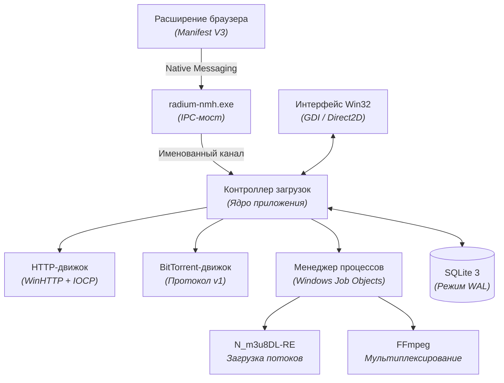

<p align="center">
  
</p>

<p align="center">
  <picture>
    
  </picture>
</p>

<h1 align="center">Radium Download Manager</h1>

<p align="center">
  <a href="../../README.md">English</a> · <a href="README.ja.md">日本語</a> · <a href="README.zh-CN.md">简体中文</a> · <a href="README.zh-TW.md">繁體中文</a> · <a href="README.ko.md">한국어</a> · <a href="README.es.md">Español</a> · <a href="README.fr.md">Français</a> · <a href="README.pt-BR.md">Português</a> · <a href="README.de-DE.md">Deutsch</a> · <b>Русский</b> · <a href="README.it-IT.md">Italiano</a> · <a href="README.ar-SA.md">العربية</a>
</p>

<p align="center">
  <b>Быстрый и компактный менеджер загрузок для Windows 10 / 11 со встроенным захватом онлайн-видео.</b><br>
  Ускоряйте загрузку файлов через сегментированные многопоточные соединения и скачивайте видео с YouTube, Bilibili и многих других сайтов (HLS, DASH и веб-медиа).<br>
  Создан на чистом C++20 и Win32 без накладных расходов Electron — минимальное потребление оперативной памяти и полное отсутствие навязчивых фоновых процессов.
</p>

<p align="center">
  <a href="https://github.com/alve33/Radium-Download-Manager/releases/latest"></a>
  <a href="https://github.com/alve33/Radium-Download-Manager/releases/latest"></a>
  
  
  
  
  <a href="https://github.com/alve33/Radium-Download-Manager/actions/workflows/windows-release.yml"></a>
</p>

<p align="center">
  <a href="#загрузка-и-установка"><b>Загрузка</b></a> ·
  <a href="#ключевые-возможности"><b>Возможности</b></a> ·
  <a href="#светлая-и-тёмная-темы"><b>Темы</b></a> ·
  <a href="#многоязычный-интерфейс"><b>Языки</b></a> ·
  <a href="#тесты-производительности-бенчмарки"><b>Тесты</b></a> ·
  <a href="#высокопроизводительный-движок-загрузки"><b>Движок</b></a> ·
  <a href="#загрузка-bittorrent"><b>BitTorrent</b></a> ·
  <a href="#интеграция-с-браузерами"><b>Браузеры</b></a> ·
  <a href="#архитектура-приложения"><b>Архитектура</b></a> ·
  <a href="#сборка-из-исходного-кода"><b>Сборка</b></a>
</p>

<br>

<p align="center">
  
</p>

## Краткий обзор

Radium — это современный высокопроизводительный менеджер загрузок с открытым исходным кодом, созданный специально для Windows 10 / 11. Разработанный как быстрая, легкая и полностью свободная от рекламы замена устаревшим аналогам, он объединяет многопоточное скачивание файлов и автоматический перехват видео и аудио из веб-браузеров.

<table>
  <tr>
    <td width="33%" valign="top">
      <h3>⚡ Предельная скорость канала</h3>
      Сегментированный HTTP/HTTPS движок с асинхронным вводом-выводом (WinHTTP + IOCP), динамическим разделением потоков и адаптивным перераспределением незавершенных диапазонов.
    </td>
    <td width="33%" valign="top">
      <h3>🌐 Бесшовный перехват в браузере</h3>
      Компактное расширение Manifest V3 для Chromium и Firefox. Распознает плейлисты HLS (.m3u8), манифесты DASH (.mpd) и прямые ссылки, добавляя аккуратную кнопку скачивания прямо на видеоплеер.
    </td>
    <td width="33%" valign="top">
      <h3>🧲 BitTorrent и обработка потоков</h3>
      Встроенный движок BitTorrent v1 с поддержкой magnet-ссылок (BEP 9), опросом трекеров и выбором файлов. Обработка видеопотоков в изолированных Windows Job Objects с помощью N_m3u8DL-RE и FFmpeg.
    </td>
  </tr>
</table>

## Загрузка и установка

Последний опубликованный релиз — **[v1.0.0](https://github.com/alve33/Radium-Download-Manager/releases/tag/v1.0.0)**. Доступные пакеты для Windows:

| Пакет | Архитектура | Формат | Описание |
| :--- | :---: | :---: | :--- |
| **Установщик Radium (Стандартный)** | x64 | [Setup (.exe)](https://github.com/alve33/Radium-Download-Manager/releases/download/v1.0.0/Radium-Setup-x64-1.0.0.exe) | Рекомендуемый установщик для большинства пользователей (Windows 11 / 10 x64) |
| **Radium Portable (Полный)** | x64 | [ZIP-архив](https://github.com/alve33/Radium-Download-Manager/releases/download/v1.0.0/Radium-v1.0.0-Windows-x64-Full.zip) | Портативный пакет с инструментами N_m3u8DL-RE и FFmpeg |
| **Radium Portable (Базовый)** | x64 | [ZIP-архив](https://github.com/alve33/Radium-Download-Manager/releases/download/v1.0.0/Radium-v1.0.0-Windows-x64-Core.zip) | Базовый пакет (потоковые инструменты требуются отдельно) |
| **Установщик Radium Core** | x64 | [Setup (.exe)](https://github.com/alve33/Radium-Download-Manager/releases/download/v1.0.0/Radium-Setup-x64-Core-1.0.0.exe) | Облегчённый установщик без встроенных потоковых инструментов |
| **Установщик Radium (ARM64)** | ARM64 | [Setup (.exe)](https://github.com/alve33/Radium-Download-Manager/releases/download/v1.0.0/Radium-Setup-ARM64-1.0.0.exe) | Нативный установщик для устройств Windows 10 / 11 на ARM |
| **Radium Portable Полный (ARM64)** | ARM64 | [ZIP-архив](https://github.com/alve33/Radium-Download-Manager/releases/download/v1.0.0/Radium-v1.0.0-Windows-ARM64-Full.zip) | Полный портативный пакет с инструментами для ARM64 |

Контрольные суммы SHA256 доступны в [SHA256SUMS.txt](https://github.com/alve33/Radium-Download-Manager/releases/download/v1.0.0/SHA256SUMS.txt).

### Быстрая установка расширения для браузера

> [!TIP]
> **Браузерное расширение поставляется отдельно в целях безопасности.** Вы можете загрузить папку [`extension/`](../../extension/) напрямую в режиме разработчика:
> 1. **Браузеры на базе Chromium (Chrome, Edge, Brave):** Перейдите на страницу `chrome://extensions`, включите **Режим разработчика**, нажмите **Загрузить распакованное расширение** и выберите папку `extension/`.
> 2. **Firefox:** Откройте `about:debugging#/runtime/this-firefox`, нажмите **Загрузить временное дополнение...** и укажите файл `manifest.firefox.json` из папки `extension/`.
> 3. **Регистрация хоста Native Messaging:** Запустите скрипт PowerShell `scripts/register-native-messaging.ps1`, чтобы прописать локальный IPC-хост в реестре Windows.

## Ключевые возможности

<p align="center">
  
</p>

### Сегментированная загрузка HTTP и HTTPS
- **Динамическое разделение потоков:** Активные соединения автоматически разделяют оставшиеся диапазоны байтов, как только освобождаются рабочие потоки.
- **Асинхронный ввод-вывод без блокировок:** Использование портов завершения ввода-вывода (IOCP) и предварительно выделенных разреженных файлов (sparse files) предотвращает задержки дисковой подсистемы.
- **Атомарная запись данных:** Загрузка ведется во временный файл `*.radium.part` и переименовывается атомарно только после полной проверки криптографического хэша.
- **Надежное возобновление:** Корректная обработка заголовков `Range` и тегов `ETag` для гарантированного продолжения прерванных закачек без повреждения данных.

### Поддержка BitTorrent
- **Мгновенный резолв Magnet-ссылок:** Загрузка метаданных за считанные секунды по протоколу BEP 9 без необходимости иметь файл .torrent.
- **Выборочное скачивание:** Удобное дерево файлов раздачи позволяет отметить только нужные файлы до начала закачки.
- **Устойчивость к сбоям:** Состояние загрузок сохраняется в SQLite 3 (режим WAL) в реальном времени, обеспечивая защиту от внезапных перезагрузок и отключений питания.

### Системная безопасность и надежность
- **Изоляция в Windows Job Objects:** Консольные утилиты (FFmpeg, N_m3u8DL-RE) запускаются строго внутри Job Object (`JOB_OBJECT_LIMIT_KILL_ON_JOB_CLOSE`), что гарантирует моментальное завершение всех дочерних процессов при закрытии программы.
- **Безопасное межпроцессное взаимодействие (IPC):** Приложение не открывает сетевых портов на localhost; общение с расширением идет через защищенные именованные каналы Windows (`\\.\pipe\Radium_IPC_<UserSID>`).
- **Защита от инъекций команд:** Параметры запуска тщательно валидируются; конфиденциальные данные (cookie и токены) передаются исключительно через защищенные временные файлы ответов (`@job.rsp`).

## Светлая и тёмная темы

Интерфейс Radium выполнен в строгом соответствии с гайдлайнами Windows 10 / 11 с нативной поддержкой темного и светлого режимов оформления:

<div align="center">

| Светлая тема (Light) | Тёмная тема (Dark) |
| :---: | :---: |
|  |  |

</div>

- **Автоматическая синхронизация:** По умолчанию подстраивается под системные параметры цвета Windows 10 / 11 (`AppsUseLightTheme`).
- **Ручное переключение:** Вы можете в любой момент зафиксировать нужный режим (`light`, `dark` или `system`) в настройках.
- **Отрисовка без мерцания:** Двойная буферизация на базе GDI и Direct2D гарантирует плавные анимации и моментальное изменение размеров окна.

## Многоязычный интерфейс

Radium поддерживает 12 распространенных мировых языков с возможностью мгновенного переключения без перезапуска приложения:

- **Динамическая смена языка:** Все элементы управления, меню и всплывающие подсказки обновляются на лету.
- **Автоопределение языка:** При первом запуске автоматически выбирается язык текущего интерфейса Windows (`GetUserDefaultUILanguage`).
- **Централизованный каталог:** Переводы настольного приложения хранятся и валидируются в файле `translations/desktop.json`.

## Скриншоты

<div align="center">

| Главное окно со списком загрузок | Центр настроек и сетевые параметры |
| :---: | :---: |
|  |  |

</div>

## Тесты производительности (Бенчмарки)

Radium непрерывно тестируется на реальных интернет-каналах в прямом сравнении с **Internet Download Manager (IDM 6.43.15)** и классическими консольными утилитами на байт-в-байт идентичных файлах.

### Прямое сравнение: Radium (v0.3.5 Dev Build) против Internet Download Manager (500 МБ в реальной сети)

Тест проводился при скачивании тестового файла размером **500 000 000 байт** (`https://sg-lg.regxa.com/500MB.test`) на Windows 11. Для исключения фактора сетевых колебаний были проведены два последовательных раунда с обратным порядком запуска. Обе программы успешно завершили скачивание и подтвердили криптографический хэш (**SHA-256:** `b16f001a0731c8636f163586c16276b3714b8977242b67ae05fa60b96f685ebc`).

| Раунд | Очередность | Время Radium | Время IDM | Сокращение времени | Пропускная способность (Radium / IDM) | Пиковая память (Radium / IDM) | Экономия RAM |
| :---: | :---: | :---: | :---: | :---: | :---: | :---: | :---: |
| **Раунд 1** | Сначала IDM, затем Radium | **184,75 с** | 221,21 с | **16,48%** (-36,46 с) | **2,71 МБ/с** / 2,26 МБ/с (+19,91%) | **20,5 МБ** / 53,8 МБ | **61,90%** |
| **Раунд 2** | Сначала Radium, затем IDM | **140,09 с** | 173,46 с | **19,24%** (-33,37 с) | **3,57 МБ/с** / 2,88 МБ/с (+23,96%) | **20,4 МБ** / 122,2 МБ | **83,31%** |
| **Среднее** | Усредненный итог раундов | **162,42 с** | 197,34 с | **17,69%** (-34,92 с) | **3,14 МБ/с** / 2,57 МБ/с (+22,18%) | **20,4 МБ** / 88,0 МБ | **76,76%** |

```
Сравнение времени скачивания 500 МБ (Меньше — лучше ▼)
─────────────────────────────────────────────────────────────────────────────
Раунд 1 (Сначала IDM):
  IDM 6.43.15     ████████████████████████████████████ 221,21 с
  Radium v0.3.5   ████████████████████████████ 184,75 с (-16,48% времени)

Раунд 2 (Сначала Radium):
  IDM 6.43.15     ████████████████████████████ 173,46 с
  Radium v0.3.5   ██████████████████████ 140,09 с (-19,24% времени)
─────────────────────────────────────────────────────────────────────────────
Общее среднее:
  IDM 6.43.15     ████████████████████████████████ 197,34 с
  Radium v0.3.5   ██████████████████████████ 162,42 с (на 17,69% быстрее)
```

#### Технические факторы высокой эффективности:
1. **Адаптивное разбиение диапазонов:** По формуле: `clamp(4 × transfer_speed_bps × 0.25 s, 1 MiB, 16 MiB)`. Введение минимальных порогов снизило объем отбрасываемых соединений на **57,3%** в первом раунде и на **42,4%** во втором.
2. **Мгновенный параллелизм потоков:** При старте свободные потоки сразу распределяются по четким границам сегментов; все 8 соединений работают с полной нагрузкой до конца передачи.
3. **Прямой потоковый ввод-вывод:** Непосредственная запись на диск исключает стадию объединения временных фрагментов файла после завершения скачивания. Это удерживает расход памяти Radium на стабильном уровне ~20 МБ, в то время как IDM расходует от 54 до 122 МБ.

## Высокопроизводительный движок загрузки

Основываясь на архитектурных концепциях открытого проекта [Brisk](https://github.com/BrisklyDev/brisk), Radium реализует современную сегментированную модель загрузки:

```
                      ┌────────────────────────────────────────┐
                      │       Целевой файл (напр. 500 МБ)      │
                      └────────────────────────────────────────┘
                       /             |            |                    Worker 0 (0-125MB)   Worker 1 (125-250MB)  Worker 2     Worker 3
        [████████████████]   [████████░░░░░░░░]   [████░░░░]   [████████████████]
           (Завершено)            (Активен)        (Активен)      (Завершено)
                                                      ▲
                                                      │ Забирает незавершенный сегмент
                                                 Свободный поток
```

1. **Предварительный опрос:** Проверка заголовков `Range` для подтверждения докачки и считывания имени файла.
2. **Параллельный запуск:** Постепенное открытие соединений до заданного лимита (по умолчанию 8, максимум 32).
3. **Адаптивный перехват задач (Work-Stealing):** Освободившийся поток делит пополам наибольший оставшийся кусок среди активных потоков.
4. **Безопасный откат:** Если сервер отклоняет частичный запрос, диапазон возвращается исходному потоку без потери прогресса.
5. **Атомарная фиксация:** Запись ведется в разреженный файл с последующим моментальным атомарным переименованием.

## Загрузка BitTorrent

Полнофункциональный встроенный стек протокола BitTorrent v1:
- **Разрешение Magnet-ссылок:** Быстрое получение списка файлов через расширение BEP 9 прямо из роя пиров.
- **Трекеры и DHT:** Поддержка анонсов HTTP/UDP и распределенной хэш-таблицы (Kademlia DHT).
- **Контроль целостности:** Алгоритм endgame и непрерывная валидация частей по контрольным суммам SHA-1.
- **Выборочная загрузка:** Древовидный просмотр раздачи для исключения лишних файлов до начала скачивания.
- **Транзакционное сохранение:** Прогресс фиксируется в базе данных SQLite.

## Адаптивная обработка видеопотоков

Для современных веб-трансляций в форматах HLS и DASH Radium задействует специализированные утилиты:
- **Изоляция в Job Objects:** Исполнение внутри Windows Job Object гарантирует принудительное завершение всех вспомогательных процессов при закрытии программы.
- **Безопасность учетных данных:** Файлы cookie и заголовки авторизации не передаются через командную строку, а записываются в защищенные временные файлы (`@job.rsp`).
- **Сборка без перекодирования:** Автоматическое объединение видео- и аудиодорожек в стандартные файлы MP4 или MKV с помощью FFmpeg.

*Примечание: Radium строго соблюдает закон и не содержит инструментов для взлома или обхода систем шифрования DRM.*

## Интеграция с браузерами

Расширение Manifest V3 обеспечивает быструю и безопасную связь браузера с настольным клиентом:

```
┌─────────────────────────────────┐
│ Веб-браузер (Chromium / Firefox)│
│  ├── Перехват webRequest        │
│  └── Кнопка скачивания на видео │
└───────────────┬─────────────────┘
                │ Stdio (32-битный JSON-RPC с префиксом длины)
┌───────────────▼─────────────────┐
│ radium-nmh.exe (Нативный хост)  │
└───────────────┬─────────────────┘
                │ Именованный канал Windows: \.\pipe\Radium_IPC_<UserSID>
┌───────────────▼─────────────────┐
│ radium.exe (Основное приложение)│
└─────────────────────────────────┘
```

- **Отсутствие открытых портов:** Взаимодействие происходит через именованные каналы с системными ACL текущего пользователя.
- **Интеллектуальная фильтрация:** Отслеживание мастер-плейлистов (.m3u8) с подавлением потока сотен мелких фрагментов (.ts, .m4s).
- **Прозрачный откат:** Если программа закрыта или скачивание отменено, браузер автоматически выполняет загрузку стандартным способом.

## Архитектура приложения



## Сборка из исходного кода

Требования: **Windows 10 / 11 x64**, **Visual Studio 2022 (MSVC 19.38+)** с компонентами для разработки на C++ и **CMake 3.25+**.

```powershell
# Клонировать репозиторий
git clone https://github.com/alve33/Radium-Download-Manager.git
cd Radium-Download-Manager

# Собрать все бинарные файлы и создать портативный пакет
powershell -ExecutionPolicy Bypass -File scripts/build-windows-msvc.ps1
```

## Тестирование и контроль качества

Radium снабжен комплексным набором модульных, интеграционных и сквозных тестов:

```powershell
# Запуск тестов C++
ctest --test-dir build/win-x64 --output-on-failure -C Release

# Запуск тестов расширения браузера
npm test
```

## Совместимость с HTTP-серверами

Radium работает с любыми серверами, поддерживающими спецификацию RFC 7233 (`206 Partial Content`). Если сервер не поддерживает докачку по частям, Radium автоматически переходит в надежный режим загрузки в одно соединение.

## Участие в разработке

Мы рады любому вкладу в развитие проекта! Перед отправкой pull request, пожалуйста, ознакомьтесь с [CONTRIBUTING.md](CONTRIBUTING.md) и изучите архитектурную документацию в [docs/INDEX.md](docs/INDEX.md).

## Лицензия и благодарности

Radium Download Manager распространяется под лицензией **Apache-2.0**. Полные условия представлены в файле [LICENSE](LICENSE).

### Сторонние компоненты
Radium использует [Brisk](https://github.com/BrisklyDev/brisk) (GPL-3.0), [N_m3u8DL-RE](https://github.com/nilaoda/N_m3u8DL-RE) (MIT), [FFmpeg](https://ffmpeg.org/) (LGPL/GPL) и [SQLite 3](https://www.sqlite.org/) (Public Domain).

---
<p align="center">
  <sub>Radium Download Manager · Нативный высокопроизводительный менеджер загрузок для Windows 10 / 11</sub>
</p>
